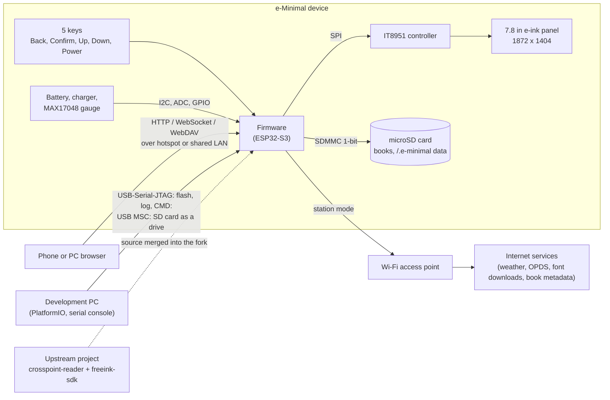
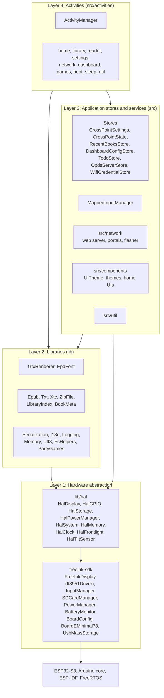
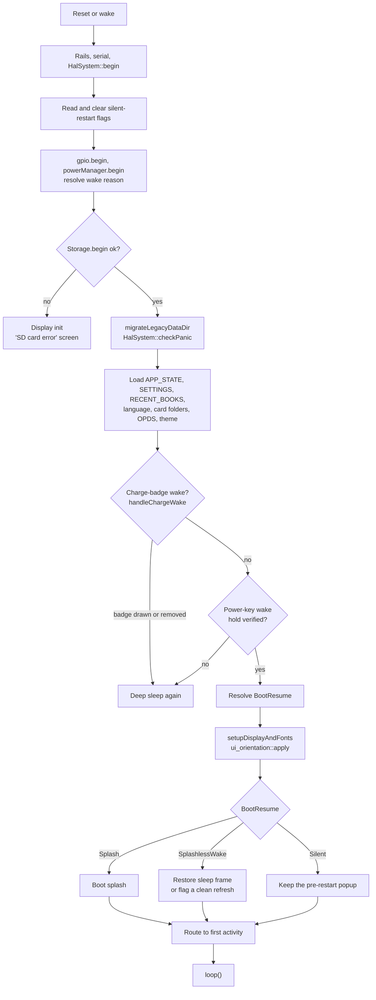

# e-Minimal Firmware: System Overview

| | |
|---|---|
| **Status** | Draft |
| **Applies to** | branch `master`, commit `09b6f02f` |
| **Audience** | Firmware developers and reviewers who are new to this fork |
| **Related** | [02-display-pipeline.md](02-display-pipeline.md), [03-application-framework.md](03-application-framework.md), [04-dashboard-and-games.md](04-dashboard-and-games.md), [05-network-and-storage.md](05-network-and-storage.md), [06-build-flash-release.md](06-build-flash-release.md) |

## Contents

1. [Purpose and scope](#1-purpose-and-scope)
2. [System context](#2-system-context)
3. [Hardware target as the firmware sees it](#3-hardware-target-as-the-firmware-sees-it)
4. [Layered architecture](#4-layered-architecture)
5. [Directory and module map](#5-directory-and-module-map)
6. [Boot sequence](#6-boot-sequence)
7. [Main loop](#7-main-loop)
8. [Tasks and concurrency](#8-tasks-and-concurrency)
9. [Memory model](#9-memory-model)
10. [Differences from upstream CrossPoint](#10-differences-from-upstream-crosspoint)
11. [Glossary](#11-glossary)
12. [Open questions](#12-open-questions)

---

## 1. Purpose and scope

e-Minimal is a fork of the CrossPoint Reader firmware. It targets one device: a
DIY e-reader built from an ESP32-S3 module and a 7.8" e-ink panel driven through
an IT8951 timing controller.

This document describes the firmware as a whole: what it talks to, how the code
is layered, how it boots, how it schedules work, and how it differs from
upstream. The sibling documents cover each subsystem in depth.

In scope:

- The `[env:eminimal]` build target in `platformio.ini`.
- Code that this target compiles: `src/`, `lib/`, and the `freeink-sdk/` submodule.

Out of scope:

- The other build targets in `platformio.ini` (Xteink X3/X4, X4 Pro, X4 Classic,
  Sticky, Paper Mono). They are inherited from upstream and are mentioned only
  where shared code branches on them.
- The electrical design of the device.

## 2. System context

The device is a standalone reader. All user content and all persistent
settings live on a microSD card. Wi-Fi is off by default and is brought up only
by specific screens.



| Actor | Interaction | Where it is implemented |
|---|---|---|
| Reader (person) | Five physical keys; e-ink output | `src/MappedInputManager.cpp`, `src/activities/` |
| microSD card | Books, fonts, dictionaries, pictures, and the `/.e-minimal` data folder | `lib/hal/HalStorage.cpp`, `src/util/CardFolders.cpp` |
| Phone or PC browser | Web UI, file transfer, text entry, game clients, dashboard editing | `src/network/` (see [05](05-network-and-storage.md)) |
| Wi-Fi access point | Station mode for network features; the device can also host its own hotspot | `src/network/PhonePortal.cpp`, `src/network/SavedWifi.cpp` |
| Development PC | Flashing, serial log, `CMD:` bench commands, USB mass storage | `platformio.ini` `[env:eminimal]`, `src/main.cpp` `loop()` |
| Upstream project | Source of the base firmware and SDK | git remote `upstream`, `.gitmodules` |

## 3. Hardware target as the firmware sees it

The firmware never reads a schematic. It reads one compile-time board profile,
`EMINIMAL_78`, in `freeink-sdk/libs/hardware/BoardConfig/include/BoardConfig.h`,
plus the IT8951 values in
`freeink-sdk/libs/hardware/BoardEMinimal78/src/EMinimal78It8951Config.cpp`.
`-DFREEINK_DEVICE_EMINIMAL=1` selects both.

### 3.1 MCU and memory

| Item | Value | Source |
|---|---|---|
| MCU | ESP32-S3 (`board_build.mcu = esp32s3`) | `platformio.ini` `[env:eminimal]` |
| Board definition | `esp32-s3-devkitc1-n16r8` | `platformio.ini` `[env:eminimal]` |
| Flash | 16 MB | `platformio.ini` `[base]` `board_build.flash_size` |
| PSRAM | 8 MB octal, enabled with `-DBOARD_HAS_PSRAM` and `memory_type = qio_opi` | `platformio.ini` `[env:eminimal]` |
| Reserved GPIOs | 33 to 37 belong to the octal PSRAM and must stay unused | `BoardConfig.h`, comment above `EMINIMAL_78` |
| Framework | Arduino on ESP-IDF (pioarduino platform 55.03.311) | `platformio.ini` `[base]` `platform` |
| C++ dialect | `-std=gnu++2a`, `-fno-exceptions` | `platformio.ini` `[base]` `build_flags` |

### 3.2 Pin assignments

All values are from the `EMINIMAL_78` profile unless noted.

| Function | GPIO | Notes |
|---|---|---|
| Panel SPI SCLK | 14 | IT8951 bus, owned by the driver |
| Panel SPI MOSI | 16 | |
| Panel SPI MISO | 17 | From `eminimal78It8951Config()`; the driver default (13) is this board's SD D0 |
| Panel SPI CS | 18 | |
| Panel reset | 40 | Active low; pulsed on every boot, held low in deep sleep |
| Panel ready (HRDY) | 38 | The IT8951 busy line |
| Panel power enable | 39 | |
| Panel D/C | none | The IT8951 16-bit preamble carries command vs data |
| SD CLK / CMD / D0 | 12 / 11 / 13 | SDMMC, 1-bit bus |
| SD power switch | 21 | Active low high-side switch; parked high in sleep |
| Key: Back | 7 | Active low, internal pull-up |
| Key: Confirm | 6 | |
| Key: Up | 4 | |
| Key: Down | 5 | |
| Key: Power | 15 | RTC-capable; the deep-sleep wake source |
| Keys: Left, Right | unassigned | `Button::Left` and `Button::Right` never fire on this board |
| Battery ADC | 8 | Divider, multiplier 2.0; kept as a bench cross-check |
| Charge status | 47 | Open drain, low while charging |
| USB detect | 9 | High when a cable is in; also an `ext0` wake source |
| Fuel gauge I2C | 41, 42 | MAX17048 at address 0x36, 100 kHz |
| Native USB | 19, 20 | USB-Serial-JTAG console and flashing (`platformio.ini` comment) |

### 3.3 Peripherals and capabilities

| Capability | State on e-Minimal | Source |
|---|---|---|
| Display controller | IT8951, native framebuffer 1872 x 1404 landscape | `EMINIMAL_78`, `FREEINK_DRIVER_IT8951` |
| Panel mount | `ROTATE_180`. The renderer draws the frame turned; the driver does not rotate | `EMINIMAL_78` comment |
| UI scale | 1.5 | `EMINIMAL_78` `uiScale` |
| Input style | `DigitalButtons`, five keys | `EMINIMAL_78` |
| Touch | none (`NO_TOUCH`) | `EMINIMAL_78` |
| Frontlight | none (`NO_FRONTLIGHT`) | `EMINIMAL_78` |
| Audio, LEDs, microphone | none | `EMINIMAL_78` |
| RTC, IMU, environment sensors | none (`NO_SENSORS`) | `EMINIMAL_78` |
| SD transport | Native SDMMC (`FREEINK_SD_SDMMC`), mounted through SdFat's block-device interface | `BoardConfig.h`, `-DUSE_BLOCK_DEVICE_INTERFACE=1` |
| Battery | I2C fuel gauge (`FREEINK_BATTERY_I2C_GAUGE`) | `BoardConfig.h` |
| USB mass storage | Enabled (`-DFREEINK_CAP_USB_MSC=1`) | `platformio.ini`, `lib/hal/HalStorage.cpp` `beginUsbDrive()` |
| Power latch | none | `EMINIMAL_78` |

The IT8951 SPI clock is 13.33 MHz for commands and reads, and 40 MHz for bulk
image writes. Waveform mode numbers, VCOM, and the refresh policy are in the
same config file. [02-display-pipeline.md](02-display-pipeline.md) explains them.

## 4. Layered architecture

The code has four layers. Each layer calls only downward. Application code is
expected to reach hardware through the HAL, not through the SDK directly
(`CLAUDE.md`, "SD access" and "UI" rules).



Layer responsibilities:

| Layer | Responsibility | Entry points |
|---|---|---|
| 1a. SDK (`freeink-sdk/`) | Board profiles, panel drivers, input scanning, SD mount, battery, USB MSC. Maintained as a separate repository and linked as PlatformIO `symlink://` libraries | `platformio.ini` `[base]` `lib_deps` |
| 1b. HAL (`lib/hal/`) | Thin wrappers that add locking, logging, and firmware policy on top of the SDK | `HalDisplay`, `HalGPIO`, `HalStorage` (`Storage` macro), `HalPowerManager` |
| 2. Libraries (`lib/`) | Rendering, fonts, book formats, parsers, persistence helpers, pure game logic. Several are written without Arduino dependencies so that host tests can build them | `lib/*/` |
| 3. Stores and services (`src/`) | Persistent settings and state, input mapping, network servers, themes, utilities | `src/*.h`, `src/network/`, `src/components/`, `src/util/` |
| 4. Activities (`src/activities/`) | One class per screen. `ActivityManager` owns the activity stack and the render task | `src/activities/ActivityManager.h` |

The global objects that tie the layers together are constructed at file scope
in `src/main.cpp`: `renderer` (`GfxRenderer`), `mappedInputManager`,
`activityManager`, `fontDecompressor`, `sdFontSystem`, and `fontCacheManager`.

## 5. Directory and module map

### 5.1 Top-level directories

| Path | Responsibility |
|---|---|
| `src/` | Application: entry point, stores, activities, network, UI components, utilities |
| `lib/` | Project libraries, compiled by PlatformIO as static libraries |
| `freeink-sdk/` | Git submodule. Hardware SDK: display drivers, board profiles, input, storage, power |
| `scripts/` | Build hooks (pre/post scripts), code generators, test-fixture generators, debugging tools |
| `test/` | Host-side unit tests (GoogleTest via CMake) and test EPUB fixtures |
| `docs/` | User and developer documentation; this folder is `docs/eminimal/` |
| `bin/` | `clang-format-fix` wrapper scripts (shell and PowerShell) |
| `.github/` | CI workflows, issue and PR templates |
| `.githooks/` | Optional pre-commit hook that runs the formatter |
| `nix/` | Nix development environment files inherited from upstream |
| `build/` | Git-ignored output directory for host tests and standalone tool builds |
| `managed_components/` | Git-ignored ESP-IDF component cache produced by the build |

Top-level files of note: `platformio.ini` (all build environments),
`partitions.csv` and `partitions_eminimal.csv` (flash layouts), `CLAUDE.md`
(fork-specific coding rules), `AGENTS.md` (upstream development guide, kept
unmodified), `USER_GUIDE.md`, `SCOPE.md`, `ROADMAP.md`, `GOVERNANCE.md`.

### 5.2 `src/` subdirectories

| Path | Responsibility |
|---|---|
| `src/main.cpp` | `setup()`, `loop()`, deep-sleep entry, silent restart, charge-wake handling |
| `src/activities/` | Activity base classes, `ActivityManager`, `RenderLock`, and one folder per feature area |
| `src/activities/boot_sleep/` | Boot splash and sleep screen |
| `src/activities/home/` | Home, file browser, crash report |
| `src/activities/library/` | Indexed library list and book details |
| `src/activities/reader/` | EPUB, TXT and XTC readers and their menus, dictionary, highlights |
| `src/activities/settings/` | Settings tabs and their sub-screens, firmware update screens |
| `src/activities/network/` | File transfer, Wi-Fi selection, USB drive, firmware install over Wi-Fi |
| `src/activities/dashboard/` | Dashboard app: tiles, widgets, weather, to-do, carousel |
| `src/activities/games/` | Game Night app: picker, lobby, shared boards |
| `src/activities/browser/` | OPDS catalog browser |
| `src/activities/util/` | Shared dialogs: keyboard, confirmation, text entry, full-screen message |
| `src/components/` | `UITheme`, theme implementations (`themes/eminimal`, `lyra`, `roundedraff`), home screen layouts, icons |
| `src/network/` | Web server, WebDAV, phone portal, game and text-entry servers, OTA and firmware flasher, embedded HTML/JS/CSS sources under `html/` |
| `src/util/` | Book cache helpers, bookmarks, dictionary access, charge badge, power probe, screenshots, orientation |
| `src/platform/` | USB PHY handoff between USB-Serial-JTAG and OTG; an eFuse check override |
| `src/images/` | Bitmap assets compiled into the firmware |

Persistent stores in `src/` and their files on the SD card:

| Store | File | Source |
|---|---|---|
| `CrossPointSettings` (`SETTINGS`) | `/.e-minimal/settings.json` | `src/CrossPointSettings.h` |
| `CrossPointState` (`APP_STATE`) | `/.e-minimal/state.json` | `src/CrossPointState.h` |
| `RecentBooksStore` (`RECENT_BOOKS`) | `/.e-minimal/recent.json` | `src/RecentBooksStore.h` |
| `DashboardConfigStore` (`DASHBOARD_CONFIG`) | `/.e-minimal/dashboards.json` | `src/DashboardConfigStore.h` |
| `TodoStore` | `/.e-minimal/todo.json` | `src/TodoStore.h` |
| `OpdsServerStore` (`OPDS_STORE`) | `/.e-minimal/opds.json` | `src/OpdsServerStore.h` |
| `WifiCredentialStore` | `/.e-minimal/wifi.json` | `src/WifiCredentialStore.h` |

See [03-application-framework.md](03-application-framework.md) for the store
base class and [05-network-and-storage.md](05-network-and-storage.md) for the
card layout.

### 5.3 `lib/` modules

| Module | Responsibility |
|---|---|
| `lib/hal` | Hardware abstraction: display, GPIO and keys, storage, power, system and panic capture, memory statistics, clock, frontlight, tilt sensor |
| `lib/GfxRenderer` | Drawing primitives, text layout to the framebuffer, bitmap helpers, grayscale buffers, font cache manager |
| `lib/EpdFont` | Font data structures, built-in font headers, compressed font decoding, SD-card and TTF font support, font conversion scripts |
| `lib/Epub` | EPUB engine: container and OPF parsing, HTML and CSS parsing, layout, hyphenation, image conversion, section and metadata caches |
| `lib/Txt` | Plain-text book reader backend |
| `lib/Xtc` | XTC and XTCH pre-rendered page container parser |
| `lib/ZipFile` | ZIP archive reader used for EPUB containers |
| `lib/InflateReader` | Streaming deflate reader on top of `uzlib` |
| `lib/uzlib` | Third-party deflate decompressor |
| `lib/miniz` | Third-party zlib-compatible compression library |
| `lib/expat` | Third-party XML parser |
| `lib/XmlParserUtils` | Safe teardown helper for expat parsers |
| `lib/JsonParser` | Streaming JSON parser and the release-JSON parser used by the OTA check |
| `lib/JpegToBmpConverter` | JPEG to BMP conversion (covers, images) |
| `lib/PngToBmpConverter` | PNG to BMP conversion |
| `lib/LibraryIndex` | `CLX1` library index: builder, on-disk format, reader, text folding for search and sort |
| `lib/BookMeta` | Per-book user metadata overrides stored as JSON |
| `lib/OpdsParser` | OPDS catalog feed parser |
| `lib/KOReaderSync` | KOReader progress sync client and position mapping. The client is compiled out of the e-Minimal target (`-DFREEINK_NO_KOSYNC=1`) |
| `lib/PartyGames` | Game Night rules and JSON views (Battleship, Codenames, Ludo, Undercover). No Arduino dependency |
| `lib/Serialization` | `PersistableStore` JSON store base, buffered file wrappers, POD read/write helpers, credential obfuscation and integrity |
| `lib/I18n` | Translation YAML sources and the generated string tables |
| `lib/Logging` | `LOG_ERR` / `LOG_INF` / `LOG_DBG` macros and the serial log sink |
| `lib/Memory` | `makeUniqueNoThrow` allocation helpers and build scratch buffers |
| `lib/Utf8` | UTF-8 decoding and composition tables |
| `lib/MiniBidi` | Bidirectional text algorithm |
| `lib/FsHelpers` | Path normalisation and natural-order file sorting |

## 6. Boot sequence

`setup()` in `src/main.cpp` runs once on the Arduino loop task. It decides how
the device woke, loads persistent state, brings up the display, and routes to
the first activity.

### 6.1 Ordered steps

| # | Step | Function or symbol |
|---|---|---|
| 1 | Hold power rails (no-op on a board with no latch) | `BoardConfig::holdPowerRails()` |
| 2 | Start the serial log. The e-Minimal target omits `CROSSPOINT_WAIT_FOR_USB_SERIAL`, so there is no 250 ms delay | `Serial.begin(115200)` |
| 3 | Initialise panic capture and record whether this boot follows a panic | `HalSystem::begin()`, `HalSystem::isRebootFromPanic()` |
| 4 | Read and clear the silent-restart flags kept in RTC memory | `silentRebootMagic`, `silentRebootTarget`, `silentRebootPayload` |
| 5 | Initialise keys and power management | `gpio.begin()`, `powerManager.begin()` |
| 6 | Resolve the wake reason and verify a power-key wake hold | `HalPowerManager::takeWakeRequest()`, `gpio.getWakeupReason()`, `gpio.verifyPowerButtonWakeup()` |
| 7 | Check for recovery mode: power-key wake with the physical Up key held | `recoveryFirmwareMode` |
| 8 | Probe tilt sensor and clock (neither is present on this board) | `halTiltSensor.begin()`, `halClock.begin()` |
| 9 | Mount the SD card. On failure, initialise the display, show "SD card error", and stop | `Storage.begin()` |
| 10 | Rename a legacy `/.crosspoint` data folder to `/.e-minimal` if only the old one exists | `migrateLegacyDataDir()` |
| 11 | Write a pending panic dump to the SD card | `HalSystem::checkPanic()` |
| 12 | Load application state and classify the wake (sleep wake, Dashboard wake, timer wake) | `APP_STATE.loadFromFile()` |
| 13 | Load settings, timezone, recent books, language | `SETTINGS.loadFromFile()`, `timezones::applyToClock()`, `RECENT_BOOKS.loadFromFile()`, `I18N.setLanguage()` |
| 14 | Create the standard card folders and load the Dashboard configuration | `card_folders::ensure()` |
| 15 | Load OPDS servers, reload the theme, bind the button navigator | `OPDS_STORE.loadFromFile()`, `UITheme::reload()` |
| 16 | Initialise the frontlight driver (absent on this board) | `Frontlight.begin()` |
| 17 | Handle a charge-badge wake. This path may draw the badge and return to deep sleep without continuing | `handleChargeWake()` |
| 18 | Act on the wake reason. An unverified power-key wake returns to deep sleep. A USB-power cold boot stays awake on e-Minimal | `switch (wakeupReason)` |
| 19 | Choose the boot presentation: `Splash`, `Silent`, or `SplashlessWake` | `enum class BootResume` |
| 20 | Initialise display, renderer, render task, and fonts | `setupDisplayAndFonts()` |
| 21 | Apply the device orientation | `ui_orientation::apply()` |
| 22 | Present: boot splash, restored sleep frame, or nothing | `activityManager.goToBoot()`, `loadSleepFrameBuffer()` |
| 23 | Route to the first activity (table in 6.3) | routing `if` chain |
| 24 | After a silent restart, wait for the first paint and absorb held keys | `activityManager.requestUpdateAndWait()` |
| 25 | Block sleep for the first 2 s | `allowSleepAt` |

Step 20, `setupDisplayAndFonts()`, performs these calls in order:
`display.begin()`, `renderer.begin()`, `activityManager.begin()` (creates the
render task), `fontDecompressor.init()`, registration of the built-in font
families with `renderer.insertFont()`, and `sdFontSystem.begin()` to discover
fonts on the SD card.

### 6.2 Flow



### 6.3 First-activity routing

The routing chain in `setup()` is evaluated top to bottom. The first match wins.

| Condition | Destination |
|---|---|
| Recovery mode | `SdFirmwareUpdateActivity` in recovery mode |
| Reboot from a panic | Crash report (`goToCrashReport()`) |
| Silent restart, target reader, a book is open | Reader |
| Silent restart, target settings | Settings |
| Silent restart, last app was the Dashboard | Dashboard |
| Silent restart, last app was Games | Games picker |
| Silent restart, otherwise | Home |
| Dashboard wake, Back not held | Dashboard, repainted over the retained frame |
| Last app was not the reader, Back not held | App launcher |
| No open book, or last sleep not from the reader, or Back held, or the reader failed to load last time | Home |
| Otherwise | Reader, reopening `APP_STATE.openEpubPath` |

The reader path clears `openEpubPath` and increments
`APP_STATE.readerActivityLoadCount` before opening the book. A crash during
load therefore sends the next boot to Home instead of looping.

## 7. Main loop

`loop()` in `src/main.cpp` runs on the Arduino loop task. One pass does the
following, in order. Several steps return early.

1. Update input: `mappedInputManager.update()`.
2. If the current activity owns raw storage (USB Drive), run only
   `activityManager.loop()` and return. No screenshots, sleep, or navigation
   run while the filesystem is detached.
3. Update the tilt sensor and the renderer's fading-fix setting.
4. Every 10 s, when a serial host is attached, log internal heap and PSRAM
   statistics (`HalMemory::getInternalHeap()`, `HalMemory::getPsramHeap()`).
5. Parse serial bench commands that start with `CMD:` (`SCREENSHOT`, `BATTERY`,
   `POWER`, `POWER SLEEP`, `POWER LAST`, `METRICS`, `METRIC`, `MEM`).
6. Reset the inactivity timer on any key event or when the activity reports
   `preventAutoSleep()`.
7. Swallow the power-key release that ends a wake hold.
8. Handle the screenshot chord (Power + Down, physical keys).
9. Enter deep sleep when the auto-sleep timeout expires, or when an activity
   requested it (`activityManager.consumeDeepSleepRequest()`).
10. On e-Minimal, open the power menu when Power is held longer than
    `POWER_MENU_HOLD_MS` (700 ms). Other boards sleep directly on a hold.
11. Handle a short power press or home-button action bound to manual refresh.
12. Request a repaint when USB is plugged or unplugged, except while reading.
13. Run the current activity: `activityManager.loop()`.
14. Idle policy:
    - If the activity sets `skipLoopDelay()` (a server is running), `yield()` only.
    - If idle for less than `HalPowerManager::IDLE_POWER_SAVING_MS` (3 s), `delay(10)`.
    - If idle longer, lower the CPU frequency with `powerManager.setPowerSaving(true)`.
      On e-Minimal, try `idleLightSleep()`. If that does not apply, wait up to
      50 ms in 10 ms slices and stop early when a key contact closes.

`idleLightSleep()` enters ESP light sleep only when the reader or a Dashboard
screen is on top, no render is pending, no key is down, no USB host is
attached, Wi-Fi is off, and no power-probe window is running. It takes the
`RenderLock` first so a repaint is never frozen halfway.

Deep sleep is entered through `enterDeepSleep()`. It saves state, closes the
current activity through `activityManager.goToSleep()`, turns Wi-Fi off,
puts the display to sleep, shuts down the SD card, and calls
`powerManager.startDeepSleep()`. Wake sources are the power key, the
USB-detect line (`ext0`, for the charge badge), and a timer (Dashboard widgets
and the charge-badge tick) as armed in `lib/hal/HalPowerManager.cpp`
`startDeepSleep()`. A deep-sleep wake is a chip reset and re-runs `setup()`.

## 8. Tasks and concurrency

The firmware uses few tasks. Input, navigation, and network servers run on the
Arduino loop task. Drawing runs on one dedicated render task.

| Task | Created in | Stack | Priority | Core | Lifetime | Role |
|---|---|---|---|---|---|---|
| Arduino loop task | Arduino core | 24 KB, set by `SET_LOOP_TASK_STACK_SIZE` when `CROSSPOINT_VECTOR_FONTS` is on | Arduino default | Arduino default | Permanent | `setup()`, `loop()`, activity `loop()`, HTTP `handleClient()` polling |
| `ActivityManagerRender` | `ActivityManager::begin()` in `src/activities/ActivityManager.cpp` | 16384 bytes with vector fonts (8192 otherwise) | 1 | 1 on multi-core chips | Permanent | Calls `currentActivity->render()` |
| `XtcStream` | `XtcReaderActivity::startStreamTask()` | 4096 bytes | 1 | 0 | While an XTC book is open on a gray-capable panel with SDMMC | Reads page data from SD while the panel send is in progress |
| `PowerProbe` | `power_probe::startWindow()` in `src/util/PowerProbe.cpp` | `TASK_STACK_BYTES` | 2 | 0 | One measurement window | Bench power sampling, started only by a `CMD:POWER` serial command |

`CROSSPOINT_VECTOR_FONTS` is 1 whenever `BOARD_HAS_PSRAM` is defined
(`lib/EpdFont/VectorFontSupport.h`), which is the case for this target.

Wi-Fi, TCP/IP, and timer tasks created by ESP-IDF and the Arduino core also
exist. This document does not enumerate them.

### 8.1 Render hand-off

```mermaid
sequenceDiagram
    participant Loop as Loop task
    participant AM as ActivityManager
    participant RT as Render task
    participant Act as Current activity
    participant Disp as HalDisplay

    Loop->>AM: requestUpdate()
    AM->>RT: task notification
    RT->>RT: take RenderLock (renderingMutex)
    RT->>Act: render(RenderLock)
    Act->>Disp: draw, displayBuffer()
    Disp-->>Act: refresh complete
    RT->>RT: release RenderLock
    RT-->>Loop: notify waiter, if requestUpdateAndWait() was used
```

Rules that follow from the implementation in `src/activities/ActivityManager.cpp`:

- The render task blocks on `ulTaskNotifyTake()` and draws only when notified.
- It takes the `RenderLock` before it reads `currentActivity`. The loop task
  takes the same lock before it replaces or deletes an activity. This closes
  the race between navigation and drawing.
- `requestUpdateAndWait()` must not be called from the render task or while
  holding a `RenderLock`. Both cases are asserted.
- The render task holds a `HalPowerManager::Lock` while drawing, so the CPU
  frequency is not lowered mid-render.

### 8.2 Synchronisation primitives

| Primitive | Type | Protects | Source |
|---|---|---|---|
| `renderingMutex` | FreeRTOS mutex, taken through `RenderLock` | The current activity and the framebuffer during a render or a navigation change | `src/activities/ActivityManager.h`, `src/activities/RenderLock.h` |
| `storageMutex` | FreeRTOS recursive mutex | Every SD-card operation, including each `HalFile` method and its destructor | `lib/hal/HalStorage.cpp` |
| `modeMutex` | FreeRTOS mutex | The CPU-frequency lock mode | `lib/hal/HalPowerManager.cpp` |
| `activityManagerSpinlock` | `portMUX` spinlock | The handle of the task waiting in `requestUpdateAndWait()` | `src/activities/ActivityManager.cpp` |
| Stream semaphores | Binary semaphores | Start, chunk, and done signals between the XTC reader and its stream task | `src/activities/reader/XtcReaderActivity.cpp` |
| `requestedUpdate`, `renderPending` | `std::atomic` flags | Pending-render state read by `renderIdle()` | `src/activities/ActivityManager.h` |

SdFat is not thread-safe. All SD access must go through `HalStorage` and
`HalFile` so that `storageMutex` serialises it (`CLAUDE.md`, "SD access";
`AGENTS.md`, "Hardware Abstraction Layer").

## 9. Memory model

The target has a small internal heap and 8 MB of PSRAM. The firmware keeps
large, long-lived buffers in PSRAM and treats the internal heap as scarce.

| Region | Used for | Source |
|---|---|---|
| Flash (`.rodata`) | Built-in fonts, translated strings, gzip-compressed web pages, bitmap assets | `lib/EpdFont/builtinFonts/`, `scripts/build_html.py`, `scripts/gen_i18n.py` |
| Internal RAM, static | Global objects in `src/main.cpp`, store singletons | `src/main.cpp` |
| Internal RAM, heap | Activities, parsers, network stacks, TLS, most `std::string` and container use | general |
| Internal RAM, task stacks | See the table in section 8 | section 8 |
| PSRAM, heap | Display framebuffers, the 4-bit gray buffer, image pixel caches | see below |
| RTC memory (`RTC_NOINIT_ATTR`) | Silent-restart magic, target, and payload. Survives `ESP.restart()`, not power loss | `src/main.cpp` |
| SD card | All persistent settings, state, caches, and the library index. There is no on-flash filesystem | `partitions_eminimal.csv` |

Framebuffers. A 1-bit frame for 1872 x 1404 is `DISPLAY_WIDTH / 8 *
DISPLAY_HEIGHT` = 328,536 bytes (`lib/hal/HalDisplay.h` `BUFFER_SIZE`).
`FREEINK_FB_PSRAM` is set for this device, so the display facade allocates its
framebuffers from PSRAM at run time instead of placing them in `.bss`. The
`BoardConfig.h` comment states that the facade keeps two of them. `GfxRenderer`
allocates its gray buffer with `heap_caps_malloc(..., MALLOC_CAP_SPIRAM)`
(`lib/GfxRenderer/GfxRenderer.cpp`). `HalMemory::allocatePsram()` is the
general helper; it never falls back to internal RAM.

Allocation rules. The build uses `-fno-exceptions`, so a failed `new` aborts.
The rules in `CLAUDE.md` require `makeUniqueNoThrow<T>()` from
`lib/Memory/Memory.h`, a null check, and `LOG_ERR` on failure. Activities are
heap-allocated on entry and deleted on exit; they allocate in `onEnter()` and
free in `onExit()`.

Heap defragmentation by restart. Wi-Fi sessions fragment the internal heap.
Activities that use Wi-Fi call `silentRestart()` (or the reader and settings
variants) on exit. It sets a flag in RTC memory, draws a loading popup, and
calls `ESP.restart()`. The next `setup()` skips the splash and routes to the
recorded target (`src/SilentRestart.h`, `src/main.cpp` `silentRestartTo()`).
A deep sleep in progress supersedes the restart (`deepSleepInProgress`).

Observability. `loop()` logs heap and PSRAM free, minimum free, and largest
block every 10 s. The `CMD:MEM` serial command prints the same figures on demand.

## 10. Differences from upstream CrossPoint

The fork consists of 76 commits on top of upstream `develop`
(`git log upstream/develop..HEAD`). The diff touches 375 files with about
103,600 insertions and 4,600 deletions (`git diff --shortstat
upstream/develop...HEAD`). A large share of the insertions is generated font
data under `lib/EpdFont/builtinFonts/`.

### 10.1 What the fork adds

| Area | Additions | Main locations |
|---|---|---|
| Build target | `[env:eminimal]`, the `[eminimal]` version section, a dedicated partition table, the SDK submodule pointed at the fork's SDK branch | `platformio.ini`, `partitions_eminimal.csv`, `.gitmodules` |
| Board support | `EMINIMAL_78` board profile and `BoardEMinimal78` IT8951 configuration (in the SDK submodule) | `freeink-sdk/libs/hardware/` |
| Display on IT8951 | One-pass 16-level gray pages, 1-bit loads for black-and-white frames, drawing turned 180 degrees for the case-mounted panel, a device-wide Display Orientation setting, per-refresh timing log | `lib/GfxRenderer/`, `lib/hal/HalDisplay.*`, `src/util/UiOrientation.h` |
| Reader performance | Whole-image pixel cache in PSRAM for EPUB images; XTC and XTCH pages streamed from SD during the panel send | `lib/Epub/Epub/converters/`, `src/activities/reader/XtcReaderActivity.cpp` |
| Fonts and UI scale | English-only built-in fonts regenerated at larger sizes; UI font tier for `uiScale` 1.5; e-Minimal theme | `lib/EpdFont/builtinFonts/`, `src/components/themes/eminimal/` |
| Five-key UI | Home grid, tab navigation with Up/Down, text-entry chooser, on-screen keyboard walk, remappable front keys | `src/components/EMinimalHomeUi.cpp`, `src/MappedInputManager.cpp`, `src/util/FiveButtonInput.h`, `docs/eminimal-controls.md` |
| Power key and app switching | Hold to wake, hold for a power menu, app switcher and app launcher | `src/activities/PowerMenuActivity.cpp`, `src/main.cpp` |
| Dashboard app | Tiled dashboard with weather, image, date, and to-do widgets; deep sleep with timer wake | `src/activities/dashboard/`, `src/DashboardConfigStore.*`, `src/TodoStore.*` |
| Game Night app | Party games with QR join and per-phone views | `lib/PartyGames/`, `src/activities/games/`, `src/network/GameServer.*`, `docs/party-games.md` |
| Phone portal and web UI | One access-point layer for phone features, Wi-Fi password entry from a phone, a new web shell and pages, in-browser Convert tool, folder picker, pictures and dashboards pages | `src/network/PhonePortal.*`, `src/network/html/`, `scripts/bindery/`, `docs/web-ui.md` |
| Reading features | Line and word picker, highlights, hold-select menu, dictionary management | `src/activities/reader/`, `src/util/HighlightStore.*` |
| Library | Book metadata overrides, series and genre views, multi-word search, `.xtch` indexing | `lib/BookMeta/`, `lib/LibraryIndex/`, `src/activities/library/` |
| Power saving | Idle light sleep, parked display controller, charge badge over the sleep screen, sleep-screen settings | `src/main.cpp` `idleLightSleep()`, `src/util/ChargeBadge.*`, `lib/hal/HalPowerManager.*` |
| USB | USB Drive (mass storage) enabled for this board | `platformio.ini`, `src/activities/network/UsbDriveActivity.*` |
| Persistence | Stores write through a `.tmp` file, keep a `.bak`, and fall back to it on load | `lib/Serialization/PersistableStore.*` |
| Network security | Web access code, Host and Origin checks, path guard, Security settings, WPA2-only hotspot, idle auto-stop | `src/network/CrossPointWebServer.*`, `src/network/WebPathGuard.h`, `src/util/WebSession.*` |
| Firmware install | Install Firmware over Wi-Fi with on-device confirmation | `src/network/FirmwareInstallServer.*`, `src/activities/network/FirmwareInstallActivity.*` |
| Product identity | Own product name, version, and hostname | `src/FirmwareIdentity.h`, `platformio.ini` |
| Data folder | `/.crosspoint` renamed to `/.e-minimal`, with a one-time migration at boot | `src/main.cpp` `migrateLegacyDataDir()` |
| Bench tooling | `CMD:` serial commands for battery, power, memory, and live UI metric tuning | `src/main.cpp` `loop()`, `src/util/PowerProbe.*` |

### 10.2 What the fork removes or disables for this target

| Item | Mechanism | Source |
|---|---|---|
| Calibre wireless server | `-DFREEINK_NO_CALIBRE_WIRELESS=1` and `build_src_filter` exclusion | `platformio.ini` `[env:eminimal]` |
| KOReader sync client and its settings screens | `-DFREEINK_NO_KOSYNC=1` and `build_src_filter` exclusions | `platformio.ini` `[env:eminimal]` |
| "Check for Updates" (GitHub release OTA) | Hidden with `#if !FREEINK_DEVICE_EMINIMAL` | `src/activities/settings/SettingsActivity.cpp` |
| All UI languages except English | `custom_i18n_builtin_langs = en` | `platformio.ini` `[env:eminimal]` |
| SPIFFS partition | Absent from the partition table | `partitions_eminimal.csv` |

### 10.3 Relationship to upstream

- The upstream repository is the git remote `upstream`
  (`crosspoint-reader/crosspoint-reader`). Its integration branch is `develop`.
- The fork's merge base with `upstream/develop` is commit `fca8f55f`
  (2026-09-23). The fork range contains no merge from upstream. Its single
  merge commit joins an internal feature branch.
- `platformio.ini` tracks the upstream base release separately: `[crosspoint]
  version = 1.6.5` is the upstream base, `[eminimal] version = 1.1.0` is the
  fork's own release number.
- `AGENTS.md` is kept identical to upstream so that it does not conflict when
  upstream is brought in. Fork-specific rules live in `CLAUDE.md`.
- Shared code branches on `FREEINK_DEVICE_EMINIMAL` (compile time) or
  `BoardConfig::isEMinimal78()` and `five_button::active()` (run time), so
  the upstream targets in `platformio.ini` remain buildable from the same tree.
- `freeink-sdk` is a real submodule with its own upstream. An SDK change is
  committed and pushed in the submodule first; the fork then records the new
  gitlink (`CLAUDE.md`, "Submodule order").

The procedure used to bring new upstream commits into the fork is not
documented in the repository. See [Open questions](#12-open-questions).

## 11. Glossary

| Term | Meaning |
|---|---|
| Activity | One screen. A class with `onEnter()`, `loop()`, `render()`, and `onExit()`, managed by `ActivityManager` |
| `APP_STATE` | Singleton `CrossPointState`: runtime state that survives sleep, such as the open book and the last app |
| A2, DU, DU4, GC16 | IT8951 waveform modes. A2 and DU are fast two-level updates, DU4 is four-level, GC16 is the full 16-level update that clears ghosting |
| Board profile | A `BoardProfile` constant in `BoardConfig.h` that lists pins and capabilities for one device |
| Boot resume | The boot presentation chosen in `setup()`: `Splash`, `Silent`, or `SplashlessWake` |
| Charge badge | A small charging indicator drawn over the sleep screen during a brief wake from deep sleep |
| CLX1 | The on-disk format of the library index (`lib/LibraryIndex`) |
| CrossPoint | The upstream open-source e-reader firmware this fork is based on |
| Dashboard | The fork's widget app (weather, date, images, to-do) |
| Data folder | `/.e-minimal` on the SD card: settings, state, caches, library index, staged firmware |
| FreeInk SDK | The hardware SDK in `freeink-sdk/`: drivers and board profiles |
| Game Night | The fork's party-game app, played with phones as controllers |
| Ghosting | Residue of a previous image on an e-ink panel after a partial update |
| HAL | Hardware abstraction layer in `lib/hal` |
| HRDY | The IT8951 host-ready line; low while the controller is busy |
| IT8951 | The e-ink timing controller between the ESP32-S3 and the panel. It has its own frame memory |
| OTA slot | One of the two application partitions (`app0`, `app1`) that can hold a firmware image |
| Phone portal | The shared layer that brings up a hotspot or joins a network and serves a page to a phone |
| PSRAM | External pseudo-static RAM on the module (8 MB here) |
| Quick Resume | A sleep mode that saves the framebuffer to the SD card and restores it on wake |
| `RenderLock` | RAII guard for the rendering mutex |
| Render task | The FreeRTOS task that calls `render()` on the current activity |
| `SETTINGS` | Singleton `CrossPointSettings`: user preferences stored in `settings.json` |
| Silent restart | A deliberate `ESP.restart()` that clears heap fragmentation and returns to a recorded screen without a splash |
| `Storage` | Macro for `HalStorage::getInstance()`, the only sanctioned path to the SD card |
| `uiScale` | Per-board multiplier applied to theme metrics and UI fonts |
| VCOM | The panel's common-electrode voltage, set on the IT8951 at every boot |
| XTC / XTCH | Pre-rendered page container formats (1-bit and multi-level) read by `lib/Xtc` |

## 12. Open questions

1. **Upstream sync procedure.** `CLAUDE.md` says `AGENTS.md` "rebases against"
   upstream, and the fork history is linear on top of the merge base. Whether
   upstream is brought in by rebase or by merge, and how often, is not written
   down in the repository.
2. **Fuel-gauge pin roles.** The profile lists GPIO 41 and 42 for the gauge
   I2C bus. Which is SDA and which is SCL was not confirmed against the
   `BatteryGaugeConfig` field order.
3. **Internal heap size.** No figure for total or typical free internal heap on
   this target was found in the source. The 10 s `MEM` log line reports it at
   run time.
4. **Framework-created tasks.** The set, stack sizes, and core affinity of
   Wi-Fi, lwIP, and timer tasks come from the prebuilt Arduino core and were
   not inspected.
5. **Arduino loop task core and priority.** These are Arduino core defaults and
   are not set in this repository.
