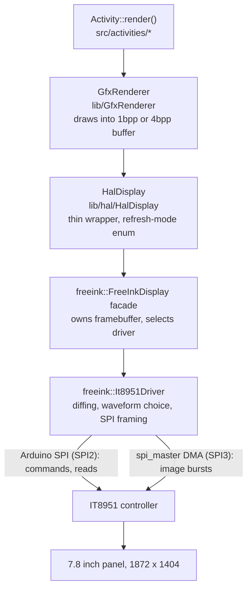
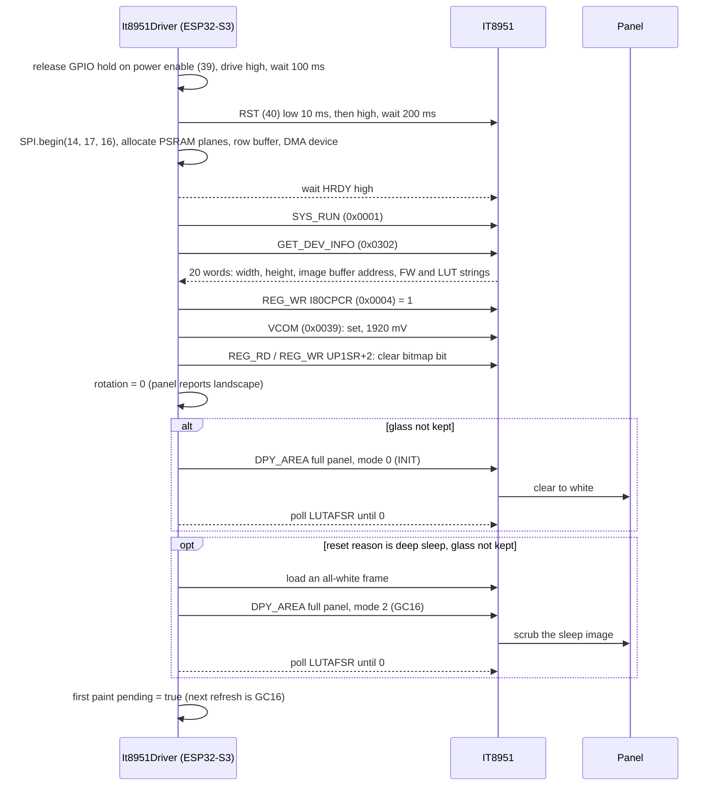
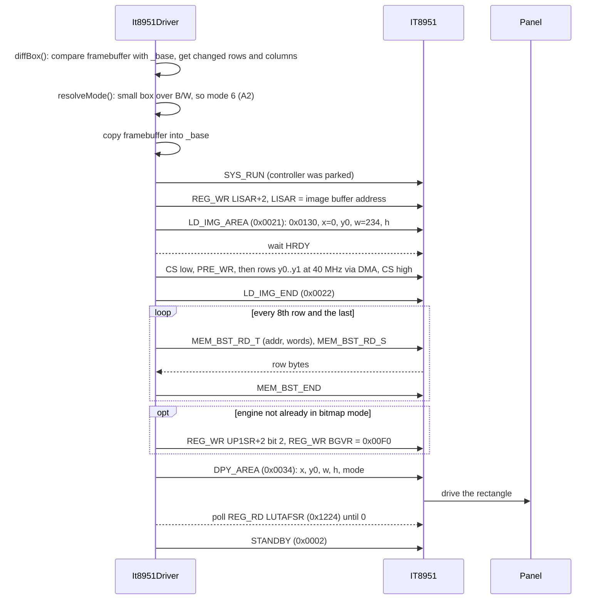
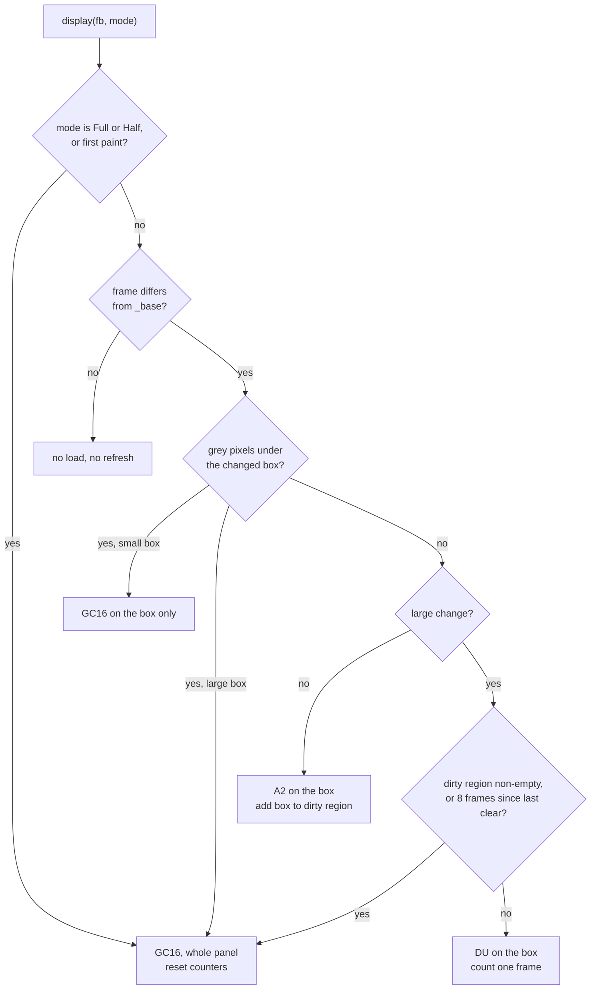
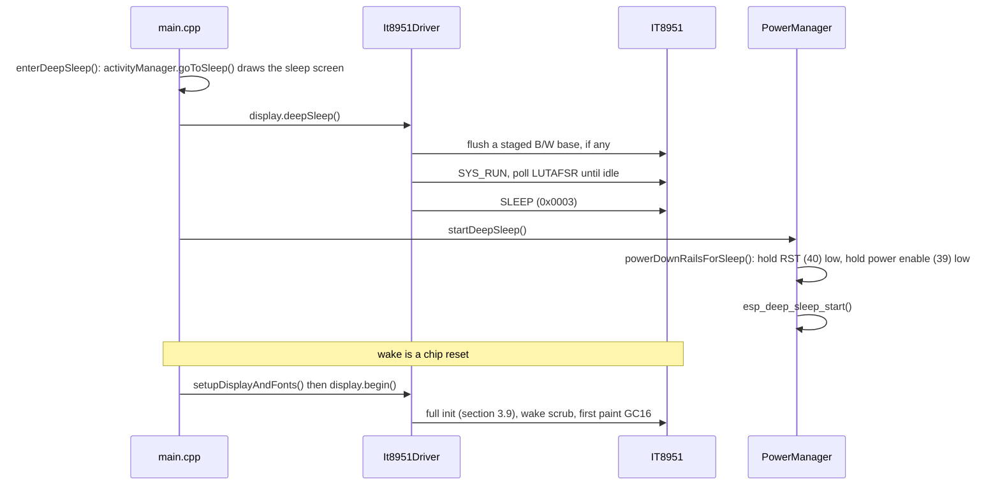
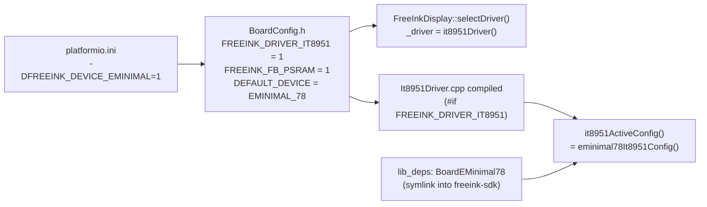

# e-Minimal Display Pipeline

| | |
|---|---|
| **Status** | Draft |
| **Applies to** | Firmware commit `09b6f02f` (branch `master`), `freeink-sdk` submodule at `c774ac17` |
| **Build target** | `[env:eminimal]` in `platformio.ini` |
| **Audience** | Firmware developers working on rendering, the display driver, power, or board bring-up |
| **Related** | [01-system-overview.md](01-system-overview.md), [03-application-framework.md](03-application-framework.md), [04-dashboard-and-games.md](04-dashboard-and-games.md), [05-network-and-storage.md](05-network-and-storage.md), [06-build-flash-release.md](06-build-flash-release.md) |

This document answers one question: how does the ESP32-S3 get pixels onto the 7.8" e-ink panel. It goes from the wires up to the call an activity makes.

## Table of contents

1. [Overview](#1-overview)
2. [Physical link](#2-physical-link)
3. [IT8951 protocol as implemented](#3-it8951-protocol-as-implemented)
4. [Framebuffers and memory](#4-framebuffers-and-memory)
5. [Renderer](#5-renderer)
6. [HAL display interface](#6-hal-display-interface)
7. [Refresh strategy](#7-refresh-strategy)
8. [Render task and RenderLock](#8-render-task-and-renderlock)
9. [Power, sleep and wake](#9-power-sleep-and-wake)
10. [Differences from the upstream panels](#10-differences-from-the-upstream-panels)
11. [Performance figures](#11-performance-figures)
12. [Tunable constants](#12-tunable-constants)
13. [Known limitations](#13-known-limitations)
14. [Bring-up and debugging](#14-bring-up-and-debugging)
15. [Open questions](#15-open-questions)

Source path abbreviations used below:

| Abbreviation | Path |
|---|---|
| `It8951Driver.cpp` / `.h` | `freeink-sdk/libs/display/FreeInkDisplay/src/driver/It8951Driver.{cpp,h}` |
| `It8951Config.h` | `freeink-sdk/libs/display/FreeInkDisplay/include/It8951Config.h` |
| `EMinimal78It8951Config.cpp` | `freeink-sdk/libs/hardware/BoardEMinimal78/src/EMinimal78It8951Config.cpp` |
| `BoardConfig.h` | `freeink-sdk/libs/hardware/BoardConfig/include/BoardConfig.h` |
| `FreeInkDisplay.cpp` / `.h` | `freeink-sdk/libs/display/FreeInkDisplay/src/FreeInkDisplay.cpp`, `.../include/FreeInkDisplay.h` |
| `HalDisplay.*` | `lib/hal/HalDisplay.{h,cpp}` |
| `GfxRenderer.*` | `lib/GfxRenderer/GfxRenderer.{h,cpp}` |

---

## 1. Overview

The panel is not driven directly. A Waveshare IT8951 controller board sits between the ESP32-S3 and the glass. The IT8951 has its own frame memory and its own waveform tables. The host does two things: it loads pixels into the controller's memory over SPI, then it tells the controller to refresh a rectangle of the glass with a named waveform mode (`It8951Driver.h`, file header comment).

The firmware has four layers between an activity and the wire.



Key facts:

- The host framebuffer is 1 bit per pixel, 1872 x 1404, landscape, in PSRAM (section 4).
- Black-and-white frames go to the controller as a 1bpp bitmap. Grey frames go as 4bpp (section 3.5).
- The driver keeps a copy of the last frame and sends only the rows that changed (section 7.2).
- The driver, not the application, picks the waveform. The application passes one of three hints: fast, half, full (section 7.1).
- The controller is put in standby after every refresh (section 9.1).

---

## 2. Physical link

### 2.1 Pin assignment

Pins are defined in the board profile `BoardConfig::EMINIMAL_78` (`BoardConfig.h`), except MISO, which is in `eminimal78It8951Config()` (`EMinimal78It8951Config.cpp`). The driver copies them into its members in `It8951Driver::begin()`.

| Signal | GPIO | Direction | Defined in | Notes |
|---|---|---|---|---|
| SCLK | 14 | out | `EMINIMAL_78.display.sclk` | |
| MOSI | 16 | out | `EMINIMAL_78.display.mosi` | |
| MISO | 17 | in | `It8951Config::miso` | Needed for device info and register reads |
| CS | 18 | out | `EMINIMAL_78.display.cs` | Driven manually by the driver, active low |
| HRDY (busy) | 38 | in | `EMINIMAL_78.display.busy` | High = controller ready (`It8951Driver::busyPolarity()`) |
| RST | 40 | out | `EMINIMAL_78.display.rst` | Active low; pulsed on every boot |
| Power enable | 39 | out | `EMINIMAL_78.display.powerEnable` | Driven high in `begin()`, held low through deep sleep |
| DC | none | | `PIN_UNASSIGNED` | The 16-bit preamble carries command/data |

Notes:

- The SD card is on SDMMC (GPIO 12/11/13), not on this SPI bus. The display has the bus to itself (`BoardConfig.h`, `EMINIMAL_78` comment).
- GPIO 33 to 37 are used by the module's octal PSRAM and must stay free (`BoardConfig.h`, `EMINIMAL_78` comment).
- `HalDisplay::HalDisplay()` still passes the legacy `EPD_*` constants from `lib/hal/HalGPIO.h` to the facade constructor. They are ignored. `FreeInkDisplay::begin()` and `It8951Driver::begin()` read `BoardConfig::ACTIVE.display`.

### 2.2 SPI settings

| Parameter | Value | Source |
|---|---|---|
| Mode | SPI mode 0, MSB first | `SPISettings(..., MSBFIRST, SPI_MODE0)` in `It8951Driver::writeWord()` and others |
| Word size | 16 bits (`transfer16`) | `It8951Driver::writeWord()`, `readData()` |
| Command, data-word and read clock | 13.33 MHz | `It8951Config::spiHz = 13333333` |
| Image burst clock | 40 MHz | `It8951Config::loadSpiHz = 40000000`, used by `It8951Driver::loadClockHz()` |
| Chip select | GPIO, software | `_spi.begin(_sclk, _miso, _mosi, -1)` in `begin()` |

The ESP32-S3 rounds a requested clock down to 80 MHz / N. The configured values are exact divisors (80/6 and 80/2) for that reason (`EMinimal78It8951Config.cpp` comments).

### 2.3 Two SPI hosts on one pair of pins

The driver uses two SPI peripherals on the same SCLK and MOSI pads (`It8951Driver.cpp`, file header comment and `initDmaLoad()`).

| Host | API | Used for |
|---|---|---|
| SPI2 (`ARDUINO_SPI_HOST`) | Arduino global `SPI` object | Commands, arguments, register reads, preambles, read-back |
| SPI3 (`DMA_SPI_HOST`) | ESP-IDF `spi_master`, DMA, half duplex, TX only | The pixel bytes of an image load |

`It8951Driver::routeLoadPinsToDma()` re-points the two output pads at the other host through the GPIO matrix before and after each burst. CS stays low under the driver's control for the whole burst. MISO stays on SPI2. If DMA setup or a DMA transfer fails, the driver logs it and uses the polled Arduino path for the rest of the run (`_dmaFailed`). `-DIT8951_DMA_LOAD=0` compiles the DMA path out.

---

## 3. IT8951 protocol as implemented

All of this section describes `It8951Driver.cpp`. Register names and bit meanings are taken from the constants and comments in that file.

### 3.1 Framing

Every transfer starts with a 16-bit preamble that tells the controller what follows.

| Preamble | Value | Meaning | Function |
|---|---|---|---|
| `PRE_CMD` | `0x6000` | A command word follows | `writeCommand()` |
| `PRE_WR` | `0x0000` | A data word (or a pixel burst) follows | `writeData()`, `streamImageRows()` |
| `PRE_RD` | `0x1000` | Host reads; one dummy word, then data | `readData()`, `readWords()` |

A single command or argument is one CS-framed transfer of two words: preamble, then value (`writeWord()`). A command with five arguments is therefore six separate CS frames. Words are sent most significant bit first.

A read is one CS frame: `PRE_RD`, one dummy word that is discarded, then the data words (`readData()`, `readWords()`).

### 3.2 HRDY handshake

`It8951Driver::waitReady()` runs before every CS frame. It polls GPIO 38 until it reads high.

- Timeout is `READY_TIMEOUT_MS` = 3000 ms.
- On timeout the function returns and the transfer goes ahead anyway ("fail open"). The timeout is only logged when `IT8951_PROBE_DEBUG` is defined.
- Inside an image burst HRDY is checked once, before the `PRE_WR` preamble. The pixel rows then go out back to back with no further check (`streamImageRows()` comment).

"Is the refresh finished" is a different check. `It8951Driver::waitDisplayReady()` reads register `REG_LUTAFSR` (`0x1224`) in a loop until it returns 0, with the same 3000 ms timeout and the same fail-open behaviour.

### 3.3 Commands used

| Constant | Code | Arguments | Used by |
|---|---|---|---|
| `CMD_SYS_RUN` | `0x0001` | none | `systemRun()`, `wakeController()` |
| `CMD_STANDBY` | `0x0002` | none | `park()` |
| `CMD_SLEEP` | `0x0003` | none | `deepSleep()` |
| `CMD_REG_RD` | `0x0010` | register address; then read one word | `readReg()` |
| `CMD_REG_WR` | `0x0011` | register address, value | `writeReg()` |
| `CMD_MEM_BST_RD_T` | `0x0012` | address low, address high, word count low, word count high | `bitmapRowsMatch()` |
| `CMD_MEM_BST_RD_S` | `0x0013` | none; data follows as a read | `bitmapRowsMatch()` |
| `CMD_MEM_BST_END` | `0x0015` | none | `bitmapRowsMatch()` |
| `CMD_LD_IMG_AREA` | `0x0021` | format word, x, y, w, h | all `loadImage*()` functions |
| `CMD_LD_IMG_END` | `0x0022` | none | all `loadImage*()` functions |
| `CMD_DPY_AREA` | `0x0034` | x, y, w, h, waveform mode | `displayArea()` |
| `CMD_VCOM` | `0x0039` | `0x0001` (set), millivolts | `setVcom()` |
| `CMD_DEV_INFO` | `0x0302` | none; then read 20 words | `getDeviceInfo()` |

The whole-frame load command (`0x0020` per the IT8951 datasheet, not verified in this code) is not used. Whole frames are loaded with `CMD_LD_IMG_AREA` over the full rectangle.

### 3.4 Registers used

| Constant | Address | Use | Function |
|---|---|---|---|
| `REG_I80CPCR` | `0x0004` | Written `0x0001` at init: enable packed host writes | `begin()` |
| `REG_LISAR` | `0x0208` (+2 for high word) | Target address of the next image load | `setTargetMemoryAddr()` |
| `REG_UP1SR` + 2 | `0x113A` | Bit 2: display engine reads frame memory as a 1bpp bitmap | `setBitmapMode()` |
| `REG_LUTAFSR` | `0x1224` | Non-zero while a refresh is running | `waitDisplayReady()` |
| `REG_BGVR` | `0x1250` | Grey level painted for a 1 bit and a 0 bit in bitmap mode; set to `0x00F0` | `setBitmapMode()` |

### 3.5 Pixel formats on the wire

The format word of `CMD_LD_IMG_AREA` is `(endian << 8) | (bpp << 4) | rotation`. The driver always sets big-endian (`ENDIAN_BIG`).

| Load | Format word | Bytes per row | Bytes per frame | Functions |
|---|---|---|---|---|
| B/W as 1bpp bitmap | `0x0130` (declared 8bpp, width 234 "pixels") | 234 | 328,536 | `loadImageBitmap()`, `sendBitmapRows()` |
| Grey or B/W as 4bpp | `0x0120` | 936 | 1,314,144 | `loadImageArea()`, `loadImageGray()`, `loadImageGray4()` |
| 2bpp | `0x0100` | 468 | | Present in code, disabled for this board |

**4bpp.** Two pixels per byte, left pixel in the high nibble. `0x0` is black and `0xF` is white (`gray4()` comment).

**1bpp bitmap.** This is the default for B/W frames on e-Minimal (`It8951LoadDepth::Bpp1`). The framebuffer bytes are sent under an 8bpp header that declares the image 234 pixels wide. The controller stores each byte untouched. The display engine is then switched to bitmap mode, where it reads each stored byte as eight pixels and paints the two levels from `REG_BGVR` (`loadImageBitmap()` comment). Details:

- Each byte is bit-reversed before sending, because the engine reads bit 0 as the leftmost pixel and the framebuffer is MSB first (`BITMAP_LSB_FIRST`, `kBitRev`).
- Partial bitmap loads are widened to multiples of 16 rows (`BITMAP_ROW_ALIGN`). The refresh rectangle is widened to multiples of 32 columns (`BITMAP_COL_ALIGN`, in `displayArea()`).
- Bitmap loads need load rotation 0 (`bitmapLoads()`).

**Mixed formats.** The controller's frame memory holds either a bitmap or 4bpp levels, never both. The driver tracks this in `_memBitmap`. A load in the other format is widened to the whole frame (`loadImageArea()`, `loadImageBitmap()`). `displayArea()` calls `setBitmapMode(_memBitmap)` so the engine always reads memory the way it was written.

**2bpp.** Not usable on this controller. It expands a 2-bit value `v` to `v << 2`, so white lands at `0xC` and pages come up grey (`It8951Config.h`, `It8951LoadDepth` comment).

### 3.6 Image transfer and chunking

Every load goes through `It8951Driver::streamImageRows(numRows, rowBytes, fill)`:

1. Wait for HRDY. Begin an SPI transaction at the load clock. Pull CS low. Send `PRE_WR`.
2. DMA path: build rows into one of three DMA buffers (`DMA_BUFS` = 3) and queue it. Each buffer is 2048 bytes (`DMA_CHUNK_TARGET`), which holds two 4bpp rows or eight bitmap rows. While one chunk is on the wire the CPU builds the next. Each queue or completion wait has a 1000 ms timeout (`DMA_TIMEOUT_TICKS`).
3. Polled path (fallback): build one row into `_rowBuf` and send it with `SPIClass::writeBytes()`.
4. Raise CS. End the transaction.

The DMA buffers and `_rowBuf` are in internal RAM, not PSRAM (`initDmaLoad()`, `begin()`).

**Partial loads are always full width.** `loadImageBand()` loads complete rows `y0..y1`. A load with a non-zero x offset misplaced the image on the bench, so the horizontal extent of a change is used for the refresh rectangle only (`It8951Driver.h`, `loadImageBand()` comment).

### 3.7 Load verification

For bitmap loads, `bitmapRowsMatch()` reads every 8th row and the last row back from controller memory (`It8951Config::verifyLoadRows` = 8) and compares them with what was sent. On a mismatch:

1. The same rows are resent on the polled path at 13.33 MHz (`_safeLoad`).
2. If the read-back still differs, verification is switched off for the rest of the run (`_verifyOff`) and a line is logged.

Verification is skipped when `GET_DEV_INFO` did not read back plausibly (`_readsOk`). 4bpp grey loads are not verified.

### 3.8 Error handling summary

| Condition | Behaviour | Source |
|---|---|---|
| HRDY low for 3 s | Proceed anyway | `waitReady()` |
| Refresh still busy after 3 s | Proceed anyway | `waitDisplayReady()` |
| `GET_DEV_INFO` returns implausible size | Use profile geometry (1872 x 1404) and fallback buffer address `0x00124850` | `getDeviceInfo()` |
| DMA init fails | Polled SPI for all loads | `initDmaLoad()` |
| DMA transfer fails mid-burst | Finish the burst polled; polled from then on | `streamImageRows()` |
| Bitmap load read-back mismatch | Resend slow, polled; then disable verification | `loadImageBitmap()` |
| Row buffer allocation fails | Loads return without sending | `loadImageArea()` and others |

No error is returned to the application for any of these, except that the 4bpp entry points return `false` when unsupported.

### 3.9 Sequence: power-up and init

`It8951Driver::begin()`, called from `FreeInkDisplay::begin()`, called from `HalDisplay::begin()`.



Notes:

- VCOM is written on every boot. An SPI-set VCOM does not survive a controller reset (`EMinimal78It8951Config.cpp`, `vcomMv` comment).
- "Glass kept" is the one-shot `HalDisplay::keepGlassOnNextBegin()`. It skips the INIT pass and the wake scrub (section 9.3).
- The wake scrub variant is `It8951WakeScrub::WhiteGc16` on this board.

### 3.10 Sequence: draw a region

Example: a menu highlight moves. The application calls `renderer.displayBuffer(FAST_REFRESH)`. Path: `GfxRenderer::displayBuffer()` to `HalDisplay::displayBuffer()` to `FreeInkDisplay::displayBuffer()` to `It8951Driver::display()`.



---

## 4. Framebuffers and memory

All large buffers are in PSRAM. `-DBOARD_HAS_PSRAM` and `board_build.arduino.memory_type = qio_opi` are set in `[env:eminimal]`. `FREEINK_FB_PSRAM` is enabled for this device in `BoardConfig.h`.

| Buffer | Owner | Format | Size | Memory | Allocated in |
|---|---|---|---|---|---|
| Framebuffer | `FreeInkDisplay::frameBuffer` | 1bpp, 1872 x 1404 | 328,536 B | PSRAM | `FreeInkDisplay::allocFrameBufferStorage()` |
| `_base` | `It8951Driver` | 1bpp copy of the last B/W frame | 328,536 B | PSRAM | `It8951Driver::begin()` |
| `_gLsb`, `_gMsb` | `It8951Driver` | 1bpp grey planes | 2 x 328,536 B | PSRAM | `It8951Driver::begin()` |
| `gray4Buf_` | `GfxRenderer` | 4bpp, 16 levels | 1,314,144 B | PSRAM, on demand | `GfxRenderer::beginGray4Target()` |
| `_rowBuf` | `It8951Driver` | one output row | 936 B | internal RAM | `It8951Driver::begin()` |
| `_dmaBuf[3]` | `It8951Driver` | DMA chunks | 3 x 2048 B | internal, DMA-capable | `It8951Driver::initDmaLoad()` |
| `_grayTab` | `It8951Driver` | plane-to-4bpp lookup | 8 KB | internal RAM | `It8951Driver::buildGrayTable()` |

Framebuffer format (`GfxRenderer::drawPixel()`):

- One bit per pixel. A set bit is white, a clear bit is black.
- Row-major, 234 bytes per row. Bit 7 of each byte is the leftmost pixel.
- Physical orientation is landscape, 1872 wide by 1404 high, as the controller reports it.

The build defines `EINK_DISPLAY_SINGLE_BUFFER_MODE=1` (`[base]` build flags, inherited). The facade therefore keeps one framebuffer, not a front/back pair. The previous frame is kept by the driver in `_base`, not by the facade.

---

## 5. Renderer

`GfxRenderer` (`lib/GfxRenderer`) is the only code that draws. It writes into the framebuffer returned by `HalDisplay::getFrameBuffer()`.

### 5.1 Orientation

Callers use logical coordinates. `rotateCoordinates()` in `GfxRenderer.cpp` maps them to physical framebuffer coordinates.

| `GfxRenderer::Orientation` | Logical size on this panel | Mapping |
|---|---|---|
| `Portrait` | 1404 x 1872 | `phyX = y`, `phyY = H - 1 - x` |
| `LandscapeClockwise` | 1872 x 1404 | 180 degrees |
| `PortraitInverted` | 1404 x 1872 | `phyX = W - 1 - y`, `phyY = x` |
| `LandscapeCounterClockwise` | 1872 x 1404 | identity |

The panel is mounted upside down in the case. The board profile declares `ROTATE_180`. The IT8951 driver does not apply it, because controller-side rotation would disable bitmap loads and partial loads. Instead `GfxRenderer::begin()` sets `mountFlipped`, and `applyOrientation()` adds 180 degrees to every orientation the caller selects. `getOrientation()` returns what the caller asked for; `getPanelOrientation()` returns what is drawn.

Rotation is done on the host for every pixel. The controller always loads with rotation 0 (`IT8951_ROTATE_AUTO` resolves to 0 because the panel reports landscape; see `It8951Driver::begin()`).

### 5.2 Drawing

- **Pixels and shapes.** `drawPixel()` clips, rotates, and sets or clears one bit. Lines, rectangles, arcs and polygons build on it or on `fillRectImpl()`.
- **Text.** `drawText()` resolves each glyph and calls `drawGlyphBitmap()`. That function rotates the glyph origin and its two axes once, then blits. Glyph bitmaps are 1-bit or 2-bit (`EpdFontData::is2Bit`).
- **Bitmaps.** `drawBitmap()`, `drawBitmap1Bit()`, `drawImage()` and `drawIcon()`.
- **Grey fills on a 1bpp target.** `fillRectDither()` uses ordered dithering patterns selected by the `Color` enum (`GfxRenderer.h`).

### 5.3 Grey rendering

There are two grey paths on this device.

**Plane path (four levels).** This is the upstream method. The page is rendered up to three times with `setRenderMode()`: `BW`, `GRAYSCALE_LSB`, `GRAYSCALE_MSB`. The driver buffers the two planes (`copyGrayscaleLsb()`, `copyGrayscaleMsb()`, `writeGrayscalePlaneStrip()`) and combines them with the B/W base into 4bpp in `loadImageGray()`. The mapping is in `gray4()`:

| Base bit | MSB | LSB | 4bpp value |
|---|---|---|---|
| 1 | any | any | `0xF` white |
| 0 | 1 | 0 | `0xA` light |
| 0 | 0 or 1 | 1 | `0x5` dark |
| 0 | 0 | 0 | `0x0` black |

The driver reports `GrayscaleBase::Combined` because `combinedGray` is true (`It8951Driver::grayscaleCapabilities()`). `displayGrayscaleBase()` then only stores the B/W frame. `displayGray()` sends base and planes as one load and one refresh.

**Gray4 path (sixteen levels).** Added by this fork. `GfxRenderer::beginGray4Target()` allocates a 4bpp frame. While it is active, every drawing primitive writes a nibble into it instead of a bit into the framebuffer (`putGray4Pixel()`, `glyphBitmap::drawGray4()`). The page is rendered once. `displayGray4Buffer()` or `displayGray4Rows()` then sends it through `It8951Driver::displayGray4Rows()` and `loadImageGray4()`.

While the rows pass through internal RAM, the driver derives its `_base`, `_gLsb` and `_gMsb` from them (`kGray4Planes`), so the next B/W frame can still be diffed. With `updateFrameBuffer`, the 1bpp framebuffer also receives the page's B/W base (white only where the nibble is `0xF`).

Users of the gray4 path: `EpubReaderActivity` (anti-aliased and image pages), `XtcReaderActivity` (`displayGray4Rows`), and `src/util/ChargeBadge.cpp` (window variants).

Grey output is unavailable while the display is inverted (night mode). `FreeInkDisplay::supportsGray4()` and `grayscaleCapabilities()` return "unsupported" in that state.

---

## 6. HAL display interface

`HalDisplay` (`lib/hal/HalDisplay.h`) is a thin wrapper over the SDK facade. The global instance is `display`. Activities normally call `GfxRenderer`, which forwards here.

| Group | Methods |
|---|---|
| Lifecycle | `begin(seamless)`, `keepGlassOnNextBegin()`, `deepSleep()` |
| Geometry | `getDisplayWidth()`, `getDisplayHeight()`, `getDisplayWidthBytes()`, `getBufferSize()` |
| Framebuffer | `getFrameBuffer()`, `clearScreen()`, `drawImage()`, `drawImageTransparent()`, `lendFrameBufferStorage()`, `returnFrameBufferStorage()` |
| B/W refresh | `displayBuffer(mode, turnOff)`, `refreshDisplay()`, `displayWindow(x, y, w, h)`, `repeatLastRefresh()` |
| Grey, plane path | `grayscaleCapabilities()`, `displayGrayscaleBase()`, `copyGrayscaleLsbBuffers()`, `copyGrayscaleMsbBuffers()`, `writeGrayscalePlaneStrip()`, `displayGrayBuffer()`, `cleanupGrayscaleBuffers()` |
| Grey, 4bpp | `supportsGray4()`, `getGray4BufferSize()`, `displayGray4()`, `displayGray4Rows()`, `snapshotWindowGray4()`, `displayWindowGray4()` |
| Polarity | `setInverted()`, `toggleInverted()`, `isInverted()` |
| Async | `displayBufferAsync()`, `waitRefreshComplete()`, `supportsAsyncRefresh()` |

Points specific to this device:

- `HalDisplay::DISPLAY_WIDTH` and `DISPLAY_HEIGHT` are legacy 800 x 480 constants. Use the runtime getters.
- `It8951Driver` does not override `PanelDriver::supportsAsyncDisplay()`, which defaults to false. `supportsAsyncRefresh()` is therefore false and refreshes block the calling task.
- `HalDisplay::begin()` calls `requestResync()` after some wake reasons. That is a no-op here (`PanelDriver::requestResync()` default).
- The X3-specific branches in `HalDisplay.cpp` (`gpio.deviceIsX3()`) do not apply.

---

## 7. Refresh strategy

### 7.1 Waveform modes

Waveform mode numbers belong to the panel's waveform table, not to the controller. This panel's table is "M841" (`EMinimal78It8951Config.cpp`, header comment).

| Mode | Name | Used here | Config field |
|---|---|---|---|
| 0 | INIT | Clear at boot | hard-coded in `begin()` |
| 1 | DU | B/W screen changes | `fastMode` |
| 2 | GC16 | Clearing refresh | `fullMode` |
| 3, 4, 5 | GL16, GLR16, GLD16 | Not used | |
| 6 | A2 | Small B/W changes (menu moves) | `menuMode` |
| 7 | DU4 | Grey pages | `grayMode` |

The application passes one of three hints. `HalDisplay::RefreshMode` maps to `freeink::RefreshMode` in `convertRefreshMode()` and `toInternal()`.

| Hint | Driver treatment (`It8951Driver::resolveMode()`) |
|---|---|
| `FULL_REFRESH` | GC16 |
| `HALF_REFRESH` | GC16 (same as full on this driver) |
| `FAST_REFRESH` | A differential mode, unless a clear is owed (section 7.3) |

### 7.2 Partial refresh and change tracking

There is no dirty-rectangle API for B/W frames. The application redraws the whole framebuffer and the driver finds what changed.

`It8951Driver::display()`:

1. If the controller memory is known to match `_base` (`_memMirrorsBase`), `diffBox()` compares the new frame with `_base` row by row. It returns the bounding rows and byte columns, and the count of changed bytes.
2. No difference: nothing is loaded. No refresh runs either, unless a clear is owed (first paint, a full or half hint, or the periodic clear), in which case GC16 runs on what memory already holds.
3. A difference: the changed rows are loaded at full width (`loadImageBand()`). The refresh rectangle is the bounding box.
4. The new frame is copied into `_base`.

A change counts as a "screen change" when the changed bytes are at least half the frame (`largeBox`). This is judged on the changed area, not on the bounding box, so two small changes far apart still count as small.

Diffing requires load rotation 0 and a panel size equal to the framebuffer size (`canDiff`).

### 7.3 Ghosting clean-up policy



Rules, all in `It8951Driver::display()` and `resolveMode()`:

- **Periodic clear.** Each large differential refresh adds one frame (`FRAME_WEIGHT` = 256) to `_partialsSinceClear`. At `ghostClearInterval` = 8 frames the next refresh becomes GC16. Small menu moves add nothing.
- **Dirty region.** Small A2 moves leave faint residue. Their boxes are merged into a dirty region (`dirtyUnion()`). The next screen change with a non-empty dirty region is forced to GC16.
- **Grey under the box.** DU and A2 are two-level waveforms. Driving anti-aliased text with them leaves a shadow. If the planes show grey inside the changed box (`grayWithin()`), the refresh is promoted to GC16.
- **After a grey page.** A DU4 page marks the whole frame dirty, so the next B/W screen change is a GC16 clear (`displayGray()`, `displayGray4Rows()`).
- **First paint.** The first refresh after `begin()` is GC16 (`_firstPaintPending`).
- **Clear without a reload.** When a clear is due and memory already matches outside the changed rows, only those rows are loaded and the whole panel is refreshed.

Grey pages (`displayGray()`, `displayGray4Rows()`) use DU4, or GC16 when the hint is full or half, on first paint, or when the periodic clear is due.

### 7.4 Window refresh

`HalDisplay::displayWindow()` reaches `It8951Driver::displayWindow()`. It loads the rows of the box and runs GC16 on the box only. It trusts nothing about the rest of controller memory, so it works over a glass kept through deep sleep. Afterwards the driver forces the next `display()` to reload the whole frame and clear.

`displayWindowGray4()` is the 16-level version. `snapshotWindowGray4()` copies a box out of the driver's planes; it returns four levels, not sixteen.

### 7.5 How the application chooses a hint

- **Default.** `GfxRenderer::displayBuffer()` defaults to `FAST_REFRESH`.
- **Reader cadence.** `ReaderUtils::displayWithRefreshCycle()` (`src/activities/reader/ReaderUtils.h`) sends `HALF_REFRESH` every N pages, where N is `CrossPointSettings::getRefreshFrequency()`. `EpubReaderActivity` also sends `HALF_REFRESH` for image pages and makes the page after an image page a clean refresh.
- **One-shot promotion.** `GfxRenderer::promoteNextRefresh(mode)` replaces the mode of the next `displayBuffer()` call. It is used when a screen is entered or an overlay closes (`PowerMenuActivity`, `SettingsActivity`, dashboard activities).
- **Manual refresh.** A short power press configured as "force refresh" calls `promoteNextRefresh(HALF_REFRESH)` and requests a repaint (`loop()` in `src/main.cpp`).
- **Dark picture pages.** `XtcReaderActivity` calls `repeatLastRefresh()`, which runs a second GC16 on what the controller already holds, with no reload.

The driver's own policy in section 7.3 runs underneath all of these.

---

## 8. Render task and RenderLock

Only one task drives the panel. Details of the activity model are in [03-application-framework.md](03-application-framework.md). The display-relevant parts are in `src/activities/ActivityManager.cpp`.

- **Render task.** `ActivityManager::begin()` creates the task `ActivityManagerRender`, priority 1, pinned to core 1 on this dual-core target. `renderTaskLoop()` blocks on a task notification, takes a `RenderLock`, and calls `currentActivity->render()`.
- **Requesting a repaint.** `Activity::requestUpdate()` sets a flag that is turned into a notification at the end of the main loop iteration. `requestUpdate(true)` notifies immediately. `requestUpdateAndWait()` blocks the caller until the render finishes; it must not be called from the render task or while holding a `RenderLock`.
- **RenderLock.** An RAII wrapper around `ActivityManager::renderingMutex`. Code outside the render task that touches the framebuffer or changes activity state takes it. `RenderLock::peek()` reports whether a render is in progress.
- **During a render.** The render task holds a `HalPowerManager::Lock` so the CPU is not slowed, and applies the night-mode setting with `display.setInverted()`.
- **Blocking.** The SPI load and the wait for the waveform both run on the render task, inside `render()`. The main loop keeps running and can read keys.

`idleLightSleep()` in `src/main.cpp` takes a `RenderLock` before entering light sleep, so a repaint is never frozen halfway.

---

## 9. Power, sleep and wake

### 9.1 Standby between refreshes

`parkWhenIdle` is true for this board. Every refresh function ends with `park()`, which sends `CMD_STANDBY`. Every function that needs the controller starts with `wakeController()`, which sends `CMD_SYS_RUN` if parked. Standby keeps the controller's frame memory, so the next refresh can still be differential (`It8951Config.h`, `parkWhenIdle` comment).

### 9.2 Light sleep

Between page turns in the reader and on dashboard menus, `idleLightSleep()` (`src/main.cpp`) puts the ESP32 into light sleep. The controller is already in standby and the image stays on the glass. No display command is sent on entry or exit.

### 9.3 Deep sleep and wake



Sources: `enterDeepSleep()` and `setupDisplayAndFonts()` in `src/main.cpp`; `It8951Driver::deepSleep()`; `HalPowerManager::startDeepSleep()` in `lib/hal/HalPowerManager.cpp`; `PowerManager::powerDownRailsForSleep()` in `freeink-sdk/libs/hardware/PowerManager/src/PowerManager.cpp`.

Points to note:

- Because a power-enable pin is assigned, RST is held low through deep sleep. `begin()` releases both GPIO holds before driving the pins (`It8951Driver::begin()`, `resetController()`).
- The controller's frame memory is lost in deep sleep. After wake, `_memMirrorsBase` is false and the first paint reloads the whole frame.
- **Wake scrub.** On a deep-sleep wake, INIT alone left a faint shadow of the sleep image. The driver therefore loads a white frame and runs GC16 after the INIT (`It8951WakeScrub::WhiteGc16`).
- **Keep-glass wake.** `display.keepGlassOnNextBegin()` skips both INIT and the scrub. It is used for dashboard timer wakes and for the charging-badge wake, which repaint over what the glass already shows (`setup()` and `handleChargeWake()` in `src/main.cpp`). The charging badge then uses `displayWindowGray4()` to redraw only its square (`src/util/ChargeBadge.cpp`).

### 9.4 VCOM

- Value: 1920, meaning -1.92 V, taken from the label on this panel's flex cable (`EMinimal78It8951Config.cpp`).
- Written in `begin()` on every boot by `setVcom()`. A value of 0 would leave the controller's stored value in place.
- VCOM is per panel. A different panel needs its own value.
- The driver never reads VCOM back.

---

## 10. Differences from the upstream panels

Upstream's reference device is the Xteink X4. The table compares it with this target.

| Aspect | Upstream X4 | e-Minimal |
|---|---|---|
| MCU | ESP32-C3, no PSRAM | ESP32-S3, 8 MB PSRAM |
| Controller | SSD1677 (or UltraChip variants) on the panel | IT8951 timing controller with its own frame memory |
| Resolution | 800 x 480 | 1872 x 1404 |
| Framebuffer | 48 KB, internal RAM | 328.5 KB, PSRAM |
| Bus | `EpdBus`: byte-oriented, write-only, DC pin | Driver-owned 16-bit SPI with MISO and preambles (`usesExternalBus()` is true) |
| Waveforms | Sent or selected by the host driver | Stored in the controller; host picks a mode number |
| Previous frame | Held in controller RAM | Held by the driver in `_base` |
| Partial update | Driver-specific window | Row diff against `_base`, load changed rows |
| Grey | LSB and MSB planes written to controller RAM | Planes combined on the host into 4bpp, or a direct 16-level frame |
| Mount rotation | Applied by the driver in hardware | Applied by `GfxRenderer` (`mountFlipped`) |
| Idle state | Driver-specific | Standby after every refresh |

### Compile-time selection



1. `[env:eminimal]` defines `FREEINK_DEVICE_EMINIMAL=1`.
2. `BoardConfig.h` derives `FREEINK_DRIVER_IT8951`, `FREEINK_MCU_S3`, `FREEINK_FB_PSRAM` and `FREEINK_SD_SDMMC` from it and sets `DEFAULT_DEVICE` to `EMINIMAL_78`.
3. `It8951Driver.cpp` is compiled only when `FREEINK_DRIVER_IT8951` is set. `FreeInkDisplay::selectDriver()` falls through to `it8951Driver()` because no other driver is linked.
4. The driver's configuration comes from `it8951ActiveConfig()`. For this device that is `eminimal78It8951Config()`, supplied by the `BoardEMinimal78` library listed in `lib_deps`. A build can override it with `-DFREEINK_IT8951_CONFIG=<function>`.
5. Application code uses `#if FREEINK_DEVICE_EMINIMAL` for device-specific behaviour (for example in `src/main.cpp`).

The `freeink-sdk` submodule points at a fork branch (`.gitmodules`). The IT8951 driver existed upstream for the M5Paper. The fork's SDK branch adds the board profile and config, the 1bpp bitmap load, DMA bursts, row diffing, standby parking, load verification, the 16-level frame API and the window functions (SDK commit history for `It8951Driver.cpp`). In this repository the fork adds the 4bpp render target in `GfxRenderer` and the matching `HalDisplay` methods.

---

## 11. Performance figures

Only figures stated in source comments are listed. They are bench measurements recorded by the authors, mostly on jumper-wire setups, and have not been re-measured for this document.

| Item | Figure | Source |
|---|---|---|
| GC16 refresh | 525 ms | `EMinimal78It8951Config.cpp`, `fullMode` |
| DU refresh | 299 ms (about 500 ms seen on Home in the case) | same, `fastMode`, `menuMode` |
| DU4 refresh | 359 ms | same, `grayMode` |
| A2 refresh | 192 ms | same, `menuMode` |
| 4bpp frame load at 10 MHz | 1107 ms | same, `spiHz` |
| 4bpp frame load at 13.3 MHz | 842 ms | same, `spiHz` |
| 4bpp frame load at 20 MHz | 541 to 580 ms | same, `loadSpiHz` |
| 4bpp frame load at 26.67 MHz | 409 to 414 ms | same, `loadSpiHz` |
| 4bpp frame load at 40 MHz | about 318 ms | same, `loadSpiHz` |
| 1bpp frame load at 20 MHz | about 145 ms (estimate; "has not been timed yet") | same, `loadDepth` |
| Menu highlight load vs whole frame | about 80 ms vs 1.1 s | `It8951Driver.h`, `_memMirrorsBase` |
| Frame diff | a few tens of ms | `It8951Driver.cpp`, `diffBox()` |
| Repeat refresh, no reload | about 0.55 s | `It8951Driver.cpp`, `repeatLastRefresh()` |
| Default wake scrub (INIT + GC16 + INIT) | 4.8 s of a 7.5 s wake | `EMinimal78It8951Config.cpp`, `wakeScrub` |
| Idle power, controller running vs parked | 636 mW vs 333 mW | same, `parkWhenIdle` |

Live figures: the `eminimal` build defines `IT8951_TIMING_LOG`. The driver prints one line per refresh (`It8951Driver::printTiming()`):

```
[it8951] display: load 23 KB 14 ms (1bpp), verify 3 ms, mode 6 refresh+wait 205 ms, total 224 ms
```

The numbers in this example are illustrative of the format only.

---

## 12. Tunable constants

### 12.1 Board configuration (`eminimal78It8951Config()` in `EMinimal78It8951Config.cpp`)

| Field | Value | Effect |
|---|---|---|
| `miso` | 17 | MISO GPIO |
| `spiHz` | 13,333,333 | Clock for commands and reads |
| `loadSpiHz` | 40,000,000 | Clock for image bursts; 0 means use `spiHz` |
| `rotation` | `IT8951_ROTATE_AUTO` | Load rotation; resolves to 0 |
| `vcomMv` | 1920 | VCOM magnitude in mV; 0 keeps the stored value |
| `fullMode` | 2 (GC16) | Clearing waveform |
| `fastMode` | 1 (DU) | B/W screen change waveform |
| `grayMode` | 7 (DU4) | Grey page waveform |
| `menuMode` | 6 (A2) | Small B/W change waveform; 0 means use `fastMode` |
| `ghostClearInterval` | 8 | Frames of differential refresh before a forced GC16; 0 disables |
| `imgBufFallbackAddr` | `0x00124850` | Used if device info returns no address |
| `wakeScrub` | `WhiteGc16` | Clean-up after INIT on a deep-sleep wake |
| `loadDepth` | `Bpp1` | B/W frames as a 1bpp bitmap |
| `parkWhenIdle` | true | Standby after every refresh |
| `combinedGray` | true | Base and grey planes in one load and one refresh |
| `verifyLoadRows` | 8 | Read back every Nth row of a bitmap load; 0 disables |

### 12.2 Driver constants (`It8951Driver.cpp`)

| Constant | Value | Effect |
|---|---|---|
| `READY_TIMEOUT_MS` | 3000 | HRDY and refresh-busy timeout |
| `RESET_PULSE_MS` | 10 | RST low time |
| `RESET_BOOT_MS` | 200 | Wait after RST release |
| `DMA_CHUNK_TARGET` | 2048 | Bytes per DMA chunk |
| `DMA_BUFS` (`It8951Driver.h`) | 3 | DMA buffers in rotation |
| `DMA_TIMEOUT_TICKS` | 1000 ms | Per-chunk DMA timeout |
| `BGVR_BW` | `0x00F0` | Bitmap-mode levels; swap bytes if the image is inverted |
| `BITMAP_LSB_FIRST` | true | Bit-reverse each bitmap byte |
| `BITMAP_ROW_ALIGN` | 16 | Row alignment of partial bitmap loads |
| `BITMAP_COL_ALIGN` | 32 | Column alignment of bitmap-mode refresh boxes |
| `FRAME_WEIGHT` (`It8951Driver.h`) | 256 | One frame in the ghost-clear counter |

### 12.3 Build flags

| Flag | Set in `[env:eminimal]` | Effect |
|---|---|---|
| `FREEINK_DEVICE_EMINIMAL=1` | yes | Selects board profile, driver and config |
| `BOARD_HAS_PSRAM` | yes | Enables PSRAM |
| `EINK_DISPLAY_SINGLE_BUFFER_MODE=1` | yes (from `[base]`) | One facade framebuffer |
| `IT8951_TIMING_LOG` | yes | One timing line per refresh |
| `IT8951_PROBE_DEBUG` | no | Device-info dump, timeout messages, per-call decisions |
| `IT8951_DMA_LOAD=0` | no | Compile out the DMA burst path |
| `FREEINK_IT8951_CONFIG=<fn>` | no | Replace the board configuration |

### 12.4 Application settings

| Setting | Effect | Source |
|---|---|---|
| Refresh frequency | Pages between `HALF_REFRESH` in the reader | `CrossPointSettings::getRefreshFrequency()` |
| Text anti-aliasing | Selects a grey path for text pages | `SETTINGS.textAntiAliasing`, `EpubReaderActivity` |
| Screen inverted | Night mode; disables grey paths | `ActivityManager::renderTaskLoop()` |
| Short power press = refresh | Manual `HALF_REFRESH` | `loop()` in `src/main.cpp` |

---

## 13. Known limitations

1. **Timeouts fail open.** `waitReady()` and `waitDisplayReady()` return after 3 s and the driver carries on. A stuck controller produces slow, wrong output, with no error reported to the application. The timeout messages need `IT8951_PROBE_DEBUG`.
2. **Busy polling.** `waitReady()` spins on `digitalRead()` with no delay. `waitDisplayReady()` polls a register over SPI in a tight loop. Both run on the render task for the duration of a refresh.
3. **Refreshes block.** There is no asynchronous refresh on this driver.
4. **Rotation 0 only.** Bitmap loads, diffing, window refreshes and the 4bpp window functions all require load rotation 0.
5. **Partial loads are full width.** A narrow change still sends complete rows.
6. **4bpp loads are not verified.** Only bitmap loads are read back.
7. **`HALF_REFRESH` equals `FULL_REFRESH`.** Both map to GC16.
8. **Plane path gives four grey levels.** Only the gray4 path gives sixteen. `snapshotWindowGray4()` returns four levels even for a page drawn with sixteen.
9. **No grey in night mode.** Inverted output forces B/W.
10. **2bpp loads do not work** on this controller.
11. **Firmware and LUT strings are not logged.** `getDeviceInfo()` reads them but prints only the first four words, and only under `IT8951_PROBE_DEBUG`.
12. **No temperature handling in the host code.** The driver does not read or set a temperature.
13. **Clock margins were tuned on specific hardware.** Comments record failures at 16 and 20 MHz for reads on jumper wires and occasional dropped bands at 26.67 and 40 MHz for writes. A new board layout needs a new sweep.
14. **The wake scrub choice is marked "under test"** in the configuration comment.
15. **`IT8951_TIMING_LOG` is described as bench-only** in `platformio.ini` but is enabled in the `eminimal` environment.

---

## 14. Bring-up and debugging

### 14.1 First power-up checklist

1. Check wiring against section 2.1. Confirm nothing uses GPIO 33 to 37.
2. Build with `-DIT8951_PROBE_DEBUG` added to `[env:eminimal]` build flags (see [06-build-flash-release.md](06-build-flash-release.md) for build and flash steps).
3. Open the serial console at 115200 baud (`monitor_speed`).
4. Look for the device-info line from `getDeviceInfo()`:
   ```
   [it8951] GET_DEV_INFO: panelW=1872 panelH=1404 imgBufAddr=0x00124850 (info[0..3]=...)
   ```
   Plausible width, height and a non-zero address mean SPI reads work. All zeros or `0xFFFF` mean no MISO, a cold controller, or wrong pins.
5. Look for the `begin` timing line (present with `IT8951_TIMING_LOG`):
   ```
   [it8951] begin: reset, ready N ms, INIT N ms, total N ms
   ```
   The panel should flash to white during INIT.
6. Look for the DMA line. Either `bulk write via DMA: SPI host ..., ... kHz actual` or `DMA bulk write unavailable ...; polled SPI`.

### 14.2 Symptom table

| Symptom | Likely cause | Where to look |
|---|---|---|
| Boot takes about a minute, old image stays | HRDY stuck low; every command waits 3 s | RST wiring; `resetController()`; `waitReady TIMEOUT` messages |
| Nothing changes, no errors | Controller asleep or reads failing; fallback geometry hides it | `GET_DEV_INFO` line; MISO pin |
| Black page, white text | Bitmap levels swapped | `BGVR_BW`: change `0x00F0` to `0xF000` |
| Text scrambled within 8-pixel groups | Bit order | `BITMAP_LSB_FIRST` |
| Whole frames correct, menu bands wrong | Partial bitmap load alignment | `BITMAP_ROW_ALIGN`, `loadImageBitmap()` |
| Old menu highlight stays on screen | A burst was dropped | `resent rows ...` messages; lower `loadSpiHz` |
| Speckle or shifted rows on grey pages | Burst clock too high for the wiring | Lower `loadSpiHz` (26,666,667 or 13,333,333) |
| Multi-second freeze during a page | HRDY stall | Lower `spiHz` or `loadSpiHz` |
| Grey text looks two-level | Wrong mode numbers for the panel's LUT | `grayMode`, `menuMode` vs the panel's waveform table |
| Persistent checkerboard or ghost after GC16 | Wrong VCOM | `vcomMv` vs the panel label |
| Shadow of the sleep image after wake | Wake scrub too weak | `wakeScrub`: try `WhiteGc16AndInit` |
| Page backgrounds grey | 2bpp loads enabled | `loadDepth` |
| Image upside down | Mount flip | `EMINIMAL_78` orientation; `GfxRenderer::begin()` `mountFlipped` |

These signatures are taken from the comments in `EMinimal78It8951Config.cpp` and `It8951Driver.cpp`.

### 14.3 Isolating a fault

- **Rule out DMA.** Build with `-DIT8951_DMA_LOAD=0`. All loads then use polled SPI.
- **Rule out the fast clock.** Set `loadSpiHz` to 0. Bursts then run at `spiHz`.
- **Rule out bitmap mode.** Set `loadDepth` to `It8951LoadDepth::Bpp4`. All frames then load as 4bpp.
- **Rule out diffing.** Request `HALF_REFRESH` (for example with the manual refresh key). That path reloads as needed and runs GC16.
- **Rule out standby.** Set `parkWhenIdle` to false.
- **See the driver's decisions.** With `IT8951_PROBE_DEBUG`, `display()` prints the mode, the chosen waveform, the counter, and the box, large, grey and dirty flags for each call.

### 14.4 Reading the timing line

`printTiming()` output fields:

| Field | Meaning |
|---|---|
| `load N KB N ms (1bpp/4bpp)` | Bytes pushed, time for the push, format now in controller memory |
| `verify N ms` | Read-back time |
| `mode N` | Waveform mode number sent to `DPY_AREA` |
| `refresh+wait N ms` | Everything else in the call, mainly the waveform |
| `total N ms` | Whole driver call |

The label is `display`, `display (same frame)`, `displayGray`, `displayGray4`, `displayWindow` or `repeat (dark page)`.

---

## 15. Open questions

These could not be determined from the code alone.

1. **Power-enable hardware.** The code drives GPIO 39 high at init and holds it low in deep sleep. Whether this pin actually switches the controller board's supply on the built hardware, and what the controller draws in deep sleep, is not stated in the code.
2. **Register semantics.** The meanings of `UP1SR` bit 2, `BGVR` and `LUTAFSR` are taken from comments in `It8951Driver.cpp`, not checked against the IT8951 datasheet.
3. **Current timings.** The figures in section 11 are historical bench notes. The 1bpp push is explicitly unmeasured in the source comment.
4. **Temperature compensation.** The driver comment says the IT8951 handles temperature internally. No host code confirms how.
5. **Arduino SPI host mapping.** That the global `SPI` object is SPI2 on the ESP32-S3 is stated in a driver comment and assumed by `ARDUINO_SPI_HOST`; it was not checked against the Arduino core source.
6. **Stale comment.** `BoardConfig.h` says the facade "keeps two" framebuffers. With `EINK_DISPLAY_SINGLE_BUFFER_MODE=1` the facade code allocates one. This document follows the code.
7. **Async fallback.** `FreeInkDisplay::displayAsyncImpl()` was not read line by line. The statement that async calls block on this driver rests on `supportsAsyncDisplay()` being false and on the `HalDisplay.h` comment.
8. **Display orientation setting.** `ui_orientation::apply()` is called from `setup()` and selects the renderer orientation from a user setting. Its implementation was not reviewed here; see [03-application-framework.md](03-application-framework.md).
