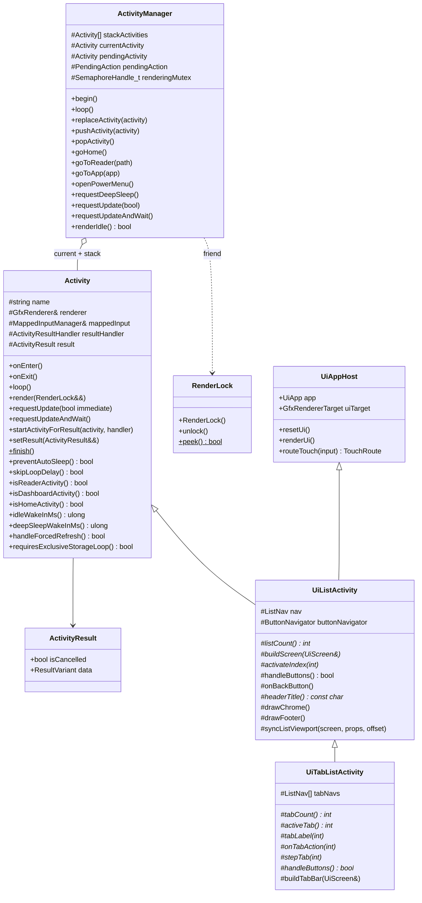
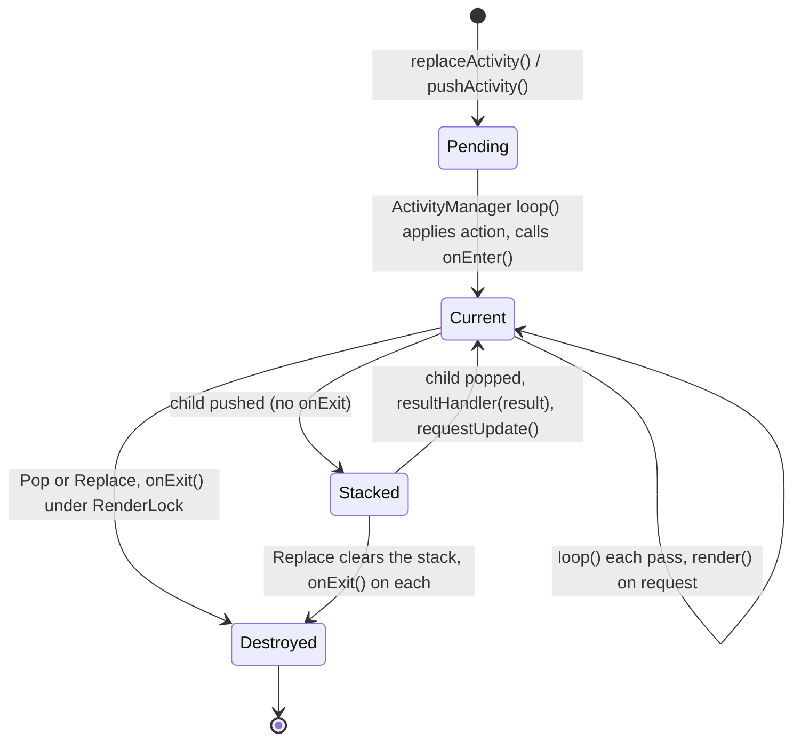
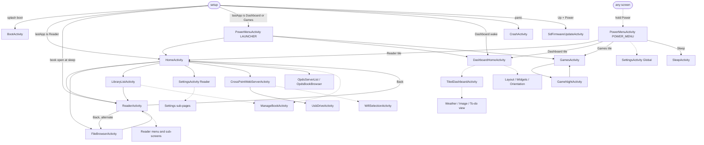
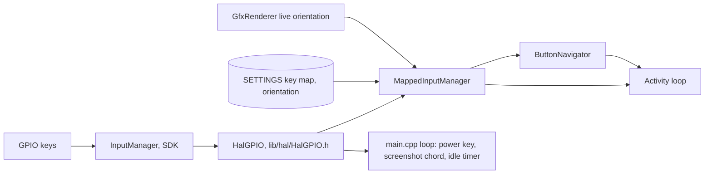
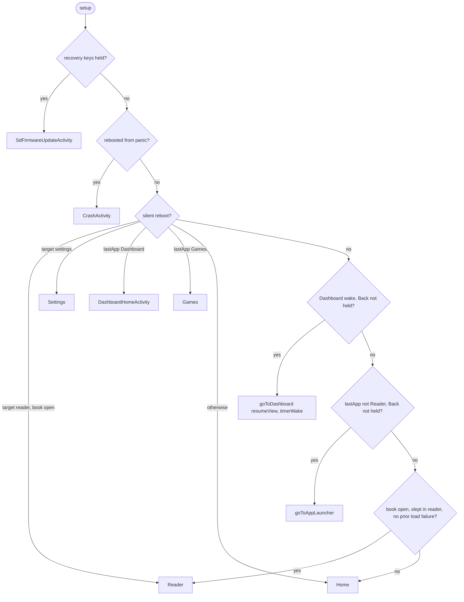

# e-Minimal Firmware: Application Framework

| | |
|---|---|
| **Status** | Draft |
| **Applies to** | commit `36f4315e` (branch `master`, build target `[env:eminimal]`) |
| **Audience** | Firmware developers adding or changing screens, input handling, settings or persisted state |
| **Scope** | Everything between the HAL and a screen: activities, navigation, input mapping, stores, UI components, sleep and idle |
| **Related** | [01-system-overview.md](01-system-overview.md), [02-display-pipeline.md](02-display-pipeline.md), [04-dashboard-and-games.md](04-dashboard-and-games.md), [05-network-and-storage.md](05-network-and-storage.md), [06-build-flash-release.md](06-build-flash-release.md) |

## Table of contents

1. [Overview](#1-overview)
2. [The activity model](#2-the-activity-model)
3. [Activity map and navigation](#3-activity-map-and-navigation)
4. [Input](#4-input)
5. [Application state and settings](#5-application-state-and-settings)
6. [UI components, themes, fonts and i18n](#6-ui-components-themes-fonts-and-i18n)
7. [Sleep, wake and idle behaviour](#7-sleep-wake-and-idle-behaviour)
8. [How to add a new activity](#8-how-to-add-a-new-activity)
9. [Design rules and pitfalls](#9-design-rules-and-pitfalls)
10. [Relationship to existing documents](#10-relationship-to-existing-documents)
11. [Open questions](#11-open-questions)

---

## 1. Overview

The application is a set of **activities**. An activity is one screen. Exactly one activity is current at any time. Others may wait beneath it on a stack.

Three global objects, defined in `src/main.cpp`, form the framework:

| Object | Type | Role |
|---|---|---|
| `renderer` | `GfxRenderer` | Drawing surface and orientation. See [02-display-pipeline.md](02-display-pipeline.md). |
| `mappedInputManager` | `MappedInputManager` | Translates physical keys into logical buttons. |
| `activityManager` | `ActivityManager` | Owns the current activity, the stack, and the render task. |

Two FreeRTOS tasks run application code:

- The **loop task** (Arduino `loop()` in `src/main.cpp`) polls input, runs global power-key and sleep logic, then calls `ActivityManager::loop()`, which calls the current activity's `loop()`.
- The **render task** (`ActivityManager::renderTaskLoop()`) blocks on a task notification and calls the current activity's `render()` under the render mutex.

Persistent data lives in singleton stores (`SETTINGS`, `APP_STATE`, `RECENT_BOOKS`, and others) that serialise to JSON files on the SD card.

On e-Minimal the firmware presents three top-level **apps**: Reader, Dashboard and Games (`AppId` in `src/CrossPointState.h`). The power key's long-press menu switches between them.

---

## 2. The activity model

### 2.1 Base types

| Type | File | Purpose |
|---|---|---|
| `Activity` | `src/activities/Activity.h` | Base class. Lifecycle hooks, result plumbing, capability flags. |
| `ActivityManager` | `src/activities/ActivityManager.h` | Current activity, stack, pending transitions, render task, render mutex. |
| `RenderLock` | `src/activities/RenderLock.h` | RAII guard on `ActivityManager::renderingMutex`. |
| `ActivityResult` | `src/activities/ActivityResult.h` | `isCancelled` plus a `std::variant` of typed result structs. |
| `UiAppHost` | `src/components/UiAppHost.h` | Hosts a FreeInkUI app (`FreeInkApp<24, 6>`), its render target and the touch-routing gate. |
| `UiListActivity` | `src/activities/UiListActivity.h` | `Activity` + `UiAppHost` for a single-list screen. |
| `UiTabListActivity` | `src/activities/UiTabListActivity.h` | `UiListActivity` with a tab band above the list. |



Activities that are neither lists nor trivial (sliders, state machines) derive from `Activity` and inherit `UiAppHost` privately, for example `WifiSelectionActivity` and `IntervalSelectionActivity`. The comment at the top of `UiListActivity.h` states this rule.

### 2.2 Lifecycle

`ActivityManager` never destroys an activity synchronously from inside its own code. Navigation calls only record a **pending action** (`PendingAction::Push`, `Pop` or `Replace`). `ActivityManager::loop()` applies it after the current activity's `loop()` returns.



Facts that follow from `ActivityManager::loop()`:

- `onEnter()` runs once, on the loop task, with the render lock **released**.
- `onExit()` runs with the render lock **held**, so no render is in flight during teardown (`ActivityManager::exitActivity()`).
- A stacked activity does **not** receive `onExit()` when a child is pushed, and does **not** receive `onEnter()` again when the child is popped. It receives its result handler, then an automatic `requestUpdate()`.
- A `Replace` calls `onExit()` on the current activity and on every stacked activity, top first.
- Popping the last activity calls `goHome()`.
- Pending actions are processed in a `while` loop. An `onEnter()` or a result handler may request another transition, which is applied in the same pass.
- If the very first activity is launched while `currentActivity` is null, `replaceActivity()` enters it immediately.

`Activity::onEnter()` and `Activity::onExit()` only log. Subclasses call the base first in `onEnter()`. In `onExit()` most existing activities also call the base first (for example `ReaderActivity::onExit()`), while `AGENTS.md` shows it last; because the base only logs, the order has no effect.

### 2.3 Navigation API

| Call | Effect | Typical use |
|---|---|---|
| `activityManager.replaceActivity(a)` | Destroy current, clear stack, enter `a` | Root screens |
| `activityManager.goHome()`, `goToReader(path)`, `goToSettings()`, `goToFileBrowser()`, `goToLibrary()`, `goToBrowser()`, `goToFileTransfer()`, `goToUsbDrive()`, `goToDashboard()`, `goToGames()`, `goToGameNight(game)`, `goToApp(app)`, `goToAppLauncher()` | Wrappers over `replaceActivity()` | Top-level navigation |
| `startActivityForResult(a, handler)` | Store `handler` on the caller, push `a` | Sub-screens, dialogs |
| `setResult(r)` then `finish()` | Record result, request pop | Returning from a sub-screen |
| `Activity::onGoHome()`, `Activity::onSelectBook(path)` | Static shims for `goHome()` / `goToReader()` | Legacy call sites (marked TODO in `Activity.h`) |

The wrappers for app roots (`goHome()`, `goToReader()`, `goToDashboard()`, `goToGames()`, `goToGameNight()`), which `goToApp()` delegates to, call `ActivityManager::noteApp()`, which records `APP_STATE.lastApp` and `APP_STATE.resumeBookOnReturn` and saves the state file only when the app changes.

`goToReader()` dispatches by file type: BMP and PNG paths open `BmpViewerActivity`; everything else goes through `ReaderActivity::create()`, which picks `EpubReaderActivity`, `TxtReaderActivity` or `XtcReaderActivity`.

Root-screen wrappers added by this fork allocate with `makeUniqueNoThrow` and log `OOM` on failure instead of aborting (for example `ActivityManager::goToGames()`).

### 2.4 Returning results

`ActivityResult::data` is a `std::variant` (`ResultVariant` in `ActivityResult.h`). The alternatives at this commit are `std::monostate` (the default, no value), `WifiResult`, `KeyboardResult`, `MenuResult`, `ChapterResult`, `PercentResult`, `IntervalResult`, `PageResult`, `ProgressChangeResult`, `NetworkModeResult`, `FootnoteResult`, `FilePathResult` and `HighlightResult`.

A child returns a value with `setResult(KeyboardResult{text}); finish();`. A child that calls `finish()` without `setResult()` returns a default `ActivityResult`. Callers check `result.isCancelled` and then `std::get_if<T>(&result.data)`. `ActivityManager::openPowerMenu()` shows the pattern.

A new result type requires a new struct and a new alternative in `ResultVariant`.

### 2.5 Requesting a render

| Call | Behaviour |
|---|---|
| `requestUpdate()` | Sets `requestedUpdate`. One notification is sent to the render task at the end of the current `ActivityManager::loop()` pass. Multiple calls in one pass collapse into one render. |
| `requestUpdate(true)` | Notifies the render task immediately. Does not wait. |
| `requestUpdateAndWait()` | Notifies and blocks the caller until the render completes. Asserts if called from the render task, while holding a `RenderLock`, or while another task is already waiting. |

`ActivityManager::renderIdle()` returns true when no render is requested, queued or running. It combines `requestedUpdate` with `renderPending`, which is set in `notifyRender()` and cleared once the render task holds the lock. The reader uses it to drop page turns pressed during a draw (`ReaderActivity::pageDrawBusy()`), and the idle light sleep uses it to avoid freezing a repaint (`idleLightSleep()` in `src/main.cpp`).

### 2.6 Render synchronisation

The render task:

1. Waits in `ulTaskNotifyTake()`.
2. Takes a `RenderLock`, then reads `currentActivity`. Taking the lock first closes the window in which the loop task could delete the activity.
3. Holds a `HalPowerManager::Lock` so the CPU is not in low-power mode during the draw.
4. Applies night mode: `display.setInverted(SETTINGS.screenInverted != 0)`.
5. Calls `currentActivity->render(std::move(lock))`.
6. Notifies any task blocked in `requestUpdateAndWait()`.

Rules for activity authors:

- State that `render()` reads and `loop()` writes must be changed under a `RenderLock`, or be atomic.
- Never hold a `RenderLock` across blocking work (network, long SD reads).
- Never call `requestUpdateAndWait()` while holding a `RenderLock`.
- `ActivityManager::loop()` deliberately holds no lock while calling `Activity::loop()`.

Task parameters on this target (`ActivityManager::begin()`):

| Parameter | Value | Reason |
|---|---|---|
| Render task stack | 16384 bytes | `CROSSPOINT_VECTOR_FONTS` is 1 when `BOARD_HAS_PSRAM` is defined (`lib/EpdFont/VectorFontSupport.h`); FreeType rasterisation runs on this task. 8192 bytes otherwise. |
| Render task core | 1 | Pinned to core 1 when `configNUM_CORES > 1`, keeping long renders off core 0's idle watchdog. |
| Render task priority | 1 | Same as upstream. |
| Loop task stack | 24 KB | `SET_LOOP_TASK_STACK_SIZE(24 * 1024)` in `src/main.cpp`, vector-font boards only. |

On the dual-core ESP32-S3 the two tasks can run truly in parallel. The locking rules are therefore strict requirements, not conventions.

### 2.7 List base classes

`UiListActivity` supplies `onEnter()`, `loop()` and `render()`. A subclass provides:

| Hook | Required | Purpose |
|---|---|---|
| `listCount()` | yes | Row count, re-read each loop pass. |
| `buildScreen(UiScreen&)` | yes | Build the FreeInkUI screen. Runs on the render task. Call `syncListViewport()` immediately before `screen.list(props)`. |
| `activateIndex(int)` | yes | Row activated by Confirm or tap. Call `app.clearTapFlash()` before leaving the screen. |
| `headerTitle()` | no | Title for the default `drawChrome()`. |
| `onBackButton()` | no | Default is `finish()`. |
| `handleButtons()`, `navigateButtons()`, `handleCustomInput()` | no | Override to change Back/Confirm semantics, the Up/Down walk, or to intercept the pass. |
| `drawFooter()` | no | Button hints. Default is Back / Select / Up / Down. |
| `onRowLongPress(int)` | no | Touch long-press; requires `wantsTouchLongPress` in the constructor. |

The default `loop()` order is: `handleCustomInput()`, `handleButtons()`, touch routing, swipe scroll, `navigateButtons()`. The default `render()` is: clear, `drawChrome()`, `renderUi()`, up to eight rebuild passes while the list reports a layout correction, `drawFooter()`, `renderer.displayBuffer()`.

`UiTabListActivity` adds a ring in which position 0 is the tab band and positions 1..N are rows. Each tab keeps its own `ListNav`. `handleButtons()` is pure virtual there because the two users (`SettingsActivity`, `TextSettingsActivity`) differ on press-versus-release and on what Back does. `LibraryListActivity` is the third subclass.

---

## 3. Activity map and navigation

Activity `name` strings are used for a few identity checks in `ActivityManager` (`isPowerMenuOpen()`, `dashboardViewOpen()`, `goHome()`'s initial-item mapping). Treat them as part of the contract.

### 3.1 Root (`src/activities/`)

| Activity | Purpose | Reached from |
|---|---|---|
| `PowerMenuActivity` | Power menu (`Mode::POWER_MENU`) and app launcher (`Mode::LAUNCHER`) | `ActivityManager::openPowerMenu()` on a Power hold; `goToAppLauncher()` at boot or wake |

### 3.2 `boot_sleep`

| Activity | Purpose | Reached from |
|---|---|---|
| `BootActivity` | Splash: logo, product name, version. Draws in `onEnter()`. | `goToBoot()` on a splash boot in `setup()` |
| `SleepActivity` | Paints the sleep screen (or nothing with `keepScreen`). Draws in `onEnter()`. | `goToSleep()` from `enterDeepSleep()` |

### 3.3 `home`

| Activity | Purpose | Reached from |
|---|---|---|
| `HomeActivity` | Reader app home: current book, cover grid, bottom tabs | `goHome()` |
| `FileBrowserActivity` | SD card folder browser with rename and delete; in `Mode::PickFirmware` it lists only `.bin` files and returns the path | `goToFileBrowser()`; Home; reader Back (long or short, by setting); `BmpViewerActivity`; `SdFirmwareUpdateActivity` (pushed as the picker) |
| `CrashActivity` | Shows panic information after a crash reboot | `goToCrashReport()` in `setup()` |

### 3.4 `library`

| Activity | Purpose | Reached from |
|---|---|---|
| `LibraryListActivity` | Tabbed library index with search | `goToLibrary()` from Home |
| `ManageBookActivity` | Per-book details and metadata overrides | Home and Library (hold Select) |

### 3.5 `reader`

| Activity | Purpose | Reached from |
|---|---|---|
| `ReaderActivity` | Abstract base: page turns, Back navigation, end-of-book options, forced refresh | `ReaderActivity::create()` |
| `EpubReaderActivity`, `TxtReaderActivity`, `XtcReaderActivity` | Format readers | `goToReader()` |
| `EpubReaderMenuActivity`, `XtcReaderMenuActivity` | Reader menu | Select in the reader. `TxtReaderActivity` has no menu and no sub-screens: it does not override `handleFormatInput()` |
| `ReaderHoldMenuActivity` | Hold-Select popup: Highlight / Dictionary / Bookmark | Hold Select in the EPUB reader |
| `EpubReaderChapterSelectionActivity`, `XtcReaderChapterSelectionActivity` | Table of contents | Reader menu |
| `EpubReaderPercentSelectionActivity` | Go to percent | Reader menu |
| `EpubReaderBookmarksActivity`, `EpubReaderHighlightsActivity`, `EpubReaderFootnotesActivity` | Lists that jump within the book | Reader menu |
| `HighlightSelectActivity` | Two-step range picker on the page | Hold-Select action |
| `DictionaryWordSelectActivity`, `DictionaryDefinitionActivity`, `DictionaryChooserActivity` | Word picker, definition viewer, dictionary list | Hold-Select action or reader menu |
| `QrDisplayActivity` | Shows the current section's text as a QR code | EPUB reader menu (`DISPLAY_QR`) |
| `KOReaderSyncActivity` | KOReader progress sync | Excluded from `[env:eminimal]` by `build_src_filter` and `FREEINK_NO_KOSYNC` |

### 3.6 `browser`

| Activity | Purpose | Reached from |
|---|---|---|
| `OpdsBookBrowserActivity` | OPDS catalogue browse and download | `goToBrowser()` (direct with one server), `OpdsServerListActivity` in picker mode |

### 3.7 `dashboard` and `games`

See [04-dashboard-and-games.md](04-dashboard-and-games.md) for internals.

| Activity | Purpose | Reached from |
|---|---|---|
| `DashboardHomeActivity` | Dashboard app root | `goToDashboard()` |
| `TiledDashboardActivity` | The launched dashboard (`name == "Dashboard"`) | Dashboard home; boot with `resumeView` |
| `WeatherDashboardActivity`, `CarouselDashboardActivity`, `TodoDashboardActivity` | A widget opened full screen | Tiled dashboard |
| `LayoutPickerActivity`, `WidgetsActivity`, `OrientationPickerActivity` | Dashboard configuration | Dashboard home |
| `DashboardPortalActivity` | Raises Wi-Fi and shows a QR to a web page | Layout picker, Widgets, Manage Dictionaries |
| `TimedDashboardActivity` | Abstract base for timer-driven dashboard screens | Base of tiled, weather and carousel screens |
| `GamesActivity` | Games app root, radio off | `goToGames()` |
| `GameNightActivity` | Hosts one party game over a hotspot | `goToGameNight(game)` from the picker |

### 3.8 `network`

| Activity | Purpose | Reached from |
|---|---|---|
| `CrossPointWebServerActivity` | File Transfer: mode choice, Wi-Fi, web server | `goToFileTransfer()` from Home; `ManageBookActivity` |
| `NetworkModeSelectionActivity` | Join a Network / Create Hotspot / USB Drive / Game Night choice (`NetworkMode`) | File Transfer, Dashboard portal |
| `WifiSelectionActivity` | Scan, select, connect; returns `WifiResult` | Any screen that needs Wi-Fi |
| `UsbDriveActivity` | USB mass storage; owns the raw SD card | `goToUsbDrive()` from File Transfer |
| `FirmwareInstallActivity` | Receives a firmware image over Wi-Fi | Global Settings |
| `CalibreConnectActivity` | Calibre wireless | Excluded from `[env:eminimal]` |

### 3.9 `settings`

| Activity | Purpose | Reached from |
|---|---|---|
| `SettingsActivity` | Tabbed settings. `Scope::Reader` (`"Settings"`) or `Scope::Global` (`"GlobalSettings"`) | `goToSettings()` from Home; power menu row (Global) |
| `SettingRowsActivity` | Base for a short sub-page built from `SettingsList` rows | Base of the three below |
| `SleepScreenSettingsActivity`, `ChargeBadgeSettingsActivity`, `SecuritySettingsActivity` | Global sub-pages | Global Settings |
| `TextSettingsActivity` | Font, size, layout, style with live preview | Settings; EPUB reader menu |
| `StatusBarSettingsActivity` | Reader status bar composition | Settings |
| `ButtonRemapActivity` | Front-key remap wizard | Settings > Controls |
| `HomeButtonSettingsActivity` | Home-key gestures; gated on `hasHomeKey()`, absent on this board | Settings |
| `ClockSettingsActivity`, `TimezonePickerActivity`, `ClockSyncActivity` | Clock, timezone, NTP | Settings |
| `LanguageSelectActivity`, `KeyboardLayoutsActivity` | UI language, keyboard layouts | Settings |
| `ManageDictionariesActivity` | Dictionary list and management | Settings > Reader |
| `FontDownloadActivity` | Download SD font families | Settings |
| `OpdsServerListActivity`, `OpdsSettingsActivity` | OPDS servers | Settings; `goToBrowser()` |
| `ClearCacheActivity`, `AboutActivity` | Removes the book cache folders under `/.e-minimal/` after a confirmation; device info | Settings; About is in Global Settings on this board |
| `SdFirmwareUpdateActivity` | Firmware update from an image on the SD card | Global Settings; recovery boot; `FirmwareInstallActivity` |
| `OtaUpdateActivity` | Network update check | Not offered on this target: in `SettingsActivity::rebuildSettingsLists()` the Global row is under `#if !FREEINK_DEVICE_EMINIMAL` and the Reader-scope row under `if (!globalMoved)` |
| `KOReaderSettingsActivity`, `KOReaderAuthActivity` | KOReader account | Excluded from `[env:eminimal]` |

### 3.10 `util`

| Activity | Purpose | Reached from |
|---|---|---|
| `TextEntryActivity` | Chooses device keyboard or phone entry; returns `KeyboardResult` | Any text field |
| `KeyboardEntryActivity`, `PhoneTextEntryActivity` | The two text-entry methods | `TextEntryActivity`; Wi-Fi password |
| `ConfirmationActivity` | Cancel/Confirm popup; the answer is `isCancelled` | Destructive actions (delete, reset) in Library, File Browser, Book Details, Manage Dictionaries, Security and font management |
| `IntervalSelectionActivity` | Slider dialog returning `IntervalResult` | Time to Sleep in Reader-scope Settings (`openSleepTimeoutPicker()`). Not reached on this board: Time to Sleep is in Global Settings, which uses a preset popup (`openSleepPresetPopup()`) |
| `FullScreenMessageActivity` | One centred message | `goToFullScreenMessage()` (SD card error) |
| `BmpViewerActivity` | Image viewer | `goToReader()` for BMP/PNG |
| `FrontlightPanelActivity` | Control-centre sheet | Light-panel gesture in `ActivityManager::loop()`; requires a frontlight, which this board lacks |

### 3.11 Navigation graph

Solid arrows replace the stack. Dashed arrows push and return.



The Reader tile resumes the open book instead of Home when `APP_STATE.resumeBookOnReturn` is set (`ActivityManager::goToApp()`).

---

## 4. Input

### 4.1 Layers



`MappedInputManager::update()` is called once per pass at the top of `loop()` in `src/main.cpp`. It calls `gpio.update()`. `InputManager` (`freeink-sdk/libs/hardware/InputManager/`) debounces: a changed raw state is committed only after it has held for more than `DEBOUNCE_DELAY` (5 ms), so a press needs two consecutive polls that agree.

### 4.2 Physical keys on e-Minimal

The board profile `EMINIMAL_78` (`freeink-sdk/libs/hardware/BoardConfig/include/BoardConfig.h`) declares five active-low digital keys. Left and Right are `PIN_UNASSIGNED`.

| Key | GPIO | `HalGPIO` index | Default logical role |
|---|---|---|---|
| Back | 7 | `BTN_BACK` (0) | `Button::Back` |
| Select | 6 | `BTN_CONFIRM` (1) | `Button::Confirm` |
| Up | 4 | `BTN_UP` (4) | `Button::Up`, `PageBack`, `NavPrevious` |
| Down | 5 | `BTN_DOWN` (5) | `Button::Down`, `PageForward`, `NavNext` |
| Power | 15 | `BTN_POWER` (6) | `Button::Power` (never remapped) |

`five_button::active()` (`src/util/FiveButtonInput.h`) is the runtime predicate for this hardware class: no touch, digital buttons, Left or Right unassigned. Application code branches on it rather than on a device `#if`.

### 4.3 Logical mapping

`MappedInputManager::mapButton()` resolves a logical `Button` to hardware:

- **Back, Confirm**: `SETTINGS.buttonMapBack` / `buttonMapConfirm` on five-button boards.
- **Up, Down**: `MappedInputManager::upDownKey()`. It reads `SETTINGS.buttonMapUp` / `buttonMapDown` and swaps them when `isNavDirectionSwapped()` is true.
- **PageBack, PageForward**: Up/Down through `SETTINGS.sideButtonLayout` (`PREV_NEXT` or `NEXT_PREV` are offered here).
- **NavNext, NavPrevious**: Down-or-Right and Up-or-Left. `ButtonNavigator` uses these.
- **ScreenLeft/Right/Up/Down**: rotated by `mapScreenDirection()`; not rotated a second time on five-button boards.
- **Left, Right**: map to unassigned pins and never fire on this board.

The key map is stored as `buttonMapBack`, `buttonMapConfirm`, `buttonMapUp`, `buttonMapDown`. `CrossPointSettings::validateButtonMap()` resets it unless it is a permutation of the four `FIVE_HW_*` indices. `ButtonRemapActivity` edits it and reads raw keys through `getPressedFrontButton()` / `getReleasedFrontButton()`.

Button hints follow the same mapping: `mapLabels(back, confirm, previous, next)` returns four labels in physical left-to-right order.

`src/HomeButtonSettings.h` holds label and field tables for the capacitive Home key (`home_button::ACTION_LABELS`, `FIELDS`, `KEYS`). `MappedInputManager::update()` only evaluates Home-key gestures when `gpio.hasHomeKey()` is true. The e-Minimal board has no Home key, so `homeButtonAction()` stays `Ignore` and `wasHomeGesture()` never fires.

### 4.4 Press, long press and repeat

| API | Semantics |
|---|---|
| `wasPressed(b)` / `wasReleased(b)` | Edge events for this pass. |
| `isPressed(b)` | Level. |
| `getHeldTime()` | Milliseconds the current or last contact was held. |
| `wasLongPressed(b, ms)` | One-shot while still held past the threshold. Marks the button so its release is swallowed. |
| `consumeSuppressedRelease()` | Called first in `ActivityManager::loop()`. If a suppressed release arrives, the whole pass is skipped, so a long press never also acts as a short press. |

Two patterns are in use:

1. **Act on release, classify by held time.** Example: `ReaderUtils::handleBackNavigation()` compares `getHeldTime()` with `GO_BACK_OR_HOME_MS` (1000 ms). It also fires at the threshold through `wasLongPressed()`, so a long hold acts without waiting for the release.
2. **`wasLongPressed()`** for an action that fires while the key is still down.

`ButtonNavigator` (`src/util/ButtonNavigator.h`) wraps list navigation. `onNextRelease` / `onPreviousRelease` step once. `onNextContinuous` / `onPreviousContinuous` repeat while held; defaults are 500 ms to start and 500 ms between repeats. A release that follows a continuous run does not also step.

Hold thresholds are local constants, for example `SKIP_HOLD_MS` 700 and `BOOKMARK_HOLD_MS` 400 in `src/activities/reader/ReaderUtils.h`, and `ACTIONS_HOLD_MS` 700 in `TodoDashboardActivity.cpp` and `ManageDictionariesActivity.cpp`. User-facing behaviour per screen is in [../eminimal-controls.md](../eminimal-controls.md).

### 4.5 The power key

The power key is handled in `loop()` in `src/main.cpp`, before `activityManager.loop()`. On e-Minimal:

| Condition | Result |
|---|---|
| Held more than `POWER_MENU_HOLD_MS` (700 ms), Down not pressed | `activityManager.openPowerMenu()`, once per hold (`powerMenuHoldLatched`). The release is swallowed (`swallowPowerRelease`). |
| Power and Down both pressed | Screenshot via `ScreenshotUtil::takeScreenshot()` under a `RenderLock`. Physical keys; ignores the key map. |
| Short release, `SETTINGS.shortPwrBtn == FORCE_REFRESH` | `activityManager.handleForcedRefresh()`, else a promoted half refresh. |
| Within 2 s of `setup()` (`allowSleepAt`) or before the wake hold is released (`powerReleasedSinceWake`, `wakePowerReleasePending`) | Ignored, so the wake gesture cannot act in the app. |

The other `shortPwrBtn` values are consumed elsewhere: `PAGE_TURN` in `ReaderUtils::detectPageTurn()` and `FOOTNOTES` in `EpubReaderActivity::loop()`. `PWR_CONFIRM` is touch-only (`MappedInputManager::wasPowerConfirmClick()`, compiled under `FREEINK_CAP_TOUCH`) and is not offered here. `SLEEP` has no short-press action in the e-Minimal branch of `loop()`; in `setup()` it lets a single click wake the device without the hold.

`openPowerMenu()` is a no-op when there is no current activity, when the power menu is already on top, or when a transition is pending.

### 4.6 Power menu and app switcher

`PowerMenuActivity` (`src/activities/PowerMenuActivity.*`) is a `UiListActivity` with a custom ring: three app tiles (`APP_TILES`: Reader, Dashboard, Games) followed by three rows (`Action::SLEEP`, `GLOBAL_SETTINGS`, `REFRESH_SCREEN`).

| Element | `POWER_MENU` mode | `LAUNCHER` mode |
|---|---|---|
| Initial cursor | Sleep row, so hold Power then Select sleeps | Tile of `APP_STATE.lastApp` |
| Tile of the open app | Closes the menu | Switches to it |
| Other tile | `activityManager.goToApp(target)` | Same |
| Sleep | `activityManager.requestDeepSleep()` | Same |
| Global Settings | Pushes `SettingsActivity(Scope::Global)` | Same |
| Refresh Screen | Returns `MenuResult{REFRESH_SCREEN}`; `openPowerMenu()`'s handler calls `handleForcedRefresh()` on the screen beneath | Repaints itself with a half refresh |
| Back | `finish()` | Nothing; it is a root screen (`isHomeActivity()` is true) |

Sleep does not call `finish()`. The activity sets a flag; `loop()` in `main.cpp` reads it with `consumeDeepSleepRequest()` and calls `enterDeepSleep()`. An activity must not sleep the device itself, because `enterDeepSleep()` re-enters `ActivityManager::loop()` to paint the sleep screen.

Both modes use the name `"PowerMenu"`, so a Power hold over the launcher does not stack a second menu.

### 4.7 Orientation

There are two orientation settings:

- `SETTINGS.orientation` turns the whole device UI on e-Minimal. `ui_orientation::apply()` (`src/util/UiOrientation.h`) applies it when `BoardConfig::isEMinimal78()`; other boards keep the UI portrait. It is called in `setup()`, in `ReaderActivity::onExit()`, when the setting changes (`SettingsActivity::applyUiSettingChange()`), and by Dashboard screens that return from the launched dashboard's own orientation.
- `SETTINGS.dashboardOrientation` turns only the launched dashboard (`dashboard_grid::applyOrientation()`).

`MappedInputManager` reads the **live** orientation from `renderer.getUiOrientation()`, not from settings. With `SETTINGS.frontButtonFollowOrientation` on, Up and Down swap in `PortraitInverted` and `LandscapeCounterClockwise` (`isNavDirectionSwapped()`), and `mapLabels()` swaps the hints to match.

Sleep images are always drawn portrait (`SleepActivity::onEnter()`). The panel is mounted upside down in the case; the 180-degree turn is applied in the renderer and is invisible to application code. See [02-display-pipeline.md](02-display-pipeline.md).

---

## 5. Application state and settings

### 5.1 Store pattern

Every store derives from `PersistableStore<T>` (`lib/Serialization/PersistableStore.h`), a CRTP singleton that requires `getFilePath()`, `toJson()` and `fromJson()`.

- `saveToFile()` and `loadFromFile()` serialise against each other with `storeMutex`.
- Writes go to a `.tmp` file that is renamed into place. Stores keep a `.bak` of the previous good file, and `loadFromFile()` falls back to it.
- `fromJson()` signals a format upgrade with `requestResave()`. It must not call `saveToFile()` (deadlock).
- Read accessors do not take `storeMutex`. This keeps SD I/O off the render path (see the comment on `CrossPointSettings::statusBarSpec()`).

On-disk formats and the `/.e-minimal/` layout are described in [05-network-and-storage.md](05-network-and-storage.md).

### 5.2 Stores

| Store (macro) | File | Owns | Loaded | Saved |
|---|---|---|---|---|
| `CrossPointSettings` (`SETTINGS`) | `settings.json` | All user preferences: reader text, status bar, sleep, key map, orientation, theme, security, charge badge | `setup()` | By each settings editor after a change |
| `CrossPointState` (`APP_STATE`) | `state.json` | Runtime state: `openEpubPath`, `lastApp`, `resumeBookOnReturn`, sleep flags, `showBootScreen`, `readerActivityLoadCount`, recent sleep images, `carouselIndex`, `dashboardPortalMode` | `setup()` | `enterDeepSleep()`, `ActivityManager::noteApp()`, boot routing in `setup()`, readers |
| `RecentBooksStore` (`RECENT_BOOKS`) | `recent.json` | Up to `MAX_RECENT_BOOKS` (10) entries: path, title, author, cover path | `setup()` | On add, update, remove |
| `OpdsServerStore` (`OPDS_STORE`) | `opds.json` | Up to 8 OPDS servers; passwords obfuscated on disk | `setup()`; reloaded in `OpdsServerListActivity` | On add, update, remove |
| `WifiCredentialStore` (`WIFI_STORE`) | `wifi.json` | Saved networks and last connected SSID; own mutex for in-memory strings | On demand: `WifiSelectionActivity::onEnter()` and `saved_wifi::hasSavedNetworks()` (`src/network/SavedWifi.cpp`, used by the Weather fetch) | On credential change |
| `DashboardConfigStore` (`DASHBOARD_CONFIG`) | `dashboards.json` | Dashboard layouts, active layout, widget settings | By dashboard screens on entry; first by `card_folders::ensure()` at boot | By the web API and `LayoutPickerActivity` |
| `TodoStore` (`TODO_STORE`) | `todo.json` | To-do items (50 items, 80 characters) | `load()` on dashboard entry, `unload()` on exit | Caller, outside any render lock |
| `KOReaderCredentialStore` | `koreader.json` | KOReader account | Not built on this target (`FREEINK_NO_KOSYNC`) | n/a |

All paths are under `/.e-minimal/`. `migrateLegacyDataDir()` in `src/main.cpp` renames an older `/.crosspoint` folder once.

Per-book data (reading progress, bookmarks, highlights) is not held in singleton stores. It is handled by `src/util/BookProgress.*`, `src/util/BookmarkFile.*` and `src/util/HighlightStore.*`, and owned by the reader.

Boot order in `setup()` matters: `APP_STATE` loads first, then `SETTINGS`, then `RECENT_BOOKS`, then `I18N.setLanguage()`, then `card_folders::ensure()` (which needs the language for default layout names), then `OPDS_STORE`, then `UITheme::reload()`.

### 5.3 `SettingsList.h`

`getSettingsList()` (`src/SettingsList.h`) returns a `std::vector<SettingInfo>`. It is the single description of every setting and has three consumers:

1. **Persistence.** `CrossPointSettings::fromJson()` and `toJson()` loop over it. A new field with a `SettingInfo` entry and a `key` needs no hand-written JSON code. Values are clamped to the entry's range on load.
2. **Device UI.** `SettingsActivity::rebuildSettingsLists()` distributes entries into tabs by `category`. `SettingRowsActivity` builds sub-pages from the same entries.
3. **Web API.** The web settings page lists and writes the same entries. See [05-network-and-storage.md](05-network-and-storage.md).

`SettingInfo` (`src/activities/settings/SettingsActivity.h`) fields that control exposure:

| Field | Effect |
|---|---|
| `category == STR_NONE_OPT` | Persisted but hidden from the device Settings screen |
| `deviceOnly` | Persisted and shown on the device; never listed or written by the web API |
| `inTextSettings` | Shown in Text Settings, hidden from the flat Reader tab |
| `obfuscated` | Stored under `<key>_obf` in obfuscated form |
| `valueGetter` / `valueSetter` | Value lives outside `CrossPointSettings` or is computed (font family, font size) |

Fields not in the list are serialised by hand in `CrossPointSettings.cpp`, notably the front-button and five-button key maps.

**Enums are append-only.** `CrossPointSettings.h` enums and their label arrays in `SettingsList.h` are persisted by index. Insert or reorder and existing cards load wrong values.

`SettingsActivity::Scope` splits settings on this board. `Scope::Reader` has four tabs (Display, Reader, Controls, System). `Scope::Global` has two (Power & Sleep, Display & System) and is reached only from the power menu.

---

## 6. UI components, themes, fonts and i18n

### 6.1 Themes

`UITheme` (`src/components/UITheme.h`) is a singleton. The `GUI` macro expands to `UITheme::getInstance().getTheme()` and returns a `BaseTheme`.

| Theme class | Folder | `UI_THEME` value |
|---|---|---|
| `BaseTheme` | `src/components/themes/` | `CLASSIC` |
| `LyraTheme` | `themes/lyra/` | `LYRA`, `COVER_GRID` |
| `Lyra3CoversTheme` | `themes/lyra/` | `LYRA_3_COVERS` |
| `RoundedRaffTheme` | `themes/roundedraff/` | `ROUNDEDRAFF` |
| `EMinimalTheme` | `themes/eminimal/` | `EMINIMAL` |

`EMinimalTheme` derives from `RoundedRaffTheme`, overrides `drawHeader()` and `drawButtonHints()`, and runs on `RoundedRaffMetrics::values`. This target defaults `uiTheme` to `EMINIMAL` and `CrossPointSettings::fromJson()` pins it there.

`BaseTheme` exposes the drawing vocabulary: `drawHeader`, `drawSubHeader`, `drawButtonHints`, `drawSideButtonHints`, `drawPopup`, `fillPopupProgress`, `drawTextField`, `drawButtonMenu`, `drawRecentBookCover`, `fillBatteryIcon`.

Layout numbers come from `UITheme::getMetrics()` (`ThemeMetrics`). On e-Minimal they are scaled by `UITheme::chromeScale()`, which returns `BoardConfig::ACTIVE.uiScale`. Use `UITheme::scaledPx()` for a hand-placed size that is not in the metrics table. `getScreenSafeArea()` returns the drawable rectangle after bezel and hint-bar insets.

Individual metrics can be patched at run time from the serial console (`CMD:METRICS`, `CMD:METRIC <name> <value>`, handled in `loop()` and `UITheme::setMetric()`). The value is not persisted.

### 6.2 Components

| Component | File | Role |
|---|---|---|
| `UiAppHost` | `UiAppHost.*` | FreeInkUI app host; the `uiReady` gate lets the loop task route touch against the interaction table the render task publishes |
| Theme tokens | `UIThemeTokens.h`, `UiAppHelpers.h` | Merge `ThemeMetrics` and font sizes into FreeInkUI tokens; swapped atomically so a render never sees a half-updated set |
| `UIScaleSpec` | `UIScale.h` | Font slots for FreeInkUI: small `UI_10`, body and title `UI_12` |
| `OptionPopup` | `OptionPopup.h` | Modal option list drawn over a screen |
| `UiSliderDialog` | `UiSliderDialog.h` | Shared slider dialog used by interval and percent selection |
| `EMinimalHomeUi`, `CoverGridHomeUi`, `HomeCoverCache` | same names | Cover-grid home page; `EMinimalHomeUi` is the 7.8" four-key variant; `HomeCoverCache` decodes the cover thumbnails and keeps PSRAM snapshots of the painted regions |
| `PhoneJoinPanel` | `PhoneJoinPanel.*` | Shared card for phone-join screens (`PhoneJoinPanel::draw()`): up to two numbered QR codes (join the network, open the page) with the typed fallback, a headline and a status line |
| Icons | `icons/*.h` | Bitmap icon tables |

All files are under `src/components/`.

### 6.3 Fonts

Font IDs are integer hashes in `src/fontIds.h`, generated by `lib/EpdFont/scripts/build-font-ids.sh`. ID 0 means "not found".

`setupDisplayAndFonts()` in `src/main.cpp` registers the built-in families with `renderer.insertFont()`. On e-Minimal the UI slots are a tier, not a literal size:

| Font ID | Registered family on e-Minimal | Use |
|---|---|---|
| `NOTOSERIF_18/20/22/24_FONT_ID` | Noto Serif 18-24 pt, four styles | Reader text (`DEFAULT_FONT_POINT_SIZE` is 20) |
| `UI_10_FONT_ID` | Ubuntu 20 px | Small UI text |
| `UI_12_FONT_ID` | Ubuntu 24 px | Body and titles |
| `SMALL_FONT_ID` | Noto Sans 16 px | Captions |
| `HINT_FONT_ID` (`EMinimalTheme.h`) | Noto Sans 12 px | Button legends only |

Do not select a font by its numeric suffix. Draw with the slot the theme gives you.

`SdCardFontSystem` (`src/SdCardFontSystem.*`, global `sdFontSystem`) is the facade for fonts on the SD card:

- `begin()` runs at the end of `setupDisplayAndFonts()`: discover families, load the saved selection.
- `ensureLoaded()` runs before the reader opens or after a settings change. It snaps `SETTINGS.fontPointSize` to a size the family provides.
- `markRegistryDirty()` is safe to call from the web server task; `refreshIfDirty()` rescans.
- It installs the resolver that `CrossPointSettings::getReaderFontId()` uses.
- It registers the active SD family at UI sizes as a script fallback, so titles in scripts the built-in UI fonts lack still render.
- `.ttf`/`.otf` families are supported when `CROSSPOINT_VECTOR_FONTS` is 1, which is the case here.

`FontInstaller` (`src/FontInstaller.*`) validates family names and `.cpfont` files, creates the family folder, deletes families and refreshes the registry. It is shared by `FontDownloadActivity` and the web upload path. Format details: [../sd-card-fonts.md](../sd-card-fonts.md).

### 6.4 Internationalisation

- Call `tr(STR_NAME)` for a string, or `I18N.get(StrId::STR_NAME)` when the ID is a value.
- Sources are YAML files in `lib/I18n/translations/`. `english.yaml` is the reference.
- `lib/I18n/I18nKeys.h` and `I18nStrings.{h,cpp}` are generated by `scripts/gen_i18n.py`. Do not edit or commit them.
- `[env:eminimal]` sets `custom_i18n_builtin_langs = en`, so only English is compiled in.
- The language is applied at boot with `I18N.setLanguage(SETTINGS.language)`.

Workflow and translator notes: [../i18n.md](../i18n.md).

---

## 7. Sleep, wake and idle behaviour

Hardware power paths are in [01-system-overview.md](01-system-overview.md). This section covers what application code sees.

### 7.1 Idle levels

| Level | Trigger | Implemented in |
|---|---|---|
| Loop delay 10 ms | Default | `loop()` |
| No delay (`yield()`) | `skipLoopDelay()` returns true (servers, long jobs) | `loop()` |
| CPU power saving, 50 ms slices | No input for `HalPowerManager::IDLE_POWER_SAVING_MS` | `loop()` |
| Light sleep between page turns | Reader or a Dashboard menu on top, nothing rendering, no USB host, Wi-Fi off | `idleLightSleep()` in `src/main.cpp` |
| Dashboard standby | 30 s without a key on a launched dashboard screen | `TimedDashboardActivity`, `IdleStandby` |
| Deep sleep | Auto-sleep timeout, power menu Sleep, or dashboard standby past the timeout | `enterDeepSleep()` |

The idle timer in `loop()` resets on any key press or release and whenever `activityManager.preventAutoSleep()` is true. An activity that must keep the device awake overrides `preventAutoSleep()`.

`idleLightSleep()` wakes on a key, on `Activity::idleWakeInMs()` (the reader's own timer, for example auto page turn), or at the auto-sleep deadline. It takes a `RenderLock` first, so a repaint is never frozen halfway.

### 7.2 Dashboard standby

`IdleStandby` (`src/activities/dashboard/IdleStandby.*`) serves dashboard screens without a timer of their own (the to-do list). `TimedDashboardActivity` implements the same behaviour for timer-driven screens.

- `poll()` is the first call in the owner's `loop()`. It returns true when the pass is consumed.
- After `IDLE_MS` (30 s) it light-sleeps under a `RenderLock` until a key goes down.
- The key that ends standby only wakes; its press and release are swallowed.
- Past the Time to Sleep setting it calls `activityManager.requestDeepSleep()`.
- It does not light-sleep with a USB host attached, because that drops the console.

### 7.3 Entering deep sleep

`enterDeepSleep()` in `src/main.cpp`:

1. Records `APP_STATE.lastSleepFromReader`, `lastSleepFromDashboard`, `dashboardViewOpen`, and clears `showBootScreen`. Saves the state file.
2. Sets `deepSleepInProgress`, so an `onExit()` that would normally call `silentRestart()` returns instead.
3. Calls `activityManager.goToSleep()`. This replaces the whole stack with `SleepActivity` and runs `ActivityManager::loop()` once so it paints immediately. From the Dashboard, `keepScreen` leaves the dashboard on the glass.
4. Saves the framebuffer for Quick Resume when that mode applies.
5. Shuts down Wi-Fi, the display and storage, then calls `powerManager.startDeepSleep()` with the Dashboard's timer wake (`ActivityManager::deepSleepWakeInMs()`), if any.

`SleepActivity::onEnter()` draws directly; it has no `render()`. It forces normal polarity, shows the "entering sleep" popup, switches to portrait and paints the selected sleep screen.

### 7.4 Boot and wake routing

A wake from deep sleep is a chip reset. `setup()` decides how to present it (`BootResume`) and where to go:



- Holding Back through boot forces Home.
- `APP_STATE.readerActivityLoadCount` is incremented before the reader is opened. A book that crashes the reader therefore does not cause a boot loop.
- A splash boot shows `BootActivity`; a wake or silent reboot keeps the retained frame until the first paint.
- On e-Minimal, `handleChargeWake()` handles wakes caused by the USB-detect line or the charge-badge timer. It updates the badge and sleeps again without starting the application, unless a key was pressed.

### 7.5 Silent restart

`src/SilentRestart.h` declares `silentRestart()`, `silentRestartToReader()`, `silentRestartToSettings()` and `restartToHomeAfterStorageHandoff()`. They are defined in `src/main.cpp`.

Purpose: Wi-Fi sessions fragment the heap. Activities that used the radio reboot on exit to recover it. The target and the live frontlight state travel in `RTC_NOINIT_ATTR` variables that survive `ESP.restart()` but not power loss.

Behaviour:

- A "Loading" popup is drawn first, so the user sees that input is not being taken.
- `setup()` reads and clears the flag, skips the splash, routes to the target, waits for the first paint with `requestUpdateAndWait()`, then absorbs any held key.
- The call returns without rebooting when deep sleep is in progress.

Callers at this commit include `CrossPointWebServerActivity`, `OpdsBookBrowserActivity`, `GameNightActivity`, `DashboardHomeActivity`, `DashboardPortalActivity`, `FirmwareInstallActivity`, `FontDownloadActivity`, `ClockSyncActivity`, `OtaUpdateActivity` and `SettingsActivity`.

`ActivityManager::isEnteringReader()` lets an `onExit()` choose `silentRestartToReader()` when the user is switching into a book.

---

## 8. How to add a new activity

### 8.1 Choose a base

| Screen shape | Base |
|---|---|
| A list of rows | `UiListActivity` |
| Tabs above a list | `UiTabListActivity` |
| A short page of settings rows | `SettingRowsActivity` |
| Anything else | `Activity` (add `private UiAppHost` if it uses FreeInkUI widgets) |

### 8.2 List screen skeleton

Modelled on `src/activities/reader/DictionaryChooserActivity.*`.

```cpp
// src/activities/util/ExampleListActivity.h
#pragma once

#include <vector>

#include "activities/UiListActivity.h"

class ExampleListActivity final : public UiListActivity {
 public:
  ExampleListActivity(GfxRenderer& renderer, MappedInputManager& mappedInput);

  void onEnter() override;

 private:
  int listCount() const override { return static_cast<int>(rowItems.size()); }
  void buildScreen(UiScreen& screen) override;
  void activateIndex(int index) override;
  const char* headerTitle() const override;

  std::vector<freeink::ui::ListItem> rowItems;  // built once in onEnter()
};
```

```cpp
// src/activities/util/ExampleListActivity.cpp
#include "ExampleListActivity.h"

#include <I18n.h>

#include <iterator>

#include "components/UITheme.h"

namespace fui = freeink::ui;

namespace {
constexpr StrId ROW_LABELS[] = {StrId::STR_SLEEP, StrId::STR_FORCE_REFRESH};
}

ExampleListActivity::ExampleListActivity(GfxRenderer& renderer, MappedInputManager& mappedInput)
    : UiListActivity("ExampleList", renderer, mappedInput) {}

void ExampleListActivity::onEnter() {
  UiListActivity::onEnter();  // resets nav, binds the screen, requests the first render
  rowItems.clear();
  rowItems.reserve(std::size(ROW_LABELS));
  for (size_t i = 0; i < std::size(ROW_LABELS); ++i) {
    fui::ListItem item;
    item.label = I18N.get(ROW_LABELS[i]);
    item.actionValue = static_cast<int16_t>(i);
    rowItems.push_back(item);
  }
}

const char* ExampleListActivity::headerTitle() const { return tr(STR_SETTINGS_TITLE); }

void ExampleListActivity::activateIndex(const int index) {
  if (index < 0 || index >= listCount()) return;
  app.clearTapFlash();
  setResult(MenuResult{index});
  finish();
}

void ExampleListActivity::buildScreen(UiScreen& screen) {
  const auto& metrics = UITheme::getInstance().getMetrics();
  const Rect safe = UITheme::getInstance().getScreenSafeArea(renderer, true, false);
  screen.setContentMarginFromScreen(fui::Insets{
      static_cast<int16_t>(safe.y + metrics.topPadding + metrics.headerHeight),
      static_cast<int16_t>(renderer.getScreenWidth() - (safe.x + safe.width)),
      static_cast<int16_t>(renderer.getScreenHeight() - (safe.y + safe.height)), static_cast<int16_t>(safe.x)});
  screen.spacer(static_cast<int16_t>(metrics.verticalSpacing));

  fui::ListProps props;
  props.items = rowItems.data();
  props.count = static_cast<uint16_t>(rowItems.size());
  props.action = ACTION_ROW;
  props.inputMask = fui::InputTouch;  // physical buttons stay in loop()
  syncListViewport(screen, props);
  screen.list(props);
}
```

The base class already handles Back (`finish()`), Confirm, Up/Down, hold-to-page, the header and the button hints.

### 8.3 Plain activity skeleton

```cpp
class ExampleActivity final : public Activity {
 public:
  ExampleActivity(GfxRenderer& renderer, MappedInputManager& mappedInput)
      : Activity("Example", renderer, mappedInput) {}

  void onEnter() override {
    Activity::onEnter();
    // allocate here; makeUniqueNoThrow + null check
    requestUpdate();
  }

  void onExit() override {
    // free in reverse order; close member files; delete any task
    Activity::onExit();
  }

  void loop() override {
    if (mappedInput.wasReleased(MappedInputManager::Button::Back)) {
      finish();
      return;
    }
    if (mappedInput.wasReleased(MappedInputManager::Button::Confirm)) {
      {
        RenderLock lock;  // render() reads counter
        counter++;
      }
      requestUpdate();
    }
  }

  void render(RenderLock&&) override {
    renderer.clearScreen();
    const auto& metrics = UITheme::getInstance().getMetrics();
    GUI.drawHeader(renderer, Rect{0, metrics.topPadding, renderer.getScreenWidth(), metrics.headerHeight},
                   tr(STR_SETTINGS_TITLE));
    const auto labels = mappedInput.mapLabels(tr(STR_BACK), tr(STR_SELECT), "", "");
    GUI.drawButtonHints(renderer, labels.btn1, labels.btn2, labels.btn3, labels.btn4);
    renderer.displayBuffer();
  }

 private:
  int counter = 0;
};
```

### 8.4 Wire it in

1. **Launch it.** For a sub-screen, call `startActivityForResult()` from the parent:

   ```cpp
   auto child = makeUniqueNoThrow<ExampleListActivity>(renderer, mappedInput);
   if (!child) {
     LOG_ERR("EX", "OOM: example list");
     return;
   }
   startActivityForResult(std::move(child), [this](const ActivityResult& result) {
     if (result.isCancelled) return;
     if (const auto* menu = std::get_if<MenuResult>(&result.data)) handlePick(menu->action);
   });
   ```

   For a root screen, add a `goTo...()` wrapper to `ActivityManager` that calls `replaceActivity()`, and `noteApp()` if it belongs to an app.
2. **Results.** Reuse an existing struct from `ActivityResult.h` where one fits. Otherwise add a struct and extend `ResultVariant`.
3. **Strings.** Add keys to `lib/I18n/translations/english.yaml` and regenerate.
4. **Settings.** For a new persisted preference, add a field to `CrossPointSettings`, add a `SettingInfo` entry in `getSettingsList()`, and append (never insert) any enum values.
5. **Capability flags.** Override only what applies: `preventAutoSleep()` for work that must not be interrupted, `skipLoopDelay()` while serving network clients, `isDashboardActivity()` for Dashboard screens, `isHomeActivity()` for app roots.
6. **Radio.** If the screen brings Wi-Fi up, follow the existing pattern and call a `silentRestart*()` function in `onExit()`.
7. **Build filter.** New files under `src/` are compiled automatically; `[env:eminimal]` uses `+<*>` with a short exclusion list.
8. **Check all four orientations** and both key-map directions if the screen draws its own layout.

---

## 9. Design rules and pitfalls

These rules come from the repository's `AGENTS.md` and `CLAUDE.md`. Only those that affect application code are listed.

### 9.1 Memory

| Rule | Detail |
|---|---|
| No bare `new` | The build uses `-fno-exceptions`; a failed `new` calls `abort()`. Use `makeUniqueNoThrow<T>()` from `lib/Memory/Memory.h`, null-check, and `LOG_ERR` on failure. |
| Allocate in `onEnter()`, free in `onExit()` | Activities are heap objects destroyed on exit. Free in reverse order. No `new`/`delete` in loops. |
| `reserve()` before `push_back` loops | Each vector growth is three heap operations. |
| Stack locals under 256 bytes | Use heap buffers for anything larger. |
| No `std::string` or Arduino `String` in hot paths | Use `std::string_view` and `snprintf` into `char[]`. A `string_view` is not null-terminated; convert before any C API. |
| `constexpr` tables | Constants and lookup tables are `constexpr` (`static constexpr` in classes) so they stay in flash. |
| Avoid `std::function` and needless templates in library and render-loop code | Prefer a function pointer or `{void* ctx; void (*fn)(void*)}`. `ReaderUtils::BackNavCallback` is an example. |
| Scope | Features that add RAM pressure without improving reading are out of scope. |

`ActivityResultHandler` is a `std::function`; that use is accepted for result handlers.

### 9.2 Rendering

| Rule | Detail |
|---|---|
| Draw through `GUI` and theme metrics | No hard-coded fonts, colours or positions. |
| No fixed screen size | Use `renderer.getScreenWidth()` / `getScreenHeight()` and `getOrientedViewableTRBL()` or `UITheme::getScreenSafeArea()`. |
| Cover all four orientations | Any `switch` on orientation needs four cases. |
| Only the render task drives the panel | From the loop task, call `requestUpdate()`. To force a cleaner refresh, call `renderer.promoteNextRefresh()` first (see `loop()` in `main.cpp`). `BootActivity` and `SleepActivity` are the exceptions: they draw in `onEnter()`. |
| Guard shared state | See [2.6](#26-render-synchronisation). |
| Clear tap flash before leaving | `app.clearTapFlash()` in `activateIndex()` of FreeInkUI screens. |

### 9.3 Input

- Read keys through `MappedInputManager`. Use `HalGPIO::BTN_*` only where a site must stay physical (recovery hold, screenshot chord, remap wizard).
- Never design a screen that requires `Button::Left` or `Button::Right`. Detect the board class with `five_button::active()`.
- Build hint labels with `mapLabels()` so they follow the key map and orientation.

### 9.4 Storage, tasks and errors

- SD access goes only through `HalStorage` (`Storage`) and `HalFile`. Do not use SdFat types directly.
- `DESTRUCTOR_CLOSES_FILE=1`: do not `close()` local files, except before `Storage.remove()` or reopening the same path. Close member files in `onExit()`.
- Debounce writes under `/.e-minimal/`. Save a store only when a value changed.
- Do not create FreeRTOS tasks inside activities without a clear need. A task created in `onEnter()` must be deleted in `onExit()` before destruction.
- No exceptions and no `abort()`. The pattern is `LOG_ERR` then `return false`, or `LOG_ERR` then a fallback. `assert` is for impossible states only.
- Log with `LOG_ERR` / `LOG_INF` / `LOG_DBG`, never raw `Serial`. User-facing text always goes through `tr()`.

### 9.5 Known traps

| Trap | Consequence |
|---|---|
| Calling `enterDeepSleep()` or blocking on sleep from an activity | Re-entrancy into `ActivityManager::loop()`. Use `activityManager.requestDeepSleep()`. |
| Expecting `onEnter()` after a child returns | It does not run. Refresh state in the result handler. |
| Holding a `RenderLock` across SD or network I/O | Rendering stalls; the idle light sleep also waits on this lock. |
| Renaming an activity `name` | Breaks `isPowerMenuOpen()`, `dashboardViewOpen()` and `goHome()`'s menu-item mapping. |
| Starting a second transition while one is pending | `pushActivity()` and `popActivity()` log an error and drop the earlier pending activity. |
| Reordering a settings enum | Existing `settings.json` files load the wrong value. |
| Calling `saveToFile()` from `fromJson()` | Deadlock on `storeMutex`. Use `requestResave()`. |

---

## 10. Relationship to existing documents

### 10.1 `docs/activity-manager.md`

[../activity-manager.md](../activity-manager.md) is the upstream migration guide from per-activity render tasks to `ActivityManager`. Its description of push, pop, replace, `RenderLock` and `requestUpdateAndWait()` remains correct. The code has moved on in these respects:

| Topic | Guide | Code at this commit |
|---|---|---|
| CPU | Single-core ESP32-C3; tasks alternate | Dual-core ESP32-S3; render task pinned to core 1 |
| Render task stack | 8 KB | 16 KB when vector fonts are compiled in |
| Render state | `requestedUpdate` only | Adds `renderPending`, `notifyRender()` and `renderIdle()` |
| Night mode | Not covered | Applied per render in `renderTaskLoop()` |
| Stack teardown on Replace | "clear stack" | `onExit()` is called on each stacked activity |
| Global gestures | Not covered | `ActivityManager::loop()` handles the Home gesture, light-panel gesture and suppressed releases before the activity |
| Sleep from an activity | Not covered | `requestDeepSleep()` / `consumeDeepSleepRequest()` |
| Exclusive storage | Not covered | `requiresExclusiveStorageLoop()` short-circuits navigation while USB Drive owns the card |
| Apps | Not covered | `AppId`, `noteApp()`, `goToApp()`, `goToAppLauncher()`, `openPowerMenu()` |
| Activity hooks | `skipLoopDelay`, `preventAutoSleep` | Adds `idleWakeInMs`, `deepSleepWakeInMs`, `isDashboardActivity`, `isHomeActivity`, `handleHomeGesture`, `handleForcedRefresh`, `getScreenshotInfo` |

### 10.2 `docs/eminimal-controls.md`

[../eminimal-controls.md](../eminimal-controls.md) is the user-level control reference for each screen. This document does not repeat it. Differences found against the code:

| Topic | Controls document | Code at this commit |
|---|---|---|
| Power menu rows | Sleep, Go Home, Refresh Screen | Sleep, Global Settings, Refresh Screen (`PowerMenuActivity::Action`) |
| "Go Home" behaviour | Described | No such row exists |
| Apps launcher | Tiles "with Sleep beneath" | Tiles with all three rows (`MENU_ITEM_COUNT` applies in both modes) |
| Source line references | `LibraryListActivity.cpp:727-738` | Those lines now hold unrelated search code |
| Source line references | `SettingsActivity.cpp:492` for the Time to Sleep step | That line now creates `WifiSelectionActivity`; the step of 5 is in `SettingsActivity::openSleepTimeoutPicker()` |

The power menu header is "Quick Menu" (`STR_POWER_MENU`) and the launcher header is "Apps" (`STR_APP_LAUNCHER`), as the controls document states.

### 10.3 `AGENTS.md`

`AGENTS.md` is kept identical to upstream and describes the upstream reference hardware. Its "Activity Lifecycle" section shows `exitActivity()` / `enterNewActivity()` free functions in `main.cpp`; these no longer exist. Its button-mapping section describes fixed Up/Down side buttons and four remappable front buttons. Its task stack figures (2048 and 4096 bytes) are guidance for activity-created tasks, not the render task.

---

## 11. Open questions

1. **Mermaid rendering.** The diagrams were checked by reading their source, not by rendering them on GitHub.
