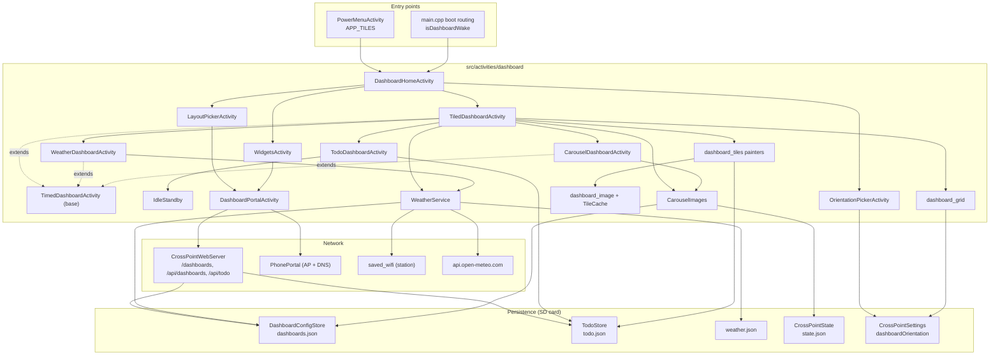
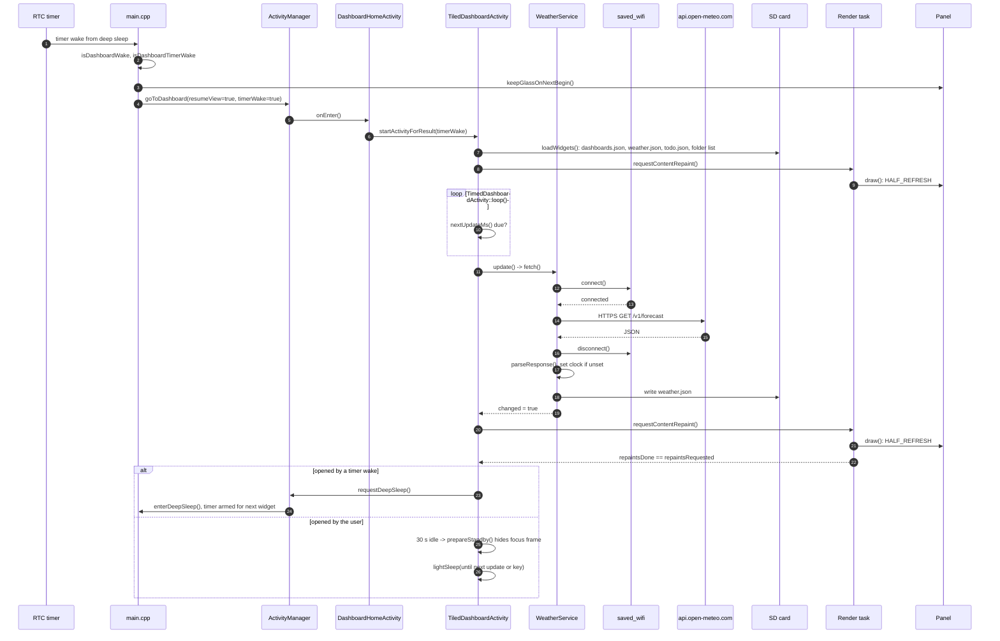
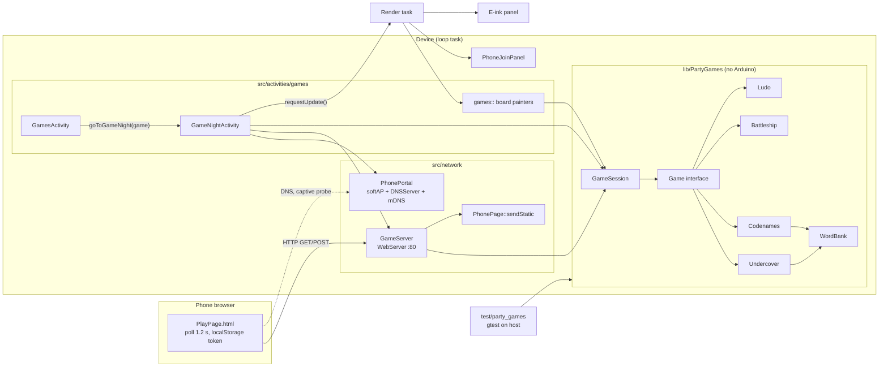
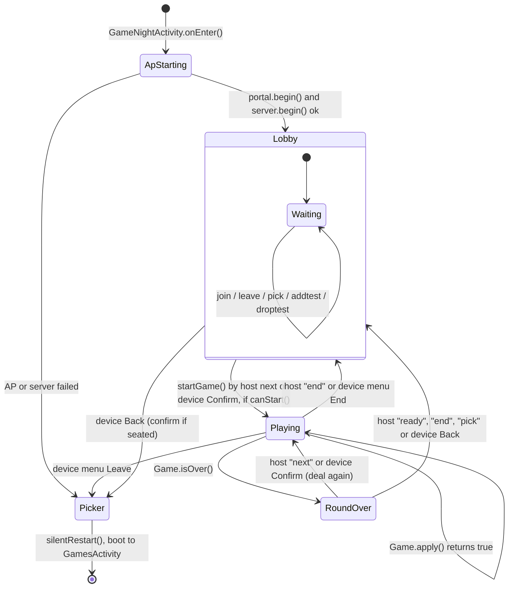
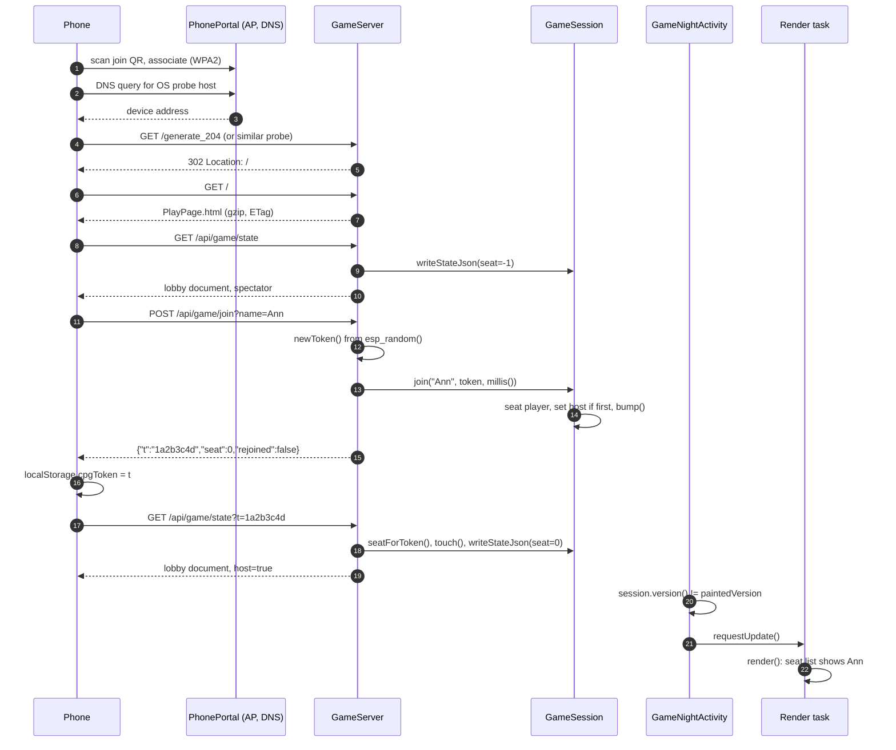

# 04 - Dashboard and Games

| | |
|---|---|
| **Status** | Draft |
| **Applies to** | commit `09b6f02f` (branch `master`, build target `[env:eminimal]`) |
| **Audience** | Firmware developers extending or maintaining the Dashboard app and Game Night |
| **Scope** | How the two fork-specific apps are built and how they plug into the rest of the firmware |
| **Related** | [01-system-overview.md](01-system-overview.md), [02-display-pipeline.md](02-display-pipeline.md), [03-application-framework.md](03-application-framework.md), [05-network-and-storage.md](05-network-and-storage.md), [06-build-flash-release.md](06-build-flash-release.md) |
| **User-level docs** | [../party-games.md](../party-games.md), [../../USER_GUIDE.md](../../USER_GUIDE.md), [../webserver.md](../webserver.md), [../webserver-endpoints.md](../webserver-endpoints.md) |

This is the developer's view. Button-by-button instructions and game rules are in the user-level documents above and are not repeated here.

## Table of contents

1. [Overview](#1-overview)
2. [Part A - Dashboard](#2-part-a---dashboard)
   - 2.1 [File map](#21-file-map)
   - 2.2 [Component diagram](#22-component-diagram)
   - 2.3 [Entry, exit and relation to the reader](#23-entry-exit-and-relation-to-the-reader)
   - 2.4 [Tile and grid model](#24-tile-and-grid-model)
   - 2.5 [Timed refresh, standby and deep sleep](#25-timed-refresh-standby-and-deep-sleep)
   - 2.6 [Data sources](#26-data-sources)
   - 2.7 [Rendering and image handling](#27-rendering-and-image-handling)
   - 2.8 [Configuration model and persistence](#28-configuration-model-and-persistence)
   - 2.9 [Walkthrough: add a widget](#29-walkthrough-add-a-widget)
   - 2.10 [Walkthrough: add a starting layout](#210-walkthrough-add-a-starting-layout)
3. [Part B - Games (Game Night)](#3-part-b---games-game-night)
   - 3.1 [File map](#31-file-map)
   - 3.2 [Component diagram](#32-component-diagram)
   - 3.3 [Engine library: lib/PartyGames](#33-engine-library-libpartygames)
   - 3.4 [Session architecture](#34-session-architecture)
   - 3.5 [HTTP protocol](#35-http-protocol)
   - 3.6 [Shared screen versus phone](#36-shared-screen-versus-phone)
   - 3.7 [Concurrency](#37-concurrency)
   - 3.8 [Memory limits](#38-memory-limits)
   - 3.9 [Phone page authoring and build-time embedding](#39-phone-page-authoring-and-build-time-embedding)
   - 3.10 [Tests](#310-tests)
   - 3.11 [Walkthrough: add a game](#311-walkthrough-add-a-game)
4. [Part C - Shared integration points](#4-part-c---shared-integration-points)
5. [Open questions](#5-open-questions)

---

## 1. Overview

The firmware has three top-level apps, identified by `AppId` (`READER`, `DASHBOARD`, `GAMES`) and persisted as `CrossPointState::lastApp` (`src/CrossPointState.h`). The reader is inherited from upstream. The Dashboard and Games are fork features.

| App | Root activity | Purpose | Radio |
|---|---|---|---|
| Dashboard | `DashboardHomeActivity` | An always-on tiled information screen (weather, to-do, picture, date) that survives sleep | Off, except for a short station connection per weather fetch and for the configuration portal |
| Games | `GamesActivity` | A picker for four party games. `GameNightActivity` turns the device into a shared board and serves a web page to phones | Off in the picker. Access point up for the whole Game Night session |

Both apps follow the same three design rules:

1. **The panel is the shared surface, the phone is the input device.** Configuration (Dashboard) and private play (Games) happen in a phone browser against an HTTP server on the device.
2. **Wi-Fi is a transient, heap-expensive mode.** Each app releases the SD font caches before the radio comes up and performs a silent restart when it leaves, to return a defragmented heap to the reader (`DashboardHomeActivity::onExit`, `DashboardPortalActivity::onExit`, `GameNightActivity::onExit`).
3. **No dedicated server task.** HTTP is pumped from the activity's `loop()` on the main loop task. The only other task involved is the render task, and all shared state is guarded by `RenderLock`.

The activity model, input mapping and the power menu are described in [03-application-framework.md](03-application-framework.md). Refresh modes and the 16-level grey target are described in [02-display-pipeline.md](02-display-pipeline.md).

---

## 2. Part A - Dashboard

### 2.1 File map

All paths are relative to the repository root.

| File | Main symbols | Role |
|---|---|---|
| `src/DashboardConfigStore.h/.cpp` | `WidgetId`, `DashboardTile`, `CustomLayout`, `dashboard_layout`, `DashboardConfigStore`, `DASHBOARD_CONFIG` | Layouts, active layout, weather place, picture folder. Persisted to `/.e-minimal/dashboards.json` |
| `src/TodoStore.h/.cpp` | `TodoItem`, `TodoStore`, `TODO_STORE` | The to-do list. Persisted to `/.e-minimal/todo.json` |
| `src/activities/dashboard/DashboardHomeActivity.*` | `DashboardHomeActivity` | App root menu: Launch, Change Layout, Widgets, Orientation |
| `.../TiledDashboardActivity.*` | `TiledDashboardActivity` | The launched dashboard: paints the active layout's tiles |
| `.../TimedDashboardActivity.*` | `TimedDashboardActivity` | Base class: timed updates, light-sleep standby, deep-sleep hand-off |
| `.../IdleStandby.*` | `IdleStandby` | The same standby behaviour for screens without a timer (the to-do list) |
| `.../DashboardGrid.*` | `dashboard_grid::applyOrientation`, `tileRect` | Maps grid cells to screen pixels aligned to the panel's partial-refresh blocks |
| `.../DashboardTiles.h/.cpp` | `dashboard_tiles::TileSize`, `sizeOf`, `TodoSnapshot`, `drawImage`, `localNow`, `ui::*` | Widget painter declarations, shared drawing helpers, the Image tile |
| `.../WeatherTile.cpp` | `dashboard_tiles::drawWeather` | Weather tile painter (five responsive variants) |
| `.../TodoTile.cpp` | `dashboard_tiles::drawTodo` | To-do tile painter |
| `.../DateTile.cpp` | `dashboard_tiles::drawDate` | Date tile painter (stack, date line, month calendar) |
| `.../DateNames.h` | `date_names::weekday`, `month` | Translated day and month names |
| `.../DashboardImage.*` | `dashboard_image::draw`, `drawFullScreen`, `maskCorners`, `TileCache`, `isImage` | Picture decode, fit, corner mask, PSRAM tile cache |
| `.../CarouselImages.*` | `CarouselImages` | Picture list of the configured folder, current index, next change time |
| `.../CarouselDashboardActivity.*` | `CarouselDashboardActivity` | Image tile opened full screen |
| `.../WeatherService.*` | `WeatherService` | Forecast cache, fetch, schedule, Wi-Fi lifecycle |
| `.../WeatherForecast.*` | `WeatherForecast`, `weather::forecastUrl`, `parseResponse`, `clockValid`, `localAt`, `iconFor` | Forecast data model, Open-Meteo URL and parser |
| `.../WeatherIcons.h` | `weather_icons::hero`, `small` | WMO code to bitmap, 160 px and 96 px |
| `.../WeatherDashboardActivity.*` | `WeatherDashboardActivity` | Weather tile opened full screen |
| `.../TodoDashboardActivity.*` | `TodoDashboardActivity` | To-do tile opened full screen, with on-device editing |
| `.../WidgetsActivity.*` | `WidgetsActivity`, `dashboard_widgets::readStatus` | Per-widget "is it set up" list; opens the portal on that widget's section |
| `.../LayoutPickerActivity.*` | `LayoutPickerActivity`, `dashboard_layouts::activeName` | Thumbnail grid of layouts; selects the active one |
| `.../OrientationPickerActivity.*` | `OrientationPickerActivity` | Sets `SETTINGS.dashboardOrientation` |
| `.../DashboardPortalActivity.*` | `DashboardPortalActivity` | Brings up Wi-Fi plus `CrossPointWebServer` and shows the QR card for the Dashboards web page |

### 2.2 Component diagram



### 2.3 Entry, exit and relation to the reader

**Entry paths**

| Path | Code | Result |
|---|---|---|
| Power menu / app switcher tile | `PowerMenuActivity::activateApp` -> `ActivityManager::goToApp(AppId::DASHBOARD)` -> `goToDashboard()` | `DashboardHomeActivity` menu |
| App launcher at boot | `main.cpp` boot routing: `lastApp != READER` and Back not held -> `ActivityManager::goToAppLauncher()` (`PowerMenuActivity::Mode::LAUNCHER`) | Launcher with the last app pre-selected. The dashboard is not reopened automatically |
| Wake from a Dashboard deep sleep | `main.cpp`: `isDashboardWake` -> `goToDashboard(APP_STATE.dashboardViewOpen, isDashboardTimerWake \|\| chargeDashboardRepaint)` | `DashboardHomeActivity` with `resumeView`; it immediately pushes `TiledDashboardActivity` without painting its own menu |
| Silent restart after Wi-Fi use | `main.cpp`: `BootResume::Silent && lastApp == DASHBOARD` -> `goToDashboard()` | `DashboardHomeActivity` menu |

There is no dashboard entry on the reader's Home screen; `goToDashboard` is only called from `ActivityManager` and `main.cpp`.

`ActivityManager::goToDashboard` calls `noteApp(AppId::DASHBOARD)`, which records `lastApp` and, when leaving the reader, sets `APP_STATE.resumeBookOnReturn` so that switching back to the reader reopens the book (`ActivityManager::noteApp`, `goToApp`).

**Activity stack.** `DashboardHomeActivity` is a root (`isHomeActivity()` returns true, `onBackButton()` is empty). Every other dashboard screen is pushed with `startActivityForResult` and returns with `finish()`. Each dashboard activity overrides `isDashboardActivity()` to return true; `ActivityManager::isDashboardActivity()` scans the whole stack for it.

**Exit.** `DashboardHomeActivity::onExit` checks `saved_wifi::usedSinceBoot()`. If the radio was used (a weather fetch), it restarts silently: `silentRestartToReader()` when `activityManager.isEnteringReader()`, otherwise `silentRestart()`. The comment in the source gives the reason: the radio leaves the heap too fragmented for the reader.

**Orientation.** The launched dashboard has its own orientation, `SETTINGS.dashboardOrientation` (`DASHBOARD_LANDSCAPE_CW`, `DASHBOARD_LANDSCAPE_CCW`, `DASHBOARD_PORTRAIT`). `TiledDashboardActivity::onEnter` applies it through `dashboard_grid::applyOrientation`, and `onExit` restores the UI orientation with `ui_orientation::apply`. The menu screens stay in the UI orientation.

### 2.4 Tile and grid model

**Grid.** `dashboard_layout` (`src/DashboardConfigStore.h`) defines a grid of `GRID_LONG` = 14 by `GRID_SHORT` = 10 square cells of `CELL_PX` = 128 px. Landscape uses 14 columns by 10 rows; portrait uses 10 by 14. A tile is at least `MIN_TILE_CELLS` = 2 cells per side.

**Tile.** `DashboardTile` is `{widget, x, y, width, height}` in cells. `WidgetId` is `NONE`, `WEATHER`, `TODO`, `IMAGE`, `DATE`.

**Layout.** `CustomLayout` holds an id (1..255), a name (up to 32 bytes), a shape flag (`portrait`) and up to `MAX_TILES` = 8 tiles. `CustomLayout::validate()` rejects an empty name, zero tiles, a `NONE` widget, an undersized or out-of-grid tile, and overlapping tiles. It returns a JSON path (`"name"`, `"tiles"`, `"tiles[2]"`) that the web page uses to mark the faulty field.

There is no separate "preset" type. The three starting layouts (Wide top, Grid, Picture top) are ordinary `CustomLayout` values built by `defaultLayout()` and installed by `DashboardConfigStore::restoreDefaultLayouts()`. Up to `MAX_LAYOUTS` = 12 layouts exist at once.

**Shape rotation.** `DashboardConfigStore::layoutTiles(id, portrait, out)` returns the layout's tiles for the requested shape. A layout drawn for the other shape is turned on its side by swapping `x`/`y` and `width`/`height`. Tiles are returned in reading order (`sortReadingOrder`), which is also the focus order.

**Cell to pixel mapping.** `dashboard_grid::tileRect` places the grid so that every inner cell edge lands on a partial-refresh block boundary of panel memory (32 px columns, 16-row bands; see the `static_assert` in `DashboardGrid.cpp`). `axesFor` resolves which panel axis each logical axis maps to for the current orientation; `alignedOrigin` centres the grid on the nearest block boundary; `span` stretches the outer tiles to the viewable edge. The stated purpose is that a tile can be refreshed on its own.

**Responsive painters.** Each widget painter receives only the tile's inner rectangle. `dashboard_tiles::sizeOf` classifies it into a `TileSize`:

| Field | Values | Rule |
|---|---|---|
| `Shape` | `Square`, `Wide`, `Tall` | Wide from 1.8:1, Tall from 1:1.6 |
| `Scale` | `Small`, `Medium`, `Large` | Short side below `SMALL_MAX` (360 px), at or above `LARGE_MIN` (620 px), or between |

`WeatherTile.cpp` shows the pattern most fully: `drawWeather` dispatches to `drawSmall`, `drawMedium`, `drawWide`, `drawTall` or `drawLarge`.

### 2.5 Timed refresh, standby and deep sleep

`TimedDashboardActivity` is the base of the three screens that change on their own: `TiledDashboardActivity`, `WeatherDashboardActivity` and `CarouselDashboardActivity`. Subclasses implement four hooks.

| Hook | Contract |
|---|---|
| `nextUpdateMs()` | `millis()` value at which `update()` should next run, or 0 for none |
| `update()` | Runs on the loop task when due. Calls `requestUpdate()` if the screen changed |
| `handleKeys()` | Keys other than Back |
| `draw(RenderLock&&)` | Paints the frame on the render task |
| `prepareStandby()` / `onWake(bool byKey)` | Optional. The tiled dashboard hides and restores its focus frame |

The base class marks `loop()` and `render()` as `final`. It counts repaint requests and completions in two atomics (`repaintsRequested`, `repaintsDone`) so that it never sleeps with a repaint outstanding.

**Power states**

| State | Trigger | Mechanism | Wake sources |
|---|---|---|---|
| Awake | Entry, key, or any wake | Normal loop | - |
| Light-sleep standby | `IDLE_BEFORE_STANDBY_MS` (30 s) without a key and no repaint pending | `HalPowerManager::lightSleep(ms)` called while holding a `RenderLock`, so the render task cannot be frozen mid-refresh | Timer (next update or deep-sleep deadline) or any key |
| Deep sleep | User idle time reaches `SETTINGS.getSleepTimeoutMs()` | `activityManager.requestDeepSleep()` | Timer armed for the next widget update, or the power key |

Details that matter when changing this code:

- `preventAutoSleep()` returns true. The dashboard replaces the normal auto-sleep with its own schedule.
- The key that ends a standby is swallowed (`swallowKeys`): it only wakes.
- Standby is skipped while a USB host is connected or the serial log is open (`gpio.isUsbConnected() || logSerial`), because light sleep drops the console. Deep sleep at the timeout still happens.
- A sleep shorter than `MIN_STANDBY_MS` (2 s) is not taken.
- A loop gap longer than `COVERED_GAP_MS` (1 s) means another screen covered this one; the idle countdown restarts.
- `LightSleepWake::NotSupported` disables standby for the rest of the visit (`standbyUnsupported`).

**Deep sleep with the dashboard on the glass.** `enterDeepSleep` in `src/main.cpp` (inside `#if FREEINK_DEVICE_EMINIMAL`) reads three things before the activities are closed:

1. `activityManager.isDashboardActivity()` -> `APP_STATE.lastSleepFromDashboard`.
2. `activityManager.deepSleepWakeInMs()`, the soonest `Activity::deepSleepWakeInMs()` on the stack. `TimedDashboardActivity::deepSleepWakeInMs` returns the time to `nextUpdateMs()`, with a 1 s floor.
3. `activityManager.dashboardViewOpen()` -> `APP_STATE.dashboardViewOpen` (true when an activity named `"Dashboard"` is on the stack).

It then calls `activityManager.goToSleep(fromTimeout, /*keepScreen=*/fromDashboard)`, so the sleep screen is not drawn over the dashboard, and `powerManager.startDeepSleep(gpio, timerWakeMs)` arms the timer.

On the next boot, `main.cpp` detects `isDashboardWake` (`ESP_RST_DEEPSLEEP` and `lastSleepFromDashboard`), calls `display.keepGlassOnNextBegin()`, and routes to `goToDashboard(dashboardViewOpen, timerWake)`. With `timerWake` set, `TiledDashboardActivity` starts with the focus frame hidden; once the due update is painted, `TimedDashboardActivity::loop` calls `requestDeepSleep()` again without waiting for the idle timers.

**Update schedule of the tiled dashboard** (`TiledDashboardActivity::nextUpdateMs`, `update`)

| Widget | Next update | Source |
|---|---|---|
| Weather | Once a day at 05:00 local (`WeatherService::FETCH_HOUR`); hourly retries, up to three, after a failure | `WeatherService::nextFetchMs` |
| Image | Every `carouselIntervalMinutes` (5 to 1440, default 30) | `CarouselImages::nextChangeMs` |
| Date | Five seconds past local midnight | `TiledDashboardActivity::nextDateChangeMs` |
| To-do | No timer. Reloaded on entry and when a full-screen view returns | `loadWidgets` |

`CarouselImages` stores its due time in RTC memory (`RTC_DATA_ATTR time_t changeDueAt`) as wall-clock time, so a picture change that fell due during deep sleep runs on the first pass after the wake. `WeatherService::load` recomputes its schedule from the cached forecast's age.

**Power cost.** The code defines the policy but contains no current measurements. Qualitatively: the device spends idle time in light sleep and then deep sleep; each widget update costs one wake, one panel refresh, and for weather one Wi-Fi station connection and one TLS request. With the default configuration that is one Wi-Fi session per day and one panel refresh per picture interval. Numbers are listed under [Open questions](#5-open-questions).

**Sequence: dashboard wake -> fetch -> render -> standby**



### 2.6 Data sources

#### To-do list

- **Storage.** `TodoStore` persists `{"items":[{"text","done"}]}` to `/.e-minimal/todo.json`. Limits: `MAX_ITEMS` = 50, `MAX_TEXT_LENGTH` = 80 bytes.
- **Lifetime.** The list is loaded only while needed. `TodoStore::load()` reserves capacity for 50 items; `unload()` returns the heap. The tiled dashboard does not keep the store loaded: `dashboard_tiles::TodoSnapshot::load()` loads, copies the counts and the first 12 open tasks under a `RenderLock`, and unloads.
- **Editing on the device.** `TodoDashboardActivity` (opened from the To-do tile) toggles, adds, edits, deletes and clears done items. Mutations go through `editList()`, which changes memory under the render lock and calls `saveToFile()` outside it. Text is entered through `TextEntryActivity`, which launches either `KeyboardEntryActivity` or `PhoneTextEntryActivity` according to `SETTINGS.textEntryMethod` (`TextEntryActivity::launch`).
- **Editing from a phone.** The Dashboards web page uses `GET /api/todo` and `POST /api/todo` on `CrossPointWebServer` (`handleGetTodo`, `handlePostTodo`). The POST body is JSON with `op` in `add`, `edit`, `toggle`, `delete`, `clearDone`, plus `text` (add, edit) and `index` (edit, toggle, delete). Both handlers load and unload the store per request.
- **Standby.** `TodoDashboardActivity` uses `IdleStandby` instead of `TimedDashboardActivity`: 30 s idle then light sleep until a key, with deep sleep requested at the sleep timeout.

#### Weather

- **API.** Open-Meteo forecast, `https://api.open-meteo.com/v1/forecast`, built by `weather::forecastUrl`. Parameters: latitude and longitude to four decimals, `current` (temperature, apparent temperature, humidity, weather code, wind speed), `daily` (weather code, max, min, precipitation probability, sunrise, sunset), `timezone=auto`, `timeformat=unixtime`, `forecast_days=5`, and Fahrenheit/mph units when configured. No API key is sent.
- **Location.** Latitude, longitude and a display name come from `DashboardConfigStore`. The Dashboards web page resolves a place name in the browser against `https://geocoding-api.open-meteo.com/v1/search` (`GEOCODE_URL` in `src/network/html/DashboardsPage.html`); the device itself never calls the geocoder.
- **Model.** `WeatherForecast` holds current conditions and up to `MAX_DAYS` = 5 days. `weather::parseResponse` fills it.
- **Cache.** `/.e-minimal/weather.json`, written after each successful fetch (`WeatherService::fetch`). `WeatherService::load` discards a cache that does not match the configured location and units (`WeatherForecast::matches`).
- **When fetched.** On `load()`: immediately if there is no valid cache, the clock is unknown, or the cache is older than `STALE_AFTER_S` (20 h); otherwise at the next 05:00 local. On failure: retry after `RETRY_MS` (1 h) up to `MAX_RETRIES` (3), then back to the daily slot. With no saved network the status becomes `NoWifi` and the check repeats daily. The full-screen weather view also fetches on Select (`WeatherDashboardActivity::handleKeys`).
- **Wi-Fi lifecycle.** `WeatherService::fetch` is blocking and runs on the loop task: `saved_wifi::connect()` -> heap check against `HttpDownloader::MIN_TLS_FREE_HEAP` and `MIN_TLS_MAX_ALLOC` -> `HttpDownloader::fetchUrl` -> `saved_wifi::disconnect()`. The radio is up only for the duration of one request. The restart that the radio makes necessary is deferred to `DashboardHomeActivity::onExit`.
- **Status.** `WeatherService::Status` is `Ready`, `NoLocation`, `NoWifi`, `Updating`, `Failed`. The tile shows it in its header.

#### Time

- The date tile and the schedules use the system clock. `weather::clockValid()` treats any time after 2024-01-01 as set.
- If the clock is not valid after a successful fetch, `WeatherService::fetch` sets it with `settimeofday` from the forecast's `current.time` plus 450 s (the middle of the 15-minute slot). The date tile therefore triggers a weather fetch even when no weather tile is placed (`TiledDashboardActivity::wantsWeather`).
- Local time is derived from the forecast's `utcOffset` (`dashboard_tiles::localNow`, `weather::localAt`), not from a configured time zone.
- `TodoDashboardActivity::refreshDate` uses a different source, `halClock.localTime()` (the hardware RTC through `HalClock`). NTP sync (`HalClock::syncFromNTP`) is invoked from `WifiSelectionActivity`, not from the dashboard.

#### Images

- **Source.** Files in `DashboardConfigStore::carouselFolder` (default `/carousel`) accepted by `dashboard_image::isImage`: not hidden, extension `.bmp`, `.png`, `.jpg` or `.jpeg`.
- **List.** `CarouselImages::load` reads up to `MAX_IMAGES` = 500 names, sorted with `FsHelpers::sortFileList`. The current index is `APP_STATE.carouselIndex` (persisted in `state.json`).
- **Upload.** Pictures arrive through the general file-transfer web UI; see [05-network-and-storage.md](05-network-and-storage.md).

### 2.7 Rendering and image handling

`TiledDashboardActivity::draw` runs on the render task.

1. **Refresh mode.** A content change uses `HalDisplay::HALF_REFRESH`. A focus-only change (focus move, frame hidden for standby, frame restored on wake) uses `FAST_REFRESH`, unless `contentVersion` moved since the last paint. The decision uses two atomics, `focusOnlyRepaint` and `contentVersion`, written by the loop task and read once at the start of `draw`.
2. **Grey path.** If an Image tile is placed, the folder is not empty and `renderer.supportsGray4()` is true, the whole frame is painted into the 16-level target (`beginGray4Target`, `paintTiles`, `endGray4Target`, `displayGray4Buffer`). If the driver refuses the frame, `gray4Refused` is set and the dashboard paints 1-bit for the rest of the visit.
3. **1-bit path.** `paintTiles` then `renderer.displayBuffer(mode)`; pictures are dithered.

`paintTiles` iterates the tiles, computes `tileRect`, insets it, calls the painter for the tile's `WidgetId`, and draws the rounded frame on top (thicker for the focused tile).

**Image tile.** `dashboard_tiles::drawImage`:

1. Empty folder -> a note inside the tile (`ImagePaint::Note`).
2. `TileCache::restore` succeeds -> the finished pixels are blitted from PSRAM (`ImagePaint::Cached`). No SD access.
3. Otherwise `dashboard_image::draw(..., Fit::Fill)` decodes and crops the picture to the tile, `maskCorners` whitens the corners outside the frame radius, and `TileCache::capture` stores the result (`ImagePaint::Decoded`).

`TileCache` is keyed by path hash, rectangle, orientation and frame kind (grey or 1-bit). `TiledDashboardActivity` owns one cache per tile slot (`imageCaches[CustomLayout::MAX_TILES]`), invalidates them when the picture steps or the layout reloads, and releases them in `onExit`. If PSRAM cannot hold a tile, the tile decodes on every paint.

**Full screen.** `dashboard_image::drawFullScreen` shows the whole picture (`Fit::Contain`) in grey where the panel supports it, otherwise dithered.

Each repaint logs its cost through `TiledDashboardActivity::logRepaint` (paint time, image decode or blit time, display time).

### 2.8 Configuration model and persistence

| Data | Owner | File | Written by |
|---|---|---|---|
| Layouts, active layout, weather place and units, picture folder and interval | `DashboardConfigStore` | `/.e-minimal/dashboards.json` | `POST /api/dashboards`; `LayoutPickerActivity` (active layout only) |
| To-do items | `TodoStore` | `/.e-minimal/todo.json` | `TodoDashboardActivity`; `POST /api/todo` |
| Forecast cache | `WeatherService` | `/.e-minimal/weather.json` | `WeatherService::fetch` |
| Picture index, portal network choice, sleep-from-dashboard flags, last app | `CrossPointState` | `/.e-minimal/state.json` | `CarouselImages::step`, `DashboardPortalActivity`, `enterDeepSleep`, `ActivityManager::noteApp` |
| Dashboard orientation | `CrossPointSettings::dashboardOrientation` | settings file | `OrientationPickerActivity`; Settings > Display; web settings |

Both stores derive from `PersistableStore<T>` and implement `getFilePath()`, `toJson()` and `fromJson()`.

**`dashboards.json` shape** (`DashboardConfigStore::toJson`, `CustomLayout::toJson`):

```json
{
  "layout": { "active": 2 },
  "layouts": [
    { "id": 2, "name": "Grid", "shape": "landscape",
      "tiles": [ { "widget": "weather", "x": 0, "y": 0, "w": 7, "h": 5 } ] }
  ],
  "weather": { "place": "...", "lat": 0.0, "lon": 0.0, "units": "c" },
  "carousel": { "folder": "/carousel", "intervalMinutes": 30 }
}
```

`fromJson` handles three cases: the current `layouts` array; older files with `presets` / `customLayouts` / `layout.preset`, converted by `migratePresets` and flagged with `requestResave()`; and a file with neither, which gets the three starting layouts. A layout that fails `validate()` is dropped and logged, not half-drawn.

**Configuration is phone-first.** The device edits only three things directly: the active layout, the orientation, and to-do items. Everything else is edited on the Dashboards page of the web UI.

- `DashboardPortalActivity` asks for the network mode with `NetworkModeSelectionActivity` (Join a Network or Create Hotspot; the last choice is remembered in `APP_STATE.dashboardPortalMode`), starts `CrossPointWebServer`, and paints a `PhoneJoinPanel` with a QR code to `pagePath(section, layoutId)`. The section maps to a URL fragment: `/dashboards`, `#layouts`, `#layout-new`, `#layout-<id>`, `#weather`, `#todo`, `#image`, `#date`.
- In hotspot mode it uses the shared network (`PhonePortal::SHARED_SSID`, `PhonePortal::sharedPassphrase()`), four clients, channel 1.
- Access control uses `WebSession` (token in the QR URL, optional code). Web server access control is covered in [05-network-and-storage.md](05-network-and-storage.md).
- `loop()` pumps `webServer->handleClient()` up to `SERVER_BURST` = 500 times per pass, resets the watchdog every 32 iterations, and polls input every 64.
- On exit it restarts silently if the radio was used. The same activity serves the Dictionaries page (`Section::Dictionaries`), in which case it restarts into Settings.

**Dashboard web API** (served by `CrossPointWebServer`, routes registered around `route("/dashboards", ...)` in `src/network/CrossPointWebServer.cpp`):

| Method | Path | Access | Handler | Payload / response |
|---|---|---|---|---|
| GET | `/dashboards` | Read | `handleDashboardsPage` | The Dashboards page |
| GET | `/api/dashboards` | Read | `handleGetDashboards` | `layout.active`, `orientation`, `grid` limits, `layouts[]`, `weather`, `carousel` with min/max |
| POST | `/api/dashboards` | Modify | `handlePostDashboards` -> `applyDashboardChanges` | Any of `layout.active`, `saveLayout` (a layout object in the `CustomLayout` JSON form; `id` absent or 0 creates one, and the answer carries the saved `id`), `deleteLayout` (id), `restoreDefaults` (bool), `weather` (`lat`, `lon`, `place`, `units`, `clearLocation`), `carousel` (`folder`, `intervalMinutes`). A rejected field is named in the error and the in-memory store is rolled back from a `DashboardSnapshot` |
| GET | `/api/todo` | Read | `handleGetTodo` | `items[]`, `max`, `maxText` |
| POST | `/api/todo` | Modify | `handlePostTodo` | `{"op": "add" \| "edit" \| "toggle" \| "delete" \| "clearDone", "text": "...", "index": n}`; answers with the updated list |

### 2.9 Walkthrough: add a widget

The example adds a hypothetical `BATTERY` widget. Each step names the existing code to follow.

1. **Identifier and wire key.** Append `BATTERY` to `enum class WidgetId` in `src/DashboardConfigStore.h`. Append `"battery"` at the same index in `WIDGET_KEYS` in `src/DashboardConfigStore.cpp`. `widgetKey()` and `widgetFromKey()` index that array by enum value, so order must match. Layout validation and JSON then accept the widget without further change.
2. **Painter.** Declare `void drawBattery(GfxRenderer&, const Rect& area, ...)` in `DashboardTiles.h` and implement it in a new `BatteryTile.cpp` in `src/activities/dashboard/`. Use `dashboard_tiles::sizeOf(area)` to choose a variant, and `ui::drawTitle`, `ui::drawNote`, `ui::drawCentered` for the common parts. Draw only inside `area`. `TodoTile.cpp` is the shortest reference.
3. **Dispatch.** Add `case WidgetId::BATTERY:` to the `switch` in `TiledDashboardActivity::paintTiles`.
4. **Data and loading.** If the widget has state, add a member to `TiledDashboardActivity` and load it in `loadWidgets()` guarded by `shows(WidgetId::BATTERY)`. Copy data that the render task reads under a `RenderLock`, as `TodoSnapshot::load` does.
5. **Schedule.** If the widget changes over time, add its due time to `nextUpdateMs()` with `consider(...)` and handle it in `update()`, setting `changed = true`. Times are `millis()` values. If the schedule must survive deep sleep, keep a wall-clock due time in RTC memory as `CarouselImages` does.
6. **Full-screen view (optional).** Add a case to `TiledDashboardActivity::openFocused`. Derive the view from `TimedDashboardActivity` if it updates on a timer, or use `IdleStandby` otherwise. Override `isDashboardActivity()` to return true so that sleep keeps the screen.
7. **Widgets list.** Extend `dashboard_widgets::COUNT`, the `WIDGETS` and `SECTIONS` arrays, `Status`, `readStatus` and `widgetName` in `WidgetsActivity.*`, and add a `Section` plus fragment in `DashboardPortalActivity::pagePath`.
8. **Layout thumbnails.** `LayoutPickerActivity::drawTiles` names the widget in each thumbnail tile through `dashboard_widgets::widgetName`; step 7 covers it.
9. **Web editor.** Add the widget to the layout editor's palette and, if it has settings, a section in `src/network/html/DashboardsPage.html`. Extend `applyDashboardChanges` and `handleGetDashboards` for new settings fields, and add them to `DashboardSnapshot` so that a rejected POST rolls back.
10. **Strings.** Add the names to `lib/I18n/translations/english.yaml`; `scripts/gen_i18n.py` regenerates the keys at build time (see [06-build-flash-release.md](06-build-flash-release.md)).

### 2.10 Walkthrough: add a starting layout

Users create layouts in the web editor without code. A new built-in starting layout needs these changes in `src/DashboardConfigStore.cpp`:

1. Increase `DashboardConfigStore::DEFAULT_LAYOUT_COUNT` in the header.
2. Add a name to `DEFAULT_NAMES` (a new `StrId`) and a row to `DEFAULT_WIDGETS`.
3. Extend `defaultLayout(index, portrait)` to produce the tile geometry for the new index. Compute sizes from `dashboard_layout::columns(portrait)` and `rows(portrait)` so that both shapes work.
4. Check `migratePresets`: its `PRESET_KEYS` array is sized by `DEFAULT_LAYOUT_COUNT` and maps the legacy presets `a`, `b`, `c`. A fourth entry must not be given a legacy key.

`restoreDefaultLayouts` matches existing layouts by name, so an existing card receives the new layout only when the user chooses "restore defaults" in the web UI or has no `dashboards.json`.

---

## 3. Part B - Games (Game Night)

### 3.1 File map

| File | Main symbols | Role |
|---|---|---|
| `lib/PartyGames/PartyGames.h/.cpp` | `GameId`, `Verb`, `Action`, `Player`, `Rng`, `JsonBuf`, `sanitizeName`, `MAX_PLAYERS` | Shared types, deterministic RNG, bounded JSON writer |
| `lib/PartyGames/Game.h` | `Game`, `GameMeta`, `gameMeta`, `gameAt`, `gameIndex` | The rules interface and the game registry accessors |
| `lib/PartyGames/GameSession.h/.cpp` | `GameSession`, `kGames` | Seats, tokens, host, lobby, round lifecycle, state document |
| `lib/PartyGames/Undercover.*`, `Codenames.*`, `Battleship.*`, `Ludo.*` | One `Game` subclass each | Rules and per-seat views |
| `lib/PartyGames/WordBank.*` | `party::words::*` | Word lists for Codenames and Undercover, stored as fixed-stride arrays in flash |
| `src/activities/games/GamesActivity.*` | `GamesActivity` | App root: 2x2 picker. Radio off |
| `src/activities/games/GameNightActivity.*` | `GameNightActivity` | Access point, server pump, lobby and round screens, device keys |
| `src/activities/games/GameBoards.*` | `games::drawBoard`, `drawSeatList`, `drawThumbnail`, `titleFor`, `statusFor` | All game pixels on the panel |
| `src/network/GameServer.*` | `GameServer` | HTTP endpoints for phones |
| `src/network/PhonePortal.*` | `PhonePortal` | Access point, captive DNS, mDNS, join QR payload |
| `src/network/PhonePage.h` | `PhonePage::sendStatic`, `redirectCaptive` | Static asset serving with ETag; captive redirect helper |
| `src/network/html/PlayPage.html` | - | The single-page phone client |
| `src/network/html/css/app.css` | - | Stylesheet shared with the other web pages |
| `src/components/PhoneJoinPanel.*` | `PhoneJoinPanel::draw` | The two-QR join card |
| `scripts/build_html.py` | - | Minifies, gzips and embeds the web assets |
| `test/party_games/` | `PartyGamesTest.cpp`, `LudoTest.cpp` | Host-side unit tests |

### 3.2 Component diagram



### 3.3 Engine library: lib/PartyGames

**Hardware independence.** The library includes only `<cstddef>`, `<cstdint>`, `<cstdio>`, `<cstring>`, `<cctype>` and `<new>`. It has no Arduino types, no renderer, no heap allocation and no `std::string`. The device side adapts to it:

- Randomness is injected: `GameSession::reseed(esp_random())` on the device (`GameNightActivity::onEnter`), a literal seed in tests.
- Time is injected: every call that needs it takes `nowMs`.
- JSON output goes through `JsonBuf`, a bounds-checked writer over a caller-owned buffer that truncates and sets `overflowed()` instead of growing.
- Names that collide with Arduino macros are avoided explicitly (`Undercover::roundNumber`, `Codenames::tileWord`).

**The rules API.** `party::Game` (`lib/PartyGames/Game.h`):

| Method | Contract |
|---|---|
| `id()` | The `GameId` |
| `start(playerCount, rng)` | Deal a round for seats `0..playerCount-1` |
| `apply(seat, action, isHost)` | Apply a decoded action. Return true only if state changed. Games that gate a phase on the host must test `isHost`, not seat 0 |
| `isOver()` | Round finished |
| `statusLine(out, cap)` | One-line English banner (used by phones) |
| `writeView(json, seat)` | The round as one JSON object, including what only `seat` may see. `seat < 0` is a spectator |

**Games.** Registered in `kGames` (`lib/PartyGames/GameSession.cpp`):

| `GameId` | Key | Min / max seats | Phases (`Phase` enum) | Private to a phone |
|---|---|---|---|---|
| `Undercover` | `undercover` | 3 / 8 | `Describe`, `Vote`, `Reveal`, `Over` | Own word, own vote |
| `Codenames` | `codenames` | 4 / 8 | `Clue`, `Guess`, `Over` | The colour key (spymasters only) |
| `Battleship` | `battleship` | 2 / 2 | `Place`, `Fire`, `Over` | Own fleet |
| `Ludo` | `ludo` | 2 / 4 | `Pick`, `Roll`, `Move`, `Over` | Legal moves for the seat on turn |

`maxPlayers` is the number of seats the game deals. `GameSession::canStart` checks only the minimum; extra seated players watch.

**State model.** Each game is a class of plain data members (arrays, small integers, a 64-byte message). The active game is constructed with placement new into `GameSession::storage_` (`GAME_STORAGE_BYTES` = 640, 8-byte aligned). `static_assert(fitsInStorage<T>())` for every game fails the build if a game outgrows the storage.

**Actions.** `Action` is `{verb, a, b, c, text[17]}`. `Verb` enumerates every wire verb; the HTTP layer parses names, and games see only the decoded form. Game rules are documented in [../party-games.md](../party-games.md).

### 3.4 Session architecture

**Lifecycle on the device**

1. `GamesActivity::activateIndex` -> `activityManager.goToGameNight(party::gameAt(index))`.
2. `GameNightActivity::onEnter`: test mode off, `releaseSdFontCaches()`, `session.reseed(esp_random())`, `session.selectGame(initialGame)`, then `startAccessPoint()`.
3. `startAccessPoint`: `PhonePortal::begin` with SSID `eMinimal Games`, channel 1, `maxClients` = `party::MAX_PLAYERS` (8), hostname `eminimal`. On failure the activity returns to the picker.
4. `startServer`: constructs `GameServer(session)` and calls `begin()`. State becomes `RUNNING`.
5. `onExit`: destroys the server, ends the portal, and performs `silentRestart()` (or `silentRestartToReader()`) if Wi-Fi was on. The boot router then lands on `goToGames()` (`BootResume::Silent && lastApp == GAMES` in `src/main.cpp`).

**Access point and captive portal.** `PhonePortal::begin` starts a soft AP, a `DNSServer` that answers every name with the AP address, and mDNS. `GameNightActivity` passes no passphrase in its `PhonePortal::Config`; `PhonePortal::begin` then generates a random 8-character WPA2 passphrase for that session ("never raise an open network"). The join QR produced by `PhonePortal::joinQrPayload` carries it. `GameServer::handleNotFound` answers every non-`/api/` path with a 302 to `/`, which is what makes a phone's connectivity probe open the page. See [Open questions](#5-open-questions) for a documentation mismatch on this point.

**Player identity and seats**

- A seat is an index 0..7 into `GameSession::players_`. `Player` is `{name[13], token, lastSeenMs, seated, test}`.
- Identity is a 32-bit token from `esp_random()` (`newToken` in `GameServer.cpp`), never zero. It is returned by `join` as eight hex digits and stored by the page in `localStorage` under `cpgToken`.
- `GameSession::join(name, token, nowMs, rejoin)` returns the seat index, or `-1` (round running or table full), `JOIN_NAME_TAKEN` (-2), or `JOIN_CAN_REJOIN` (-3). Names are sanitised to printable ASCII by `sanitizeName` and compared without case.
- **Away.** A phone seat that has not polled for `AWAY_AFTER_MS` (10 s) is away (`isAway`). The seat is kept. An away seat can be reclaimed by name with `rejoin=1`, in the lobby or mid-round; the old token stops working.
- **Packing.** `GameSession::startGame` calls `packSeats()` so that seated players occupy `0..N-1` before `Game::start`. Tokens and the host seat move with their players.
- **Leaving.** `leave(seat)` works only in the lobby.

**Host role**

- The first phone to join is the host (`hostSeat_`). `rehost()` keeps a phone as host whenever one is seated.
- Host-only verbs: `Pick`, `Next`, `Ready` (after a round), `AddTest`, `DropTest`, `End` (`GameSession::applyAction`).
- The device's own buttons act with the host's authority: `GameNightActivity::hostAction` applies the verb as `session.hostSeat()`, and `Confirm` in the lobby calls `session.startGame()` directly.

**Test players.** `setTestMode(true)` is armed by the first press of the lobby's previous key. Test seats have a private random token that no request can resolve (`seatForToken` skips them). The host's phone can view and act as a test seat with the `as` parameter (`GameServer::viewSeat`).

**Private versus shared state**

| State | Where it lives | Who can read it |
|---|---|---|
| Full round state | The `Game` object inside `GameSession::storage_` | The loop task and (under `RenderLock`) the render task |
| Shared view | `Game` accessor methods (for example `Codenames::revealed`, `Battleship::shotAt`) | `games::drawBoard` paints only these on the panel |
| Private view | `Game::writeView(json, seat)` | Only the HTTP response to the request whose token resolves to `seat` |
| Spectator view | `writeView(json, -1)` | Any browser without a seat |

The server holds all secrets; privacy is enforced only by which fields `writeView` emits for a seat. The tests named `ShowsEachPhoneOnlyItsOwnWord`, `TheKeyIsOnlyOnTheSpymastersPhone` and `APhoneNeverSeesTheOtherFleet` cover this.

**Session state diagram**



`Lobby` is `GameSession::inLobby()` (`game_ == nullptr`). `Playing` and `RoundOver` both report `"phase":"play"` in the state document; `"over"` distinguishes them.

### 3.5 HTTP protocol

**Transport.** Plain HTTP on port 80 (`GameServer::PORT`), served by the Arduino `WebServer` class. There is no WebSocket. Phones poll: `PlayPage.html` calls `poll()` every 1200 ms (`setInterval`), allows one poll in flight (a hung poll is superseded after 5 s), and every action response carries the new state so the actor does not wait for the next poll.

**Parameters.** All request parameters are URL query arguments, including on POST. There is no request body and no authentication header.

**Endpoints** (`GameServer::begin`)

| Method | Path | Query parameters | Handler | Response |
|---|---|---|---|---|
| GET | `/` | - | `handlePlayPage` | `PlayPage.html`, gzip, `ETag`, `Cache-Control: no-cache`; 304 on matching `If-None-Match` |
| GET | `/css/app.css` | - | `handleStylesheet` | Stylesheet, same caching |
| GET, POST | `/api/game/state` | `t` (token, optional), `as` (test seat, optional) | `handleState` | 200, state document. Without a valid `t`: spectator view |
| POST | `/api/game/join` | `name`, `rejoin=1` (optional) | `handleJoin` | 200 with `{"t":"<8 hex>","seat":n,"rejoined":bool}` or `{"error":"...","rejoin":"<name>"?}` |
| POST | `/api/game/act` | `t`, `v` (verb), `a`, `b`, `c` (integers, optional), `s` (text, optional), `as` (optional) | `handleAction` | 200, state document after the action. 403 `{"error":"Join first"}` without a seat |
| POST | `/api/game/leave` | `t` | `handleLeave` | 200, state document: spectator view after leaving, or the unchanged seat view mid-round |
| OPTIONS | any | - | `handleNotFound` | 204 |
| any | other, not under `/api/` | - | `handleNotFound` | 302 `Location: /` |
| any | other, under `/api/` | - | `handleNotFound` | 404 `{"error":"Unknown endpoint"}` |

All JSON responses carry `Cache-Control: no-store`. An action that the rules refuse still returns 200 with unchanged state.

**Verbs** (`VERBS` table in `GameServer.cpp`, `Verb` enum in `PartyGames.h`)

| `v` | Arguments | Scope |
|---|---|---|
| `ready` | - | In-round "done"; host after a round: back to lobby |
| `next` | - | Host: start a round, advance a reveal, deal again |
| `clue` | `s` word, `a` count | Codenames spymaster |
| `guess` | `a` tile | Codenames operative |
| `pass` | - | Codenames |
| `place` | `a` ship, `b` x, `c` y, `s` `h`/`v` | Battleship |
| `fire` | `a` x, `b` y | Battleship |
| `vote` | `a` target seat | Undercover |
| `roll` | - | Ludo |
| `move` | `a` token | Ludo |
| `shape` | `a` 0..3 | Ludo, before the first roll |
| `pick` | `a` game index | Host, lobby or after a round |
| `addtest`, `droptest` | - | Host, lobby, test mode armed |
| `end` | - | Host, while a round exists |

Text in `s` passes through `sanitizeName` into `Action::text` (16 characters).

**State document** (`GameSession::writeStateJson`)

| Key | Meaning |
|---|---|
| `v` | Session version; increments on every visible change |
| `seat` | The seat this view is served as, or -1 |
| `me` | The caller's own seat; differs from `seat` while the host plays a test seat |
| `name`, `host` | Of the viewed seat |
| `game`, `title` | Selected game key and English title |
| `phase` | `"lobby"` or `"play"` |
| `canStart`, `testMode`, `minPlayers`, `maxPlayers`, `status` | Lobby gating and the banner |
| `players[]` | `{s, n, host, away, test}` per seated player |
| `games[]` | Lobby only: `{i, k, t, min, max}` per game |
| `over`, `g` | In a round: finished flag and the game's own view from `Game::writeView` |

A full example and the reply table for `join` are in [../party-games.md](../party-games.md).

**Sequence: join**



**Sequence: one game turn (Codenames guess)**

```mermaid
sequenceDiagram
  autonumber
  participant A as Phone A (operative, on turn)
  participant B as Phone B (other player)
  participant GS as GameServer
  participant S as GameSession
  participant G as Codenames
  participant GN as GameNightActivity loop
  participant RT as Render task
  participant EPD as Panel

  A->>GS: POST /api/game/act?t=TA&v=guess&a=7
  Note over GN,GS: GameNightActivity::loop holds RenderLock for this one handleClient()
  GS->>S: seatFromRequest() -> seat 2, touch()
  GS->>S: applyAction(2, {Guess, a=7})
  S->>G: apply(2, action, isHost=false)
  G->>G: validate turn and phase, reveal(7)
  G-->>S: true
  S->>S: bump() -> version 43
  GS->>S: writeStateJson(seat 2)
  GS-->>A: state v=43 (tile 7 revealed)
  GN->>GN: version 43 != paintedVersion, 700 ms since last paint
  GN->>RT: requestUpdate()
  RT->>S: games::statusFor(), games::drawBoard() under RenderLock
  RT->>EPD: displayBuffer() fast; FULL_REFRESH every 8th paint
  B->>GS: GET /api/game/state?t=TB (next 1.2 s poll)
  GS->>S: writeStateJson(seat 5)
  GS-->>B: state v=43, B's own private fields
```

### 3.6 Shared screen versus phone

| | E-ink panel | Phone |
|---|---|---|
| Lobby | `PhoneJoinPanel` card (join QR, page QR, fallback URLs) and `games::drawSeatList` with host, away and test tags (`GameNightActivity::renderLobby`) | Name entry, seat list, game picker (host), start, test controls (host, when armed) |
| Round | Header with the translated game title, status banner from `games::statusFor`, board from `games::drawBoard` | The game panel for the seat: private data and controls |
| Undercover | Tally board: seats, alive, ready, votes | Own word; vote buttons |
| Codenames | 5x5 word grid; revealed tiles show owner by fill pattern | Spymasters see the key; operatives pick and guess |
| Battleship | Both grids with hits, misses and sunk hulls; ships hidden | Own fleet, placement, firing grid |
| Ludo | 15x15 board, tokens by shape, die | Shape pick, roll, token choice |
| Language | Translated through `tr()` (`games::statusFor`, `titleFor`) | English strings produced by the library (`statusLine`, `msg`) and the page |

The device paints from accessor methods only. It never calls `writeView`, so no private field can reach the panel through the renderer.

Device keys in Game Night are handled in `GameNightActivity::applyInput`; the key table is in [../party-games.md](../party-games.md).

### 3.7 Concurrency

There is no web server task. Two tasks touch the session:

| Task | Code | Access |
|---|---|---|
| Loop task | `GameNightActivity::loop` -> `GameServer::handleClient` -> handlers -> `GameSession` | Read and write |
| Render task | `GameNightActivity::render` -> `games::drawBoard`, `drawSeatList`, `statusFor` | Read only |

Rules that the code follows:

1. **Per-request lock.** `loop()` runs up to `MAX_ITERATIONS` = 200 `handleClient()` calls per pass. Each call is wrapped in its own `RenderLock`, so a render can run between two requests but never during one. A request can deal, end or pack the table, so the lock is required even for apparent reads.
2. **Input under the lock.** `handleInput` takes a `RenderLock` around `applyInput`, because the session and the popup are what `render()` draws. It skips the lock when nothing was pressed, because the render task holds the lock through an entire panel refresh.
3. **Activity switches outside the lock.** `activityManager.goToGames()` is called after the lock is released; switching activities takes the render lock itself.
4. **Responsiveness.** Inside the burst the loop resets the task watchdog every 32 iterations and, every 64, yields, updates input and handles keys. `skipLoopDelay()` returns true while the server runs.
5. **Repaint throttling.** A repaint is requested only when `session.version()` or the lobby's away bitmask changed, and at most once per `MIN_REPAINT_INTERVAL_MS` (700 ms). Polling alone never bumps the version. Every eighth paint is a `FULL_REFRESH` (`FULL_REFRESH_EVERY`).
6. **Sleep.** `preventAutoSleep()` holds the device awake while the server runs and a non-test, non-away phone polled within `PRESENCE_GRACE_MS` (2 minutes). After that the normal auto-sleep timeout applies, and deep sleep takes the access point down.

Because all HTTP handling is single-threaded on the loop task, requests are processed strictly one at a time and `GameServer::json_` needs no lock of its own.

### 3.8 Memory limits

| Item | Size or limit | Defined in |
|---|---|---|
| Seats | 8 | `party::MAX_PLAYERS` |
| Player name | 12 characters | `party::MAX_NAME_LEN` |
| Action text | 16 characters | `party::MAX_TEXT_LEN` |
| Game object storage | 640 bytes, in place, no heap | `GameSession::GAME_STORAGE_BYTES` |
| State document buffer | 3072 bytes, one per server, reused for every response | `GameServer::JSON_BUFFER_SIZE` |
| Access point stations | 8 | `AP_MAX_CONNECTIONS` in `GameNightActivity.cpp` |
| Heap allocations per session | One `WebServer`, one `DNSServer`, the `GameServer` object | `GameServer::begin`, `PhonePortal::begin`, `GameNightActivity::startServer` |

The buffer bound is enforced by a host test, `GameSession.EveryGameViewFitsTheServerBuffer`, which seats eight players in every game and requires each view to fit with 64 bytes of headroom and end in `}`. `GameServer` is deliberately separate from `CrossPointWebServer` to avoid the heap cost of WebDAV, WebSocket upload and the file manager (comment in `GameServer.h`). Static assets are sent straight from flash with `send_P`.

Flash and RAM estimates recorded by the authors are in the "Costs" section of [../party-games.md](../party-games.md).

### 3.9 Phone page authoring and build-time embedding

**Authoring.** `src/network/html/PlayPage.html` is one file containing markup, an inline script and no external JavaScript. It links `/css/app.css`. The script is structured as:

- Transport: `call()`, `poll()`, `act()`, `hostAct()`, `join()`, `leave()`.
- A top-level `render()` that dispatches by `s.game` to `undercover()`, `codenames()`, `battleship()` or `ludo()` panel functions.
- Thumbnail SVG generators in an `ART` map, mirroring `games::drawThumbnail`.
- Sound cues, toggled and remembered in `localStorage` (`cpgSound`).

**Embedding.** `scripts/build_html.py` is a PlatformIO pre-build script (`extra_scripts = pre:scripts/build_html.py` in the `[base]` section of `platformio.ini`). For every `.html`, `.js` and `.css` file under `src/` it:

1. Minifies HTML (comments and inter-tag whitespace removed; `pre`, `code`, `textarea`, `script` and `style` blocks preserved). JS and CSS are not minified.
2. Compresses with gzip level 9 and `mtime=0` for reproducible output.
3. Writes `<Name><Html|Css|Js>.generated.h` beside the source with a `PROGMEM` byte array, `<name>CompressedSize`, `<name>OriginalSize` and `<name>ETag` (first 16 hex digits of the SHA-256 of the compressed bytes).

`GameServer.cpp` includes `html/PlayPageHtml.generated.h` and `html/css/appCss.generated.h` and serves them through `PhonePage::sendStatic`, which answers a matching `If-None-Match` with 304. The page is immutable for a firmware image, so a reload mid-game costs no flash read.

The generated headers are build outputs: `.gitignore` excludes `*.generated.h`, so they exist only after a build. Edit the `.html` / `.css` source, never the header.

### 3.10 Tests

`test/party_games/` builds one gtest executable, `PartyGamesTest`, from `PartyGamesTest.cpp`, `LudoTest.cpp` and the seven `lib/PartyGames/*.cpp` sources (`test/party_games/CMakeLists.txt`). It is registered in `test/CMakeLists.txt` with `add_subdirectory(party_games)`. No device code or mock is linked.

| Suite | Coverage |
|---|---|
| `Rng`, `SanitizeName`, `JsonBuf`, `WordBank` | Primitives: determinism, escaping and truncation, word-list integrity |
| `GameSession` | Seating, single host, version bumps, start gating, lobby JSON, away detection, buffer fit, deal again |
| `RoundLoop` | End-of-round authority, rejoin by name (lobby and mid-round), name collisions, spectators, leave rules |
| `TestPlayers` | Test seats: arming, naming, packing, host hand-over, never away |
| `Undercover`, `Codenames`, `Battleship`, `Ludo` | Rules and per-seat privacy of each game |

Build and run commands are in `test/README`. The HTTP layer (`GameServer`), the page and the board painters have no automated tests.

### 3.11 Walkthrough: add a game

The checklist in [../party-games.md](../party-games.md) ("Adding a game") is authoritative. The steps below add the exact symbols to touch, in dependency order, for a hypothetical game `Dice`.

**Engine (`lib/PartyGames/`)**

1. Create `Dice.h` / `Dice.cpp` with `class Dice final : public Game`. Use plain data members only. Expose read-only accessors for everything the shared screen needs. Avoid member names that collide with Arduino macros.
2. `PartyGames.h`: add `Dice` to `enum class GameId` and increase `GAME_COUNT`. Add verbs to `enum class Verb` only if the existing ones do not fit.
3. `GameSession.h`: include `Dice.h`.
4. `GameSession.cpp`: add a row to `kGames` (key, English title, min and max seats), a `static_assert(fitsInStorage<Dice>(), ...)`, and a `case GameId::Dice: game_ = new (storage_) Dice();` in `startGame()`. Raise `GAME_STORAGE_BYTES` if the assert fails.
5. Implement `writeView(JsonBuf&, int8_t seat)`. Emit shared fields for every caller and private fields only for the owning seat. Emit valid JSON for `seat == -1`.

**HTTP (`src/network/GameServer.cpp`)**

6. Only if a verb was added: add its name to the `VERBS` table. No route changes are needed.

**Panel (`src/activities/games/`)**

7. `GameBoards.cpp`: add `drawDice(...)` and a case in `drawBoard()`; add a status formatter and a case in `statusFor()`; add `drawDiceThumb(...)` and a case in `drawThumbnail()`; add a case in `titleFor()`.
8. `GamesActivity.cpp`: add a case in `descriptionFor()`. The grid adapts through `GRID_ROWS`, which is derived from `party::GAME_COUNT`; check the layout with an odd count.

**Phone (`src/network/html/PlayPage.html`)**

9. Add a `dice(box, s, g)` panel function and register it in the dispatch map in `render()` (`{ undercover: ..., codenames: ..., battleship: ..., ludo: ... }`). Add an `ART.dice` thumbnail. Extend the turn and winner helpers that switch on `s.game` if the game has turns or winners.

**Strings**

10. Add the title, description and status strings to `lib/I18n/translations/english.yaml`.

**Tests (`test/party_games/`)**

11. Add tests for the rules and for privacy (each seat's view contains only its own secrets). Add the new `.cpp` to `test/party_games/CMakeLists.txt`. `GameSession.EveryGameViewFitsTheServerBuffer` iterates `GAME_COUNT` and therefore covers the new game's document size automatically; raise `GameServer::JSON_BUFFER_SIZE` and the constant in that test together if needed.

No registration is needed in `ActivityManager`, the power menu or `main.cpp`: the picker and the lobby enumerate games through `party::gameAt` and `GAME_COUNT`.

---

## 4. Part C - Shared integration points

### 4.1 App switching and boot

| Point | Symbol | Dashboard | Games |
|---|---|---|---|
| App identity | `AppId` in `src/CrossPointState.h` | `DASHBOARD` | `GAMES` |
| Power menu tile | `APP_TILES` in `src/activities/PowerMenuActivity.cpp` | `DashboardAppIcon96`, `STR_APP_DASHBOARD` | `GamesAppIcon96`, `STR_APP_GAMES` |
| Dispatch | `ActivityManager::goToApp` | `goToDashboard()` | `goToGames()` |
| Direct entry | `ActivityManager` | `goToDashboard(resumeView, timerWake)` | `goToGames()`, `goToGameNight(GameId)` |
| Secondary entry | - | None | File Transfer mode list: `NetworkMode::GAME_NIGHT` -> `goToGames()` (`CrossPointWebServerActivity`) |
| Root screen | `isHomeActivity()` true, `onBackButton()` empty | `DashboardHomeActivity` | `GamesActivity` |
| Cold boot with `lastApp` set | `main.cpp` -> `goToAppLauncher()` | Launcher, not the app | Launcher, not the app (the source notes that Games would bring its hotspot up) |
| Silent restart | `main.cpp`, `BootResume::Silent` | `goToDashboard()` | `goToGames()` |
| Deep-sleep wake | `main.cpp`, `isDashboardWake` | Resumes the dashboard view | Not applicable |

The power menu has two modes: `Mode::POWER_MENU`, opened over the current activity by `ActivityManager::openPowerMenu`, and `Mode::LAUNCHER`, a root screen. Both show the same three app tiles. The power menu itself is described in [03-application-framework.md](03-application-framework.md).

### 4.2 Shared phone-facing components

| Component | Dashboard use | Games use |
|---|---|---|
| `PhonePortal` | `DashboardPortalActivity::startHotspot`: shared SSID `eMinimal`, saved passphrase from `sharedPassphrase()`, 4 clients | `GameNightActivity::startAccessPoint`: SSID `eMinimal Games`, per-session passphrase, 8 clients |
| `PhoneJoinPanel::draw` | Portal card with page QR carrying the session token, optional access code | Lobby card with join QR and page QR |
| `PhonePage::sendStatic` | Used by `CrossPointWebServer` for the Dashboards page | Used by `GameServer` for the play page and stylesheet |
| `app.css` | Shared stylesheet | Shared stylesheet (a second embedded copy) |
| HTTP server | `CrossPointWebServer` with `WebSession` access control | `GameServer`, no access control beyond seat tokens |
| Station mode alternative | Yes (`WifiSelectionActivity`) | No; access point only |
| Heap preparation | `FontCacheManager::releaseSdFontCaches()` | Same |
| Exit | Silent restart if the radio was used | Silent restart if Wi-Fi was on |

Both servers bind port 80, so only one can run at a time. The activity model guarantees this: each server is owned by one activity and destroyed in its `onExit`.

### 4.3 Settings and persisted flags

| Setting or flag | Location | Effect |
|---|---|---|
| `dashboardOrientation` | `CrossPointSettings`; listed in `src/SettingsList.h` under Display | Orientation of the launched dashboard and default shape for restored layouts |
| Sleep timeout (`getSleepTimeoutMs()`) | `CrossPointSettings` | Dashboard deep-sleep deadline; Game Night auto-sleep after the presence grace |
| `textEntryMethod` | `CrossPointSettings` | Keyboard or phone for to-do text |
| `networkAnnounce` | `CrossPointSettings` | mDNS for the dashboard portal. `GameNightActivity` always passes a hostname |
| `hotspotPasswordMode`, `phoneTextPassphrase` | `CrossPointSettings` | Shared hotspot passphrase policy (dashboard portal). Not used by Game Night |
| `lastApp`, `resumeBookOnReturn` | `CrossPointState` | App switching and reader resume |
| `lastSleepFromDashboard`, `dashboardViewOpen` | `CrossPointState` | Dashboard wake routing |
| `carouselIndex`, `dashboardPortalMode` | `CrossPointState` | Picture position; last portal network choice |

There is no setting that hides or disables either app, and Game Night's test mode is not persisted.

### 4.4 Build flags

| Flag or mechanism | Where | Effect on these features |
|---|---|---|
| `-DFREEINK_DEVICE_EMINIMAL=1` | `[env:eminimal]` in `platformio.ini` | Enables the dashboard's sleep integration in `src/main.cpp` (`enterDeepSleep` timer wake and keep-screen path, `handleChargeWake`). Without it `fromDashboard` and `timerWakeMs` are compile-time constants `false` and `0` |
| `-DBOARD_HAS_PSRAM` | `[env:eminimal]` | Required for `dashboard_image::TileCache` to obtain buffers; the tile falls back to decoding on every paint when allocation fails |
| `pre:scripts/build_html.py` | `[base]` `extra_scripts` | Generates the embedded `PlayPage` and `DashboardsPage` headers |
| `pre:scripts/gen_i18n.py` | `[base]` `extra_scripts` | Generates string ids used by both apps |
| `build_src_filter` | `[env:eminimal]` | Excludes Calibre and KOReader sources only; no dashboard or games source is filtered |

No dedicated compile-time switch for the Dashboard or for Games was found. `lib/PartyGames` is compiled as an ordinary library dependency through PlatformIO's library discovery. Build details are in [06-build-flash-release.md](06-build-flash-release.md).

---

## 5. Open questions

Items below could not be determined from the code at this commit, or are inconsistencies that a maintainer should resolve.

1. **Access point security wording.** `docs/party-games.md` and the class comment in `GameNightActivity.h` describe the Game Night network as "open". `PhonePortal::begin` never starts an open network: without a configured passphrase it generates a random WPA2 passphrase per session, and the join QR carries it. The code is taken as authoritative here; the prose elsewhere appears to predate that change.
2. **Power figures.** No current or energy measurements for light-sleep standby, deep sleep, a weather fetch or a dashboard refresh are present in the source. Section 2.5 describes the policy only.
3. **Per-tile partial refresh.** The grid is aligned so that "a tile can refresh on its own" (`DashboardConfigStore.h`, `DashboardGrid.h`), but `TiledDashboardActivity::draw` repaints the whole frame and calls `displayBuffer` / `displayGray4Buffer` once. Whether the driver limits the physical update to changed blocks is a display-pipeline question; see [02-display-pipeline.md](02-display-pipeline.md).
4. **Other build targets.** The Dashboard and Games sources and the power-menu tiles are not guarded by `FREEINK_DEVICE_EMINIMAL`. Whether they are reachable or usable on the other environments in `platformio.ini` was not verified.
5. **`saveLayout` details.** `applySaveLayout` (`src/network/CrossPointWebServer.cpp`) was read only as far as its `id` handling and error paths; any side effects beyond saving the layout (for example activating a newly created one) are not documented here.
6. **Two clock sources.** The date tile uses the system clock with the forecast's UTC offset, while `TodoDashboardActivity::refreshDate` uses `HalClock` (hardware RTC, POSIX time zone). Whether the two are kept consistent when the forecast sets the system clock is not established.
7. **Game Night and `networkAnnounce`.** `GameNightActivity` passes the mDNS hostname unconditionally, while the dashboard portal honours `SETTINGS.networkAnnounce`. It is unclear whether this difference is intended.
