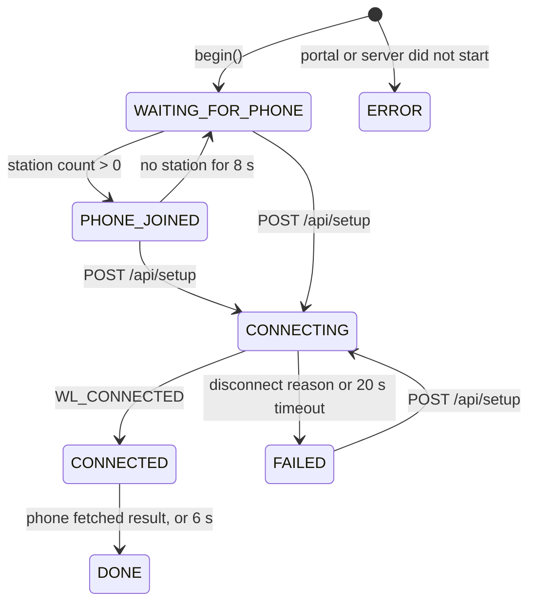
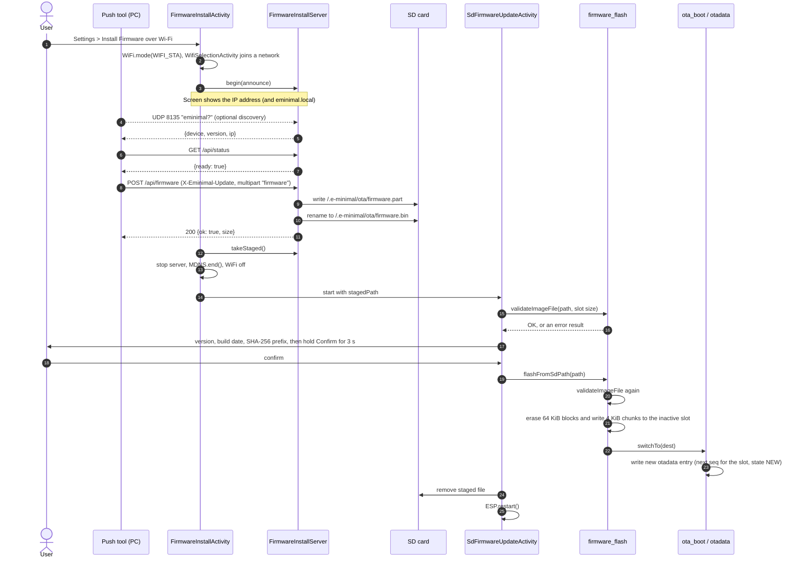
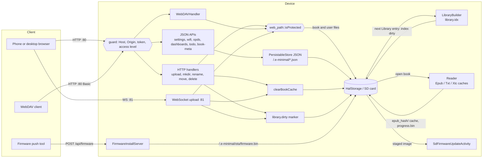

# e-Minimal Firmware: Network and Storage

| | |
|---|---|
| **Status** | Draft |
| **Applies to** | commit `36f4315e`, branch `master`, build target `[env:eminimal]` |
| **Audience** | Firmware contributors, reviewers, and anyone auditing what the device exposes over Wi-Fi or writes to the SD card |
| **Scope** | Everything under `src/network`, the firmware update paths, the SD card access layer, and every persistent store |
| **Related** | [01-system-overview.md](01-system-overview.md), [02-display-pipeline.md](02-display-pipeline.md), [03-application-framework.md](03-application-framework.md), [04-dashboard-and-games.md](04-dashboard-and-games.md), [06-build-flash-release.md](06-build-flash-release.md) |

All paths in this document are relative to the repository root. A claim is followed by the file and symbol that backs it.

## Table of contents

1. [Overview](#1-overview)
2. [Part A: Networking](#part-a-networking)
   - 2. [Wi-Fi lifecycle](#2-wi-fi-lifecycle)
   - 3. [Phone portal and phone pages](#3-phone-portal-and-phone-pages)
   - 4. [Servers](#4-servers)
   - 5. [Clients](#5-clients)
   - 6. [Web page authoring and embedding](#6-web-page-authoring-and-embedding)
   - 7. [Firmware update paths](#7-firmware-update-paths)
   - 8. [Security considerations](#8-security-considerations)
3. [Part B: Storage](#part-b-storage)
   - 9. [SD card access layer](#9-sd-card-access-layer)
   - 10. [On-card directory layout](#10-on-card-directory-layout)
   - 11. [Persistent stores](#11-persistent-stores)
   - 12. [Internal flash and off-card state](#12-internal-flash-and-off-card-state)
   - 13. [Data flow: phone to reader](#13-data-flow-phone-to-reader)
4. [Differences from the existing docs](#14-differences-from-the-existing-docs)
5. [Open questions](#15-open-questions)

---

## 1. Overview

The device has one radio and one removable storage medium. Both are used on demand.

- **Wi-Fi is off while reading.** The radio is brought up only inside a network screen (File Transfer, Wi-Fi setup, Game Night, phone text entry, firmware install, OPDS, the Weather widget's daily fetch). Leaving that screen turns the radio off and, in most cases, restarts the firmware silently to recover heap (`src/network/NetworkLink.h`, `src/SilentRestart.h`).
- **Every HTTP server listens on port 80 and only one runs at a time.** There are five: `CrossPointWebServer`, `WifiSetupServer`, `TextEntryServer`, `GameServer`, `FirmwareInstallServer`. Each instance is owned by one activity (`src/network/TextEntryServer.h`, class comment).
- **All user data lives on the SD card.** The `[env:eminimal]` partition table has no SPIFFS partition (`partitions_eminimal.csv`). Settings, credentials, caches and the library index are files under `/.e-minimal` on the card.
- **Persistent stores are JSON**, written through one base class with temp-file-then-rename and a `.bak` fallback (`lib/Serialization/PersistableStore.h`). Book caches and the library index are binary (`lib/Serialization/Serialization.h`, `lib/LibraryIndex/LibraryFormat.h`).
- **Firmware updates on this board come from the SD card**, either from a file the user copied or from an image pushed over Wi-Fi and staged on the card. Both paths validate the image and require confirmation on the device (`src/network/FirmwareFlasher.h`, `src/activities/settings/SdFirmwareUpdateActivity.cpp`).

Two upstream features are compiled out of this target by `platformio.ini` (`[env:eminimal]`): Calibre wireless (`-DFREEINK_NO_CALIBRE_WIRELESS=1`) and KOReader sync (`-DFREEINK_NO_KOSYNC=1`).

---

# Part A: Networking

## 2. Wi-Fi lifecycle

### 2.1 Radio states

`NetworkLink::state()` (`src/network/NetworkLink.h`) reports one of three states from `WiFi.getMode()` and `WiFi.status()`:

| State | Condition | Used by |
|---|---|---|
| `OFF` | Mode is `WIFI_MODE_NULL`, or no link in either mode | Reading, Home, Library, Settings |
| `STATION` | STA bit set and `WL_CONNECTED` | File Transfer (Join Network), firmware install, OPDS, Weather fetch |
| `HOTSPOT` | AP bit set | File Transfer (Create Hotspot), Wi-Fi phone setup, phone text entry, Game Night |

### 2.2 Who turns the radio on

| Entry point | Mode | Owner | Radio off / restart on exit |
|---|---|---|---|
| File Transfer, Join Network | STA | `CrossPointWebServerActivity::onNetworkModeSelected` | `silentRestart()` in `onExit` when Wi-Fi was on |
| File Transfer, Create Hotspot | AP | `CrossPointWebServerActivity::startAccessPoint` via `PhonePortal` | Same |
| Wi-Fi setup from a phone | AP+STA | `WifiSelectionActivity` owning `WifiPhoneSetup` | Portal dropped; a joined station survives for the caller |
| Phone text entry | STA if already joined, else AP | `PhoneTextEntryActivity::start` | Radio returned to the state it was found in; no restart |
| Dashboards / Dictionaries page | STA or AP | `DashboardPortalActivity` (`src/activities/dashboard/DashboardPortalActivity.cpp`) | `silentRestart()` or `silentRestartToSettings()` in `onExit` when the radio was used |
| Game Night | AP | `GameNightActivity::startAccessPoint` | Portal dropped, then `silentRestart()` or `silentRestartToReader()` in `onExit` when Wi-Fi was on |
| Install Firmware over Wi-Fi | STA | `FirmwareInstallActivity::onEnter` | `silentRestart()` in `onExit` |
| Weather widget fetch | STA | `WeatherService::fetch` via `saved_wifi::connect` | `saved_wifi::disconnect()` after each fetch; `DashboardHomeActivity::onExit` restarts if `saved_wifi::usedSinceBoot()` |
| OPDS browser | STA | `OpdsBookBrowserActivity` | See [03-application-framework.md](03-application-framework.md) |

### 2.3 Saved networks: `WifiCredentialStore`

`WifiCredentialStore` (`src/WifiCredentialStore.h`) holds up to eight networks (`MAX_NETWORKS`) and the SSID that connected last. It is saved to `/.e-minimal/wifi.json`. Passwords are XOR-obfuscated with a key derived from `esp_efuse_mac_get_default()` and base64-encoded (`lib/Serialization/ObfuscationUtils.cpp`); the class comment states this is not cryptographically secure. Each entry also stores `password_len` and `password_crc32`; an entry whose decoded password fails either check is discarded and the file is resaved (`WifiCredentialStore::fromJson`).

The SDK's own NVS credential storage is disabled with `WiFi.persistent(false)` before every `WiFi.begin` call (`WifiSelectionActivity::attemptConnection`, `saved_wifi::prepareStation`, `WifiPhoneSetup::startAttempt`) and in `PhoneTextEntryActivity::start` and `DashboardPortalActivity::startHotspot`.

### 2.4 Unattended joins: `SavedWifi`

`saved_wifi::connect()` (`src/network/SavedWifi.cpp`) is the blocking join used by background jobs with no UI of their own.

1. Try the last-connected network.
2. Otherwise scan, keep the saved networks that are in range, sort by RSSI, and try each.
3. Each attempt waits up to `perNetworkTimeoutMs` (default 10 s) and stops early on `WL_CONNECT_FAILED`.

Open networks are skipped unless `SETTINGS.backgroundOpenWifi` is set. In step 2 the scan result is also checked: a network that is open on the air is skipped even when its name is saved with a password (`saved_wifi::connect`, comment "an impostor"). Step 1 joins the last-connected network without a scan, so that check does not run there. The station hostname is `eMinimal-<MAC>`.

### 2.5 Phone-assisted setup: `WifiPhoneSetup` and `WifiSetupServer`

The device has no keyboard suited to long passwords, so the password can be typed on a phone. `WifiPhoneSetup` (`src/network/WifiPhoneSetup.h`) is the state machine; `WifiSelectionActivity` paints it.



Key behaviour, all in `src/network/WifiPhoneSetup.cpp`:

- The portal is raised in `WIFI_AP_STA` mode (`Config::keepStation`) on the channel of the target network. An AP+STA radio has one channel, so this keeps the phone attached during the join.
- The submit handler only records the request. The join starts on the next `loop()` so the HTTP response leaves first.
- Auto-reconnect is disabled during an attempt. The verdict comes from `ARDUINO_EVENT_WIFI_STA_DISCONNECTED` reasons, because `WiFi.status()` alone cannot distinguish a wrong password.
- Failure reasons map to `WRONG_PASSWORD`, `NOT_FOUND` or `TIMEOUT` (`isPasswordReason`, `pollAttempt`).
- The portal stays up after a result until the phone has fetched it (`WifiSetupServer::resultSeenByPhone`) or `RESULT_HOLD_MS` (6 s) passes.

The credential is saved by the activity, not by `WifiPhoneSetup` (`WifiSelectionActivity.cpp`, `WIFI_STORE.addCredential` and `setLastConnectedSsid`).

### 2.6 Power implications

- `CrossPointWebServer::begin` calls `WiFi.setSleep(false)`. `PhoneTextEntryActivity::start` does the same in station mode.
- `HttpDownloader` disables modem sleep for the duration of each transfer and restores `WIFI_PS_MIN_MODEM` afterwards (`WifiPowerSaveGuard` in `src/network/HttpDownloader.cpp`). `OtaUpdater::installUpdate` does the same.
- Activities that serve HTTP return `preventAutoSleep() == true` while the server runs (`CrossPointWebServerActivity.h`, `FirmwareInstallActivity.h`).
- Idle timeouts turn the radio off without user action: File Transfer after the configured Auto-stop time (`WebSession::idleExpired`, Off / 5 / 15 / 30 min), firmware install after 5 min (`FirmwareInstallActivity::IDLE_STOP_MS`), phone text entry after 5 min (`PHONE_IDLE_MS`).
- Wi-Fi alone needs roughly 45 KB of heap, and the server comes on top (comment in `FirmwareInstallActivity::onEnter`). Network activities release the SD-font caches first (`FontCacheManager::releaseSdFontCaches`) and restart afterwards because the radio leaves the heap fragmented (`src/network/SavedWifi.h`, comment on `disconnect`).

---

## 3. Phone portal and phone pages

### 3.1 `PhonePortal`

`PhonePortal` (`src/network/PhonePortal.h`) owns the Wi-Fi side of "the device raises a page and a phone opens it": the access point, a catch-all DNS server on port 53, mDNS, and the strings a QR code needs.

| Property | Value | Source |
|---|---|---|
| Shared SSID | `eMinimal` | `PhonePortal::SHARED_SSID` |
| mDNS name | `eminimal.local` | `PhonePortal::SHARED_HOSTNAME` |
| Security | WPA2, always | `PhonePortal::begin`: a `Config` without a passphrase gets a generated one |
| Passphrase | 8 characters from a 54-character alphabet without `0/O/1/l/I`, from `esp_random()` | `PhonePortal::generatePassphrase` |
| Passphrase lifetime | Saved in `SETTINGS.phoneTextPassphrase`; or new per session when `hotspotPasswordMode == 1` | `PhonePortal::sharedPassphrase` |
| Default clients | 4 | `Config::maxClients` |
| Captive DNS | Every name resolves to the AP address | `dns->start(DNS_PORT, "*", apIp)` |
| Join QR | `WIFI:T:WPA;S:<ssid>;P:<passphrase>;;` | `PhonePortal::joinQrPayload` |

Portal users and their configuration:

| Feature | SSID | Passphrase | Max clients | Mode |
|---|---|---|---|---|
| File Transfer hotspot; Dashboards / Dictionaries page hotspot | `eMinimal` | shared | 4 | AP |
| Wi-Fi phone setup | `eMinimal` | shared | 2 | AP+STA |
| Phone text entry | `eMinimal` | shared | 2 | AP, or AP+STA if the radio was already on |
| Game Night | `eMinimal Games` | random per session | `party::MAX_PLAYERS` | AP |

Game Night passes no passphrase in its `Config` (`GameNightActivity::startAccessPoint`), so `PhonePortal::begin` generates one for the session. The comment in `GameNightActivity.cpp` that calls this network "Open" does not match `PhonePortal::begin`.

### 3.2 `PhonePage`

`PhonePage` (`src/network/PhonePage.h`) holds two helpers shared by every server:

- `sendStatic` sends a build-time gzipped asset with `Content-Encoding: gzip`, an `ETag`, and `Cache-Control: no-cache`. A matching `If-None-Match` gets `304`. The server must collect the `If-None-Match` header.
- `redirectCaptive` answers an unmatched URI with `302` to `/`, which is the answer phone operating systems need to open their captive-portal sheet. URIs under `/api/` are not redirected, so a page's own request errors surface as `404`.

---

## 4. Servers

Summary of every listener:

| Server | Transport and port | Runs during | Link | Authentication |
|---|---|---|---|---|
| `CrossPointWebServer` | HTTP 80, WebSocket 81, UDP 8134 | File Transfer; Dashboards / Dictionaries page (`DashboardPortalActivity`) | STA or AP | Session token / 6-digit code (default on), access level |
| `WebDAVHandler` | HTTP 80 (same server) | File Transfer, when Security > WebDAV is on | STA or AP | HTTP Basic with the code as password |
| `WifiSetupServer` | HTTP 80 | Wi-Fi phone setup | AP+STA | None beyond the WPA2 hotspot |
| `TextEntryServer` | HTTP 80 | Phone text entry | STA or AP | None beyond the link |
| `GameServer` | HTTP 80 | Game Night | AP | Per-seat token for actions |
| `FirmwareInstallServer` | HTTP 80, UDP 8135 | Install Firmware over Wi-Fi | STA | Required request header; confirmation on device |
| `PhonePortal` DNS | UDP 53 | Any hotspot | AP | n/a |

### 4.1 `CrossPointWebServer` (File Transfer)

**Purpose.** The file manager, settings, fonts, dictionaries, dashboards and pictures pages, their JSON APIs, and uploads (`src/network/CrossPointWebServer.h`). User-level documentation is in [../webserver.md](../webserver.md); the full endpoint reference with request and response bodies is in [../webserver-endpoints.md](../webserver-endpoints.md); page design rules are in [../web-ui.md](../web-ui.md). This section summarises and records where the code differs.

**When it runs.** Created in `CrossPointWebServerActivity::startWebServer` after a station join or after the hotspot is up. `DashboardPortalActivity::startServer` creates the same server, with its own `WebSession`, for the Dashboards and Dictionaries pages. `begin()` refuses to start without a connected station or a running AP. The activity calls `handleClient()` in batches of up to 500 iterations per loop (`MAX_ITERATIONS`).

**Access model.** `WebSession::begin` (`src/util/WebSession.cpp`) creates the per-session credentials after Wi-Fi is up:

- a 32-hex-character token from 16 bytes of `esp_fill_random`,
- a 6-digit code from `esp_random() % 1000000`,
- a snapshot of the Security settings into `WebSecurityOptions` (`requireCode`, `accessLevel`, `webdav`, `discovery`).

Every route is registered through `CrossPointWebServer::route` or `routeUpload`, which call `guard` → `check`. `check` applies, in order:

1. **Host check.** `hostAccepted` accepts only the station IP, the AP IP, `eminimal.local`, and `<WiFi hostname>.local`. Otherwise `421`, or on the hotspot a `302` to the AP address for non-API GETs.
2. **Origin check on writes.** A non-read method with an `Origin` header that is `null` or not an accepted host gets `403`.
3. **Body cap.** JSON routes reject bodies over 64 KiB (`MAX_JSON_BODY`) with `413`.
4. **Authentication.** Accepted when `requireCode` is off, or the `ems` cookie matches the token, or (WebDAV only) HTTP Basic carries the code, or `?t=<token>` matches. Token and code comparisons use `constantTimeEquals`.
5. **Access level.** Each route names the least `WebAccess` it needs (`Read`, `Upload`, `Modify`). The session level admits routes up to its own; otherwise `403`.

A page GET authenticated by `?t=` is answered with `Set-Cookie: ems=<token>; Path=/; SameSite=Strict` and a redirect to the same URL without `t` (`Verdict::SetCookie`). `POST /api/login` is the only route open without a session; five wrong codes lock all code attempts for 60 s (`tryCode`, `MAX_CODE_TRIES`, `LOCKOUT_MS`). Allowed responses carry `X-Frame-Options: DENY`, `X-Content-Type-Options: nosniff` and `Referrer-Policy: no-referrer`. No CORS headers are sent.

The multipart data callback re-runs `check` before each chunk is written (`routeUpload`).

**Endpoints.** Registered in `CrossPointWebServer::begin`:

| Method | Path | Access | Purpose |
|---|---|---|---|
| GET | `/`, `/files`, `/settings`, `/fonts`, `/dictionaries`, `/dashboards`, `/pictures`, `/convert` | Read | Pages |
| GET | `/css/app.css`, `/js/app.js`, `/js/jszip.min.js`, `/js/bindery-core.js`, `/js/bindery-app.js`, `/js/pdf.min.js`, `/js/pdf.worker.min.js` | Read | Static assets |
| POST | `/api/login` | none | Exchange the 6-digit code for the session cookie |
| GET | `/api/status` | Read | Version, IP, mode, RSSI, free heap, uptime, device, access level |
| GET | `/api/files`, `/api/folders` | Read | Directory listing; streamed folder tree (depth 4, 256 entries) |
| GET | `/download` | Read | Stream one file in 4 KiB chunks |
| POST | `/upload` | Upload | Multipart upload |
| POST | `/mkdir` | Upload | Create folder |
| POST | `/rename`, `/move`, `/delete` | Modify | File management |
| GET / POST | `/api/book-meta` | Read / Modify | Per-book metadata overrides |
| GET / POST | `/api/settings` | Read / Modify | Settings that are not device-only |
| GET | `/api/fonts` | Read | Installed SD fonts |
| POST | `/api/fonts/upload` | Upload | `.cpfont` upload |
| POST | `/api/fonts/delete` | Modify | Remove a font family |
| GET | `/api/dictionaries` | Read | Installed dictionaries |
| POST | `/api/dictionaries/select`, `/api/dictionaries/delete` | Modify | Choose or remove a dictionary |
| GET / POST | `/api/dashboards`, `/api/todo` | Read / Modify | Dashboard layouts, widget settings, to-do list (see [04-dashboard-and-games.md](04-dashboard-and-games.md)) |
| GET / POST | `/api/opds`, `/api/opds/delete` | Modify (reads included) | OPDS server list |
| GET / POST | `/api/wifi`, `/api/wifi/delete` | Modify (reads included) | Saved Wi-Fi networks |

**WebSocket upload (port 81).** Text frame `START:<token>:<filename>:<size>:<path>`, then binary frames, with `READY`, `PROGRESS:`, `DONE` or `ERROR:` replies (`onWebSocketEvent`). The handshake applies the same Host and Origin rules to the headers that are present (`wsHandshakeHeader`); no header is mandatory, so a handshake that sends no `Host` header is not refused at this step. `START` checks the token, the access level, `FsHelpers::isSafePathComponent` on the file name, and `web_path::isProtected` on the path. An upload with no frame for 30 s (`WS_IDLE_MS`) is aborted and its partial file removed.

**UDP discovery (port 8134).** When `security.discovery` is on, the payload `hello` is answered with `crosspoint (on <hostname>);81` (`handleClient`). The `UDP_PORTS[]` array declared at the top of `CrossPointWebServer.cpp` is not referenced anywhere; only `LOCAL_UDP_PORT` (8134) is used.

**Memory and concurrency.**

- The `WebServer` and `WebSocketsServer` objects are heap-allocated in `begin()` and freed in `stop()`.
- HTTP uploads are buffered in a 4 KiB vector (`UploadState::UPLOAD_BUFFER_SIZE`) before each SD write. Downloads stream through a 4 KiB stack buffer.
- WebSocket upload state is file-scope (`wsUploadFile`, `wsUploadInProgress`, ...). One upload runs at a time; a second `START` is refused.
- The serving task is deliberately not subscribed to the task watchdog (comment at the end of `begin()`).
- `GET /api/book-meta` does not open the EPUB when the largest free heap block is below 60 KiB (`BOOK_META_MIN_HEAP`, `ESP.getMaxAllocHeap()`); it still answers, with the title taken from the file name.
- `PersistableStoreBase::storeMutex` serialises concurrent saves from the web path and the main task (`lib/Serialization/PersistableStore.h`).

**Side effects on the library.** A completed upload clears that book's cache (`clearBookCache`) and, for `.epub`, `.txt`, `.md`, `.xtc` and `.xtch`, marks the library index dirty (`isLibraryBookFile`, `library::markLibraryIndexDirty`). Rename carries the book's cache, bookmarks, recent entry and open-book pointer to the new path (`moveBookStateInFolder` and the helper above it). Move (`handleMove`) clears the book's cache instead and carries only its metadata override (`bookmeta::move`). HTTP and WebSocket uploads refuse to overwrite an existing file.

### 4.2 `WebDAVHandler`

**Purpose.** WebDAV access to the card for desktop file managers (`src/network/WebDAVHandler.h`).

**When it runs.** Registered on the File Transfer server only when `security.webdav` is true (`CrossPointWebServer::begin`). It answers any path for `OPTIONS`, `PROPFIND`, `GET`, `HEAD`, `PUT`, `DELETE`, `MKCOL`, `MOVE`, `COPY`, `LOCK`, `UNLOCK` (`WebDAVHandler::canHandle`).

**Access model.** Every request passes `WebDavGate::allow`, which is `CrossPointWebServer::davGate` → `check` with `RouteKind::Dav`. Unauthenticated requests get `401` with `WWW-Authenticate: Basic realm="e-Minimal"`.

| Method | Access needed |
|---|---|
| `OPTIONS`, `PROPFIND`, `GET`, `HEAD` | Read |
| `PUT` of a new file, `MKCOL`, `COPY`, `LOCK`, `UNLOCK` | Upload |
| `PUT` over an existing file, `DELETE`, `MOVE` | Modify |

`PUT` decides its level when the body starts (`_putNeeded`) and writes to `<path>.davtmp` before renaming into place. `GET`, `HEAD`, `PUT`, `DELETE`, `MKCOL`, `MOVE` and `COPY` filter their paths with `web_path::isProtected`. `handlePropfind` does not apply it to the requested path, only to the names of the children it lists: a `PROPFIND` of `/.e-minimal` returns the names and sizes of its entries that do not start with a dot, and a `PROPFIND` of a file inside it returns that file's size. File contents stay unreachable. `LOCK` and `UNLOCK` are dummies that touch no file.

### 4.3 `WebPathGuard`

`web_path::isProtected` (`src/network/WebPathGuard.h`) is the single path rule used by the web interface, WebDAV and the upload WebSocket. A path is protected when **any** segment, separated by `/` or `\`, is protected. A segment is protected when, after ignoring leading spaces and trailing dots and spaces (which FAT also ignores):

- it starts with `.` (covers `.`, `..` and `/.e-minimal`),
- it contains `~` followed by a digit (FAT 8.3 short-name aliases such as `EMINIM~1`),
- it equals `System Volume Information` or `XTCache`, case-insensitively.

A null path is protected. Before this check, request paths are normalised by `normalizeWebPath`, which calls `FsHelpers::normalisePath`.

### 4.4 `WifiSetupServer`

**Purpose.** The form a phone uses to send a home network password (`src/network/WifiSetupServer.h`). Runs only inside `WifiPhoneSetup`.

| Method | Path | Behaviour |
|---|---|---|
| GET | `/` | Setup page |
| GET | `/css/app.css` | Stylesheet |
| GET | `/api/setup` | `{state, ssid, error?, ip?}`; fetching a final state sets `resultSeen` |
| POST | `/api/setup` | JSON `{ssid, password}`; SSID 1 to 32 bytes, password at most 63; `409` while connecting |
| GET | `/api/networks` | JSON array of SSIDs from the last scan, streamed |
| any | other | Captive redirect, or `404` under `/api/` |

There is no per-request authentication. The page is reachable by any client on the hotspot. The trade-off of using the shared passphrase here is written out in `WifiPhoneSetup::begin`. The status body is serialised into a 320-byte stack buffer.

### 4.5 `TextEntryServer`

**Purpose.** One text field typed on a phone instead of the on-device keyboard (`src/network/TextEntryServer.h`). Owned by `PhoneTextEntryActivity`.

| Method | Path | Behaviour |
|---|---|---|
| GET | `/` | Text entry page |
| GET | `/css/app.css` | Stylesheet |
| GET | `/api/text` | `{title, text?, maxBytes, kind, state}`; `text` is never sent for a password field |
| POST | `/api/text` | JSON `{text}`; accepted once, later posts get `409` |

Validation in `handleSubmit`: body at most 1024 bytes, text at most the field limit (default `MAX_TEXT_BYTES` = 256), no control characters, well-formed UTF-8 structure. There is no per-request authentication. In station mode the page is reachable by any host on the joined network; the activity uses `requestCount()` to detect a phone.

### 4.6 `GameServer` (summary)

`GameServer` (`src/network/GameServer.h`) is the HTTP half of Game Night. It is intentionally separate from the file server so that guests never face WebDAV, WebSockets or the file manager. The protocol and game state are documented in [04-dashboard-and-games.md](04-dashboard-and-games.md) and [../party-games.md](../party-games.md).

| Method | Path | Behaviour |
|---|---|---|
| GET | `/`, `/css/app.css` | Play page and stylesheet |
| GET, POST | `/api/game/state` | State as seen by the caller's seat; spectators get a view without a seat |
| POST | `/api/game/join` | Issues a seat token |
| POST | `/api/game/act` | Requires a valid seat token (`403` otherwise) |
| POST | `/api/game/leave` | Releases the caller's seat |
| OPTIONS | any | `204` |
| any | other | `302` to `/`, or `404` JSON under `/api/` |

Every state document is serialised into one fixed 3072-byte buffer (`JSON_BUFFER_SIZE`). The server has no access to the SD card.

### 4.7 `FirmwareInstallServer`

Described with the update flow in [section 7.3](#73-install-firmware-over-wi-fi).

---

## 5. Clients

### 5.1 `HttpDownloader`

`HttpDownloader` (`src/network/HttpDownloader.h`) is the only outbound HTTP client. It offers three `fetchUrl` overloads (to a string, to a `Stream`, to a callback) and `downloadToFile`.

- **TLS stack.** `[base]` in `platformio.ini` sets `-DFREEINK_NET_WOLFSSL=1`, which `[env:eminimal]` inherits. With that flag every request goes through `runGetWolf`, which uses `freeink::SecureHttpClient` (`src/network/HttpDownloader.cpp`). The `esp_http_client` path with the CA bundle is compiled only without the flag.
- **Redirects.** Up to five hops (`MAX_REDIRECTS`). `downgradeRedirectsToHttp` rewrites an `https://` redirect target to `http://` to avoid a second TLS session.
- **Timeout.** 60 s per socket operation (`HTTP_TIMEOUT_MS`).
- **Credentials.** Optional HTTP Basic, sent pre-emptively.
- **User-Agent.** `CrossPoint-ESP32-<CROSSPOINT_VERSION>`.
- **Heap floor.** Callers should check `MIN_TLS_FREE_HEAP` (40 000) and `MIN_TLS_MAX_ALLOC` (20 000) before a TLS transfer; `WeatherService::fetch` and `OpdsBookBrowserActivity` do.
- **File downloads.** `downloadToFile` removes any existing destination, writes directly to the destination path, and removes it on failure or when no data arrived. There is no temporary file.

Users: `WeatherService` (forecast JSON), `OpdsBookBrowserActivity` (feeds and book downloads), `FontDownloadActivity` (font manifest and files), `OtaUpdater`.

### 5.2 OPDS

- **Server list.** `OpdsServerStore` (`src/OpdsServerStore.h`), up to eight servers with name, URL, user name and obfuscated password, in `/.e-minimal/opds.json`. Editable on the device and through `/api/opds`.
- **Parsing.** `lib/OpdsParser` provides a streaming parser (`OpdsParser`, `OpdsParserStream`). The browser activity feeds the HTTP body into it as it arrives and truncates a feed that does not fit in memory (`OpdsBookBrowserActivity.cpp`, log "Feed truncated to fit memory").
- **Downloads.** Books are saved to `SETTINGS.opdsDownloadFolder` (SD root when empty) under a name built by `opdsBookFilename` from `SETTINGS.opdsFilenameFormat`.

### 5.3 KOReader sync

`lib/KOReaderSync` contains the client, credential store (`/.e-minimal/koreader.json`), document identifier and progress mapping. It is **not part of the e-Minimal target**: `[env:eminimal]` defines `FREEINK_NO_KOSYNC=1` and removes `KOReaderSettingsActivity.cpp`, `KOReaderAuthActivity.cpp` and `KOReaderSyncActivity.cpp` from the build with `build_src_filter`. The settings entry is guarded by `#if !FREEINK_NO_KOSYNC` (`SettingsActivity.cpp`, `SettingsList.h`).

### 5.4 Calibre wireless

Not part of the e-Minimal target: `FREEINK_NO_CALIBRE_WIRELESS=1`, and `CalibreConnectActivity.cpp` is filtered out of the build.

---

## 6. Web page authoring and embedding

Pages are plain files under `src/network/html`: one `*.html` per page, shared `css/app.css`, and scripts under `js/`. They are not served from the SD card.

`scripts/build_html.py` runs as a PlatformIO pre-build script (`extra_scripts = pre:scripts/build_html.py` in `platformio.ini`). For every `.html`, `.js` and `.css` file under `src/` it:

1. Minifies HTML only (comments removed, whitespace collapsed; `pre`, `code`, `textarea`, `script` and `style` blocks preserved).
2. Compresses with gzip level 9 and `mtime=0` for reproducible output.
3. Writes `<Name><Html|Css|Js>.generated.h` beside the source, containing a `constexpr char[] PROGMEM` byte array, `...CompressedSize`, `...OriginalSize`, and `...ETag`.

The ETag is the first 16 hex characters of the SHA-256 of the compressed bytes. Because the content is fixed for a firmware image, `PhonePage::sendStatic` can answer a matching `If-None-Match` with `304`. Brotli is not used; the script notes that Firefox does not accept it over plain HTTP.

A server includes the generated header and passes the symbols to `PhonePage::sendStatic`, for example `WifiSetupPageHtml` / `WifiSetupPageHtmlETag` in `WifiSetupServer::handlePage`. Design rules for the pages are in [../web-ui.md](../web-ui.md). The build pipeline as a whole is covered in [06-build-flash-release.md](06-build-flash-release.md).

---

## 7. Firmware update paths

### 7.1 Components

| Component | File | Role |
|---|---|---|
| `firmware_flash::validateImageFile` | `src/network/FirmwareFlasher.cpp` | Full integrity check of an image file on the SD card |
| `firmware_flash::flashFromSdPath` | `src/network/FirmwareFlasher.cpp` | Raw write of the image to the inactive OTA slot, then boot switch |
| `ota_boot::switchTo` | `src/network/OtaBootSwitch.cpp` | Writes a new `otadata` entry selecting the destination slot |
| `board_tag::Scanner` | `src/network/FirmwareBoardTag.cpp` | Streaming search for the embedded board tag |
| `FirmwareInstallServer` | `src/network/FirmwareInstallServer.cpp` | Receives a pushed image and stages it on the SD card |
| `FirmwareInstallActivity` | `src/activities/network/FirmwareInstallActivity.cpp` | Wi-Fi join, server lifetime, handover to the install screen |
| `SdFirmwareUpdateActivity` | `src/activities/settings/SdFirmwareUpdateActivity.cpp` | File picker, validation, on-device confirmation, flashing |
| `OtaUpdater` | `src/network/OtaUpdater.cpp` | Upstream GitHub release check and download |
| `FirmwareIdentity.h` | `src/FirmwareIdentity.h` | Product name, display version and hostname macros |

### 7.2 Image validation

`validateImageFile` streams the file in 4 KiB chunks and returns a `firmware_flash::Result`:

| Check | Failure result |
|---|---|
| File opens | `OPEN_FAIL` |
| Size at least 64 KiB | `TOO_SMALL` |
| Size at most the destination partition | `TOO_LARGE` |
| First byte is `0xE9` | `BAD_MAGIC` |
| `chip_id` (header offset 12) equals that of the running image | `BAD_CHIP` |
| Segment table stays inside the file | `BAD_SEGMENTS` |
| No embedded board tag naming a different board | `WRONG_BOARD` |
| Body, padding and optional hash add up to the file size | `BAD_SIZE` |
| XOR checksum (seed `0xEF`) matches the stored byte | `BAD_CHECKSUM` |
| SHA-256 trailer matches, when `hash_appended` is set | `BAD_SHA` |

**Board tag.** Every image contains the string `CROSSPOINT-BOARD-V1:<board>;` once in `.rodata` (`board_tag::TAG`). The board name comes from the `FREEINK_DEVICE_*` build flag; for this target it is `eminimal`. The scanner rejects only a tag that names a **different** board. An image with no tag passes (`src/network/FirmwareBoardTag.h`, header comment). The tag exists because all ESP32-S3 boards share one `chip_id`.

**What validation does not cover.** There is no cryptographic signature check. The SHA-256 trailer is an integrity hash inside the image, not an authenticity proof. The on-device confirmation screen states that the firmware is unsigned (described in [../eminimal-controls.md](../eminimal-controls.md)).

### 7.3 Install Firmware over Wi-Fi

Entry: Settings > Install Firmware over Wi-Fi (`SettingAction::WifiFirmwareInstall`).

`FirmwareInstallServer` exposes only this surface (`src/network/FirmwareInstallServer.h`):

| Transport | Endpoint | Behaviour |
|---|---|---|
| HTTP GET | `/api/status` | `{device, version, ip, ready}` |
| HTTP POST | `/api/firmware` | Multipart, field `firmware`; must carry the `X-Eminimal-Update` header |
| HTTP | any other | `404` JSON |
| UDP 8135 | payload `eminimal?` | Replies `{device, version, ip}` to the sender, when Announce on Network is on |
| mDNS | `_eminimal-update._tcp` on port 80, name `eminimal.local` | When Announce on Network is on (`FirmwareInstallActivity::startServer`) |

Upload checks, in `handleUploadData`: header present (`403`), field name (`400`), no image already staged (`409`), an OTA slot exists, first byte `0xE9` (`400`), running size at most the slot size (`413`), final size at least 64 KiB (`400`), SD write success (`507`). The body is written to `/.e-minimal/ota/firmware.part` in 4 KiB batches and renamed to `/.e-minimal/ota/firmware.bin` on completion. The server never writes to flash.



Notes on the flow:

- `flashFromSdPath` is called with `alreadyValidated == false` from `SdFirmwareUpdateActivity`, so the image is validated a second time immediately before the write. The activity's comment calls this a TOCTOU re-validation (for example, a swapped card).
- The information shown before confirmation is read from the image: `esp_app_desc_t` version, date and time at file offset 32, and the first four bytes of the SHA-256 trailer (`SdFirmwareUpdateActivity::readImageInfo`).
- If the user cancels or the install fails, `FirmwareInstallActivity::installStaged` removes the staged file and calls `silentRestart()`.
- The activity leaves by itself after five minutes without a request (`IDLE_STOP_MS`).

### 7.4 SD Card Firmware Update and boot recovery

Settings > SD Card Firmware Update starts `SdFirmwareUpdateActivity` without a staged path. It opens `FileBrowserActivity` in `Mode::PickFirmware` and then follows the same validate, confirm and flash steps.

The same activity is the recovery path. `setup()` in `src/main.cpp` samples a physical key at a power-button wake (`recoveryFirmwareMode`; Up on this board) and, when held, replaces the normal start with `SdFirmwareUpdateActivity(..., recoveryMode = true)`. In recovery mode cancelling returns to the picker instead of leaving.

### 7.5 Partition switching

The `[env:eminimal]` table has two application slots of `0x7F0000` bytes each (`app0` / `ota_0`, `app1` / `ota_1`) and a two-sector `otadata` partition (`partitions_eminimal.csv`). Partition layout and flashing over USB are covered in [06-build-flash-release.md](06-build-flash-release.md).

`flashFromSdPath` takes the destination from `esp_ota_get_next_update_partition`, erases in 64 KiB blocks interleaved with 4 KiB writes, and calls `ota_boot::switchTo`. It does not use the Arduino `Update` class or `esp_ota_set_boot_partition`; the header comment in `src/network/OtaBootSwitch.h` gives the reason (`esp_image_verify` rejects patched images on the upstream X3/X4 hardware).

`ota_boot::switchTo`:

1. Reads both 32-byte `otadata` entries.
2. Picks the active one: valid CRC, highest sequence, state not `INVALID` or `ABORTED`.
3. Computes the smallest sequence above the active one that maps to the destination slot (`(seq - 1) % 2`).
4. Erases the **other** `otadata` sector and writes the new entry with `ota_state = ESP_OTA_IMG_NEW` and a CRC32 over the sequence.

### 7.6 Failure and rollback behaviour

Facts from the code:

- **Before the switch.** Any validation, read, erase or write failure returns before `switchTo` is called. `otadata` is unchanged, so the next boot uses the slot that was already running. The inactive slot may hold a partial image.
- **After the switch.** The new entry is written with state `NEW`. The previous entry stays in the other `otadata` sector.
- **No explicit rollback calls.** Nothing under `src/` or `lib/` calls `esp_ota_mark_app_valid_cancel_rollback` or `esp_ota_mark_app_invalid_rollback_and_reboot`.
- **User-initiated recovery.** The Up + Power recovery hold reaches the SD firmware picker instead of the normal Home or reader routing (section 7.4), provided the installed image boots far enough to run `setup()`. The stores, `SETTINGS` included, are still loaded first.
- **Automatic rollback is enabled in the SDK configuration, with a short window.** `[env:eminimal]` has no `custom_sdkconfig`, so it links the framework's prebuilt ESP32-S3 libraries and bootloader; the `sdkconfig.default` and `sdkconfig.defaults` files in the repository root are for `esp32c3` and do not apply. In the framework package checked (Arduino core 3.3.11, `esp32s3/qio_opi/include/sdkconfig.h`) `CONFIG_BOOTLOADER_APP_ROLLBACK_ENABLE` is set. With it, the ESP-IDF bootloader turns the `NEW` entry into `PENDING_VERIFY` on the first boot, and the Arduino core's `initArduino()` (`cores/esp32/esp32-hal-misc.c`) calls `esp_ota_mark_app_valid_cancel_rollback()` before `setup()` runs, unless the application overrides the weak `verifyRollbackLater()` or `verifyOta()` hooks. Nothing under `src/` or `lib/` overrides them. An image that resets before `initArduino()` is therefore rolled back on the next boot; an image that gets that far is marked valid, and a later crash in `setup()` or the UI does not roll back. This was read from the sources and not exercised on a device; see [Open questions](#15-open-questions).

### 7.7 `OtaUpdater` (upstream release check)

`OtaUpdater` (`src/network/OtaUpdater.cpp`) queries `https://api.github.com/repos/crosspoint-reader/crosspoint-reader/releases/latest`, looks for an asset named `crosspoint-<tag>-<board>.bin`, compares three-part versions against `CROSSPOINT_VERSION`, and streams the image through `esp_ota_begin` / `esp_ota_write` / `esp_ota_end` / `esp_ota_set_boot_partition`. It checks `chip_id` and the board tag while streaming and calls `esp_ota_abort` on a mismatch.

The class is compiled into the e-Minimal image, but the "Check for Updates" action is omitted from the Global Settings list for this board with `#if !FREEINK_DEVICE_EMINIMAL` (`SettingsActivity.cpp`, comment "OtaUpdater only knows upstream's release assets; e-Minimal updates from the SD card"). The second list in the same file adds the action only when `globalMoved` is false, and `globalMoved` is `BoardConfig::isEMinimal78()`, which is true on this board. `SettingAction::CheckForUpdates` is the only place `OtaUpdateActivity` is created, so the updater cannot be started from the e-Minimal UI.

### 7.8 `FirmwareIdentity.h`

`src/FirmwareIdentity.h` separates the name shown to the user from the machine version:

| Macro | e-Minimal value (from `platformio.ini`) | Used for |
|---|---|---|
| `FIRMWARE_NAME_TEXT` | `e-Minimal` (`FIRMWARE_PRODUCT_NAME`) | Product name on screen |
| `FIRMWARE_DISPLAY_VERSION` | `e-Minimal v<eminimal.version>` | Version on screen |
| `FIRMWARE_ABOUT_VERSION` | Display version plus `(CrossPoint <crosspoint.version>)` | About screen |
| `FIRMWARE_HOSTNAME` | `eminimal` (`FIRMWARE_PRODUCT_HOSTNAME`) | mDNS name in Calibre mode (not built on this target) |
| `CROSSPOINT_VERSION` | `<eminimal.version>-eminimal` | Web API, User-Agent, discovery replies, OTA comparison |

---

## 8. Security considerations

This section states what the code does. It does not assess risk.

### 8.1 Access points

- `PhonePortal::begin` never raises an open network. With no passphrase configured it generates one.
- The shared passphrase is stored in `settings.json` on the SD card and reused across sessions unless Security > Hotspot Password is "New Each Time" (`PhonePortal::sharedPassphrase`). The comment in `WifiPhoneSetup::begin` records the consequence: every phone that ever joined knows it, and the Wi-Fi setup page carries the home network password over that link.
- The join QR code contains the passphrase (`joinQrPayload`).
- The captive DNS answers every name with the device address while a portal is up.

### 8.2 Authentication by server

| Server | Authenticated | Unauthenticated |
|---|---|---|
| `CrossPointWebServer` | All routes when Security > Access Code is on (the default, `webAccessCode = 1`) | `POST /api/login`; everything when Access Code is off |
| `WebDAVHandler` | Same gate, Basic auth | Not registered unless enabled |
| WebSocket (81) | Token in `START` when the code is required | The socket handshake itself (Host and Origin are checked) |
| `WifiSetupServer` | none | All endpoints |
| `TextEntryServer` | none | All endpoints |
| `GameServer` | Seat token for `act` and `leave` | Page, `state`, `join` |
| `FirmwareInstallServer` | none | `GET /api/status`; `POST /api/firmware` needs only the `X-Eminimal-Update` header |
| UDP 8134 / 8135 | none | Discovery replies, when Announce on Network is on |

Additional facts:

- All traffic is plain HTTP and plain WebSocket. No server in `src/network` terminates TLS.
- The `ems` session cookie is set without `HttpOnly` (`sendDenied`, `handleLogin`). [../webserver-endpoints.md](../webserver-endpoints.md) notes that page script reads it for the WebSocket.
- The session token and code live in RAM for one session and are regenerated by `WebSession::begin`.
- The Security settings are marked `withDeviceOnly()` in `src/SettingsList.h`, and `handlePostSettings` skips device-only entries, so they cannot be changed through `/api/settings`.
- The `X-Eminimal-Update` header requirement is a cross-site request defence, not a credential: the class comment in `FirmwareInstallServer.h` explains that a browser form cannot add it without a preflight the server never answers. Any host on the joined network that sends the header can stage an image. Flashing still requires confirmation on the device.
- `FirmwareInstallServer`, `WifiSetupServer`, `TextEntryServer` and `GameServer` do not check the `Host` header.

### 8.3 Path traversal protection

- HTTP file routes, WebDAV and the WebSocket all use `web_path::isProtected` (section 4.3), with one exception: WebDAV `PROPFIND` does not check the requested path, so it lists names and sizes inside a protected folder (section 4.2). `FsHelpers::normalisePath` runs first and collapses every `..` component separated by `/`; it cannot climb above the root. A `..` that survives (for example after a backslash) is refused because it starts with a dot.
- Upload and rename names are additionally checked with `FsHelpers::isSafePathComponent` or `isProtectedItemName`; new folder names are checked for characters FAT does not allow (`handleCreateFolder`).
- Font uploads validate the family name (`FontInstaller::isValidFamilyName`), the file name (`FontInstaller::isValidCpfontFilename`) and the first eight bytes of the file (`handleFontUploadData`).
- Dictionary deletion accepts only the roots `/dictionaries` and `/.dictionaries` (`handleDictionaryDelete`).
- `FirmwareInstallServer` writes to two fixed paths and takes no path from the client.
- `GameServer` and `TextEntryServer` do not touch the SD card. `WifiSetupServer` does not either; the credential is saved by the activity.

### 8.4 What is and is not validated

| Input | Validated | Not validated |
|---|---|---|
| Uploaded book or file | Name, destination path, access level | Content |
| Uploaded `.cpfont` | Names, magic bytes | Remainder of the file at upload time |
| Firmware image | Magic, chip, segments, checksum, SHA-256 trailer, board tag when present | Signature (none exists); an untagged image passes the board check |
| Wi-Fi setup form | SSID and password lengths | n/a |
| Text entry | Length, control characters, UTF-8 structure | Overlong encodings and surrogates (comment on `isWellFormedUtf8`) |
| JSON API bodies | Size cap of 64 KiB on File Transfer routes; per-field checks in each handler | n/a |
| HTTPS server certificates | Not verified on this build: `runGetWolf` calls `http.setInsecure()`, which sets `WOLFSSL_VERIFY_NONE` (`freeink-sdk/libs/network/SecureNet/src/SecureClient.cpp`) | The class comment in `HttpDownloader.h` ("verified against the CA bundle") describes the non-wolfSSL path only |

### 8.5 Stored secrets

- Wi-Fi and OPDS passwords are obfuscated, not encrypted (section 2.3). The key is the device MAC address.
- The hotspot passphrase is stored in `settings.json` (`phoneTextPassphrase`).
- All of these are on the removable SD card. `web_path::isProtected` keeps the contents of `/.e-minimal` out of reach of the web interface (WebDAV `PROPFIND` can still list file names and sizes there, section 4.2); USB Drive mode exposes the whole card as a mass-storage device (`HalStorage::beginUsbDrive`).

---

# Part B: Storage

## 9. SD card access layer

### 9.1 `HalStorage` and `HalFile`

All file access goes through the `Storage` singleton (`lib/hal/HalStorage.h`). Application code does not use SdFat types directly; the header undefines `SdMan`.

- `HalStorage::begin()` forwards to `SDCard.begin()`. The card driver lives in the vendored `freeink-sdk`. On this target the card is on native 1-bit SDMMC through SdFat's block-device interface (`-DUSE_BLOCK_DEVICE_INTERFACE=1` in `[env:eminimal]`).
- Methods take a recursive FreeRTOS mutex (`HalStorage::StorageLock`), so calls from different tasks are serialised.
- `openFileForRead` / `openFileForWrite` take a module tag used in log lines.
- `HalFile` is a move-only handle with `read`, `write`, `seek`, `rename`, `openNextFile` and `isContiguous`.
- `prepareForDeepSleep()` unmounts the card and stops the host before deep sleep. Open files become invalid.
- `beginUsbDrive()` detaches the filesystem and hands the block device to USB mass storage. The caller must stop all file work first and reboot after `endUsbDrive()`.

If the card fails to mount at boot, `setup()` shows "SD card error" and stops there (`src/main.cpp`).

### 9.2 `FsHelpers`

`lib/FsHelpers/FsHelpers.h` holds path and name utilities with no I/O state:

| Function | Purpose |
|---|---|
| `normalisePath`, `decodeUriEscapes` | Canonicalise request paths |
| `isSafePathComponent` | Reject names that are unsafe as a single path component |
| `sanitizePathComponentForFat32` | Make a name FAT-legal |
| `checkFileExtension`, `hasEpubExtension`, `hasTxtExtension`, ... | Case-insensitive type tests |
| `naturalLess`, `sortFileList` | Natural-order sorting |
| `extractFolderPath` | Parent folder of a file path |

### 9.3 Serialisation helpers

- `lib/Serialization/Serialization.h`: `writePod` / `readPod` and length-prefixed `writeString` / `readString`, for `HalFile` and standard streams. Used by the binary book caches. Values are written in the MCU's native little-endian layout.
- `lib/Serialization/PersistableStore.h`: the JSON store base class (section 11.1).
- `lib/Serialization/ObfuscationUtils.h` and `CredentialIntegrity.h`: password obfuscation and CRC32.

---

## 10. On-card directory layout

### 10.1 The data folder and its migration

The firmware keeps its own files in `/.e-minimal`. Upstream uses `/.crosspoint`. `migrateLegacyDataDir()` in `src/main.cpp` runs once per boot, immediately after the card mounts and before any store is loaded:

| Card contents | Action |
|---|---|
| Only `/.crosspoint` | Renamed to `/.e-minimal` |
| Both folders | Nothing; the old folder is left untouched |
| Only `/.e-minimal`, or neither | Nothing |
| Rename fails | Error logged; stores start from defaults |

File formats inside the folder are unchanged by the rename ([../file-formats.md](../file-formats.md), introduction).

### 10.2 Layout

```text
/
├── .e-minimal/                    firmware data (hidden from the web interface)
│   ├── settings.json  (+ .bak)    CrossPointSettings
│   ├── state.json     (+ .bak)    CrossPointState
│   ├── recent.json    (+ .bak)    RecentBooksStore
│   ├── wifi.json      (+ .bak)    WifiCredentialStore
│   ├── opds.json      (+ .bak)    OpdsServerStore
│   ├── dashboards.json(+ .bak)    DashboardConfigStore
│   ├── todo.json      (+ .bak)    TodoStore
│   ├── weather.json               cached forecast
│   ├── library.idx                CLX1 library index
│   ├── library.new / .bak / .stage / .dirty   index build and install files
│   ├── meta/                      per-book metadata overrides, reenrich.bin
│   ├── bookmarks/                 per-book bookmark files
│   ├── highlights/                per-book *.hl files
│   ├── epub_<hash>/               EPUB cache: book.bin, sections/<n>.bin, progress.bin, covers
│   ├── xtc_<hash>/, txt_<hash>/   XTC and TXT caches
│   ├── ota/firmware.part, firmware.bin   staged firmware image
│   ├── sleep_frame.bin            frame buffer kept across deep sleep
│   ├── badge_window.bin           charge badge window
│   └── dict.tmp, dicthtml.tmp     dictionary lookup scratch files
├── .fonts/ or fonts/              SD card fonts, one folder per family
├── dictionaries/ or .dictionaries/   StarDict dictionaries
├── carousel/                      default folder for the dashboard Image widget
├── sleep/, sleep.bmp, sleep-overlay.*   sleep screen images
└── (user folders and books)
```

Sources: `getFilePath()` of each store; `lib/LibraryIndex/LibraryBuilder.cpp` (path constants); `lib/BookMeta/BookOverrides.cpp`; `src/util/BookmarkUtil.cpp`; `src/util/HighlightStore.cpp`; `lib/Epub/Epub.h`, `lib/Xtc/Xtc.h`, `lib/Txt/Txt.cpp` (cache path constructors); `src/network/FirmwareInstallServer.cpp`; `src/main.cpp` (`SLEEP_FRAME_FILE`); `src/util/ChargeBadge.cpp`; `src/util/Dictionary.cpp`; `src/FontInstaller.cpp`; `DashboardConfigStore::DEFAULT_CAROUSEL_FOLDER`; `SleepActivity.cpp`.

Font layout and the `.cpfont` format are in [../sd-card-fonts.md](../sd-card-fonts.md). Cache file layouts are in [../file-formats.md](../file-formats.md).

### 10.3 What is created when

| Item | Created |
|---|---|
| `/.e-minimal` | First JSON save (`PersistableStoreBase::writeDocToFile` calls `Storage.mkdir`), first library build, or the dirty marker |
| `*.json` | First `saveToFile()` of that store. A missing file is not an error; the store runs on defaults |
| `*.json.bak` | Second and later saves, when the current file starts with `{` or `[` |
| `*.json.tmp` | During each save; renamed into place |
| `*.json.bad` | Only when a damaged primary cannot be removed |
| `epub_<hash>/` etc. | When a book is first opened or its metadata is read. `<hash>` is `std::hash<std::string>` of the book path |
| `library.idx` | When the Library is entered and the index is missing, invalid or dirty |
| `library.dirty` | By `library::markLibraryIndexDirty()` after an upload, rename, move or delete |
| `ota/` | First firmware push |
| `sleep_frame.bin` | On entering deep sleep; removed on wake unless the sleep continues |

Settings > Clear Reading Cache removes only directories in `/.e-minimal` whose names match a known book cache prefix (`ClearCacheActivity.cpp`; `isBookCacheDirectoryName` in `src/util/BookCacheUtils.cpp`). JSON stores and the library index are kept.

---

## 11. Persistent stores

### 11.1 `PersistableStore<T>`

Every JSON store is a CRTP singleton deriving from `PersistableStore<T>` (`lib/Serialization/PersistableStore.h`). A store supplies `getFilePath()`, `toJson()` and `fromJson()`.

**Save** (`saveToFile` → `PersistableStoreBase::writeDocToFile` with `keepBackup = true`):

1. Serialise to a string under `storeMutex`.
2. Write `<path>.tmp`.
3. If `<path>` exists and looks like JSON, rotate it to `<path>.bak`. If it does not look like JSON, remove it; if it cannot be removed, move it to `<path>.bad`.
4. Rename `<path>.tmp` to `<path>`.

A reset during the write leaves the previous file in place.

**Load** (`loadFromFile` → `readDocFromFile`):

1. Parse `<path>`. A missing file returns `false` silently.
2. If the primary is missing, empty or unparseable and `<path>.bak` parses, load the backup, remove the bad primary, and resave after `fromJson`.
3. `fromJson` may call `requestResave()` to upgrade a legacy shape; the save happens after the mutex is released.

**Versioning.** The JSON stores carry no version number. Compatibility is by tolerant parsing: missing keys keep the in-memory default, and legacy keys are migrated in `fromJson` followed by `requestResave()`.

**Concurrency.** `storeMutex` is held across serialise and write. `loadFromFile` takes it too. In-memory readers of a store do not, by design (class comment).

### 11.2 Store table

| Store | Path | Format | Versioning and migration | Written | Failure handling |
|---|---|---|---|---|---|
| `CrossPointSettings` (`SETTINGS`) | `/.e-minimal/settings.json` | JSON | No version field. Legacy sleep-timeout enum mapped to minutes; plaintext obfuscated fields upgraded and resaved (`CrossPointSettings::fromJson`) | Settings screens, `POST /api/settings`, `PhonePortal::sharedPassphrase` | `.tmp` + `.bak`; defaults when no file |
| `CrossPointState` (`APP_STATE`) | `/.e-minimal/state.json` | JSON | Legacy `lastSleepImage` folded into the recent-sleep ring | Sleep, app and book changes; web rename of the open book | Same |
| `RecentBooksStore` (`RECENT_BOOKS`) | `/.e-minimal/recent.json` | JSON | None found | Opening a book; web rename; pruning missing books. Limit 10 | Same |
| `DashboardConfigStore` (`DASHBOARD_CONFIG`) | `/.e-minimal/dashboards.json` | JSON | `migratePresets` converts the earlier preset A/B/C shape; resaved | `POST /api/dashboards`, on-device layout choices | Same; three default layouts when no file |
| `TodoStore` (`TODO_STORE`) | `/.e-minimal/todo.json` | JSON | None found | `POST /api/todo`, dashboard edits. Limits 50 items, 80 bytes each | Same; loaded and unloaded around each use |
| `WifiCredentialStore` (`WIFI_STORE`) | `/.e-minimal/wifi.json` | JSON, obfuscated passwords | Adds `password_len` and `password_crc32` to older files; plaintext `password` accepted and upgraded | Joining a network, `POST /api/wifi`, last-connected changes. Limit 8 | Same; corrupted entries dropped and file resaved |
| `OpdsServerStore` (`OPDS_STORE`) | `/.e-minimal/opds.json` | JSON, obfuscated passwords | `requestResave()` on legacy shape (`OpdsServerStore::fromJson`) | Device OPDS settings, `POST /api/opds`. Limit 8 | Same |
| Weather cache | `/.e-minimal/weather.json` | JSON | See [04-dashboard-and-games.md](04-dashboard-and-games.md) | After a successful forecast fetch | See 04 |
| Library index | `/.e-minimal/library.idx` | Binary `CLX1` | `CLIX_FORMAT_VERSION` 3: a mismatch fails validation and the index is rebuilt. `CLIX_FOLD_VERSION` 4: a mismatch rebuilds sort keys and keeps arrival history | Library entry when missing, invalid or dirty | Built as `library.new`, previous kept as `library.bak` during install; `recoverInterruptedInstall` repairs a half-finished install |
| Book metadata overrides | `/.e-minimal/meta/` | Per-book JSON via `writeDocToFile` without backup (`lib/BookMeta/BookOverrides.cpp`); `reenrich.bin` | Not examined | `POST /api/book-meta`, Manage Book | `.tmp` + rename |
| EPUB cache | `/.e-minimal/epub_<hash>/book.bin` | Binary (`Serialization.h`) | `BOOK_CACHE_VERSION` 11; a mismatch rebuilds | First open of a book | Rebuilt from the EPUB |
| EPUB sections | `.../sections/<spine>.bin` | Binary | `SECTION_FILE_VERSION` 49, with a separate partial-build marker | When a chapter is laid out | Rebuilt; version byte is written last to commit |
| Reading progress | `.../progress.bin` | Binary | Not examined | Page turns and exit | Written to `progress.bin.tmp`, then renamed (`ProgressFile.h`) |
| Bookmarks | `/.e-minimal/bookmarks/` | JSON via `writeDocToFile` without backup | Not examined | Bookmark changes | `.tmp` + rename |
| Highlights | `/.e-minimal/highlights/<key>.hl` | Not examined | Not examined | Highlight changes | Not examined |
| Staged firmware | `/.e-minimal/ota/firmware.bin` | ESP32 app image | n/a | Firmware push | `.part` then rename; removed after install or cancel |
| Sleep frame | `/.e-minimal/sleep_frame.bin` | Raw frame buffer | Size must equal the display buffer | Deep sleep entry | Removed when the size does not match |

The library index layout is specified in [../file-formats.md](../file-formats.md) ("CLX1"). The index is built in one walk of the card to a staging file, with a depth cap of five levels (`LIBRARY_MAX_DEPTH`) and duplicate-entry suppression (`lib/LibraryIndex/LibraryBuilder.h`).

---

## 12. Internal flash and off-card state

### 12.1 Partitions

`partitions_eminimal.csv` (16 MB flash):

| Name | Type | Offset | Size | Use |
|---|---|---|---|---|
| `nvs` | data/nvs | `0x9000` | `0x5000` | Arduino and IDF key-value storage |
| `otadata` | data/ota | `0xE000` | `0x2000` | Boot slot selection (section 7.5) |
| `app0` | app/ota_0 | `0x10000` | `0x7F0000` | Application slot |
| `app1` | app/ota_1 | `0x800000` | `0x7F0000` | Application slot |
| `coredump` | data/coredump | `0xFF0000` | `0x10000` | Core dump |

There is no SPIFFS or LittleFS partition; the upstream `partitions.csv` has a `spiffs` entry that this table drops. A partition table change takes effect only with a USB flash, since OTA and SD updates never rewrite it (comment in `[env:eminimal]`). See [06-build-flash-release.md](06-build-flash-release.md).

### 12.2 NVS

- Wi-Fi credentials are not stored in NVS (`WiFi.persistent(false)`).
- The only application use of `Preferences` found is `lib/hal/HalGPIO.cpp`, namespace `cphw`, keys `dev_ovr` and `dev_det`, for the upstream X3/X4 hardware detection.
- The Wi-Fi driver's own calibration data use of NVS is outside this code base.

### 12.3 RTC memory

State that survives a restart or deep sleep without the SD card:

| Variable | File | Purpose |
|---|---|---|
| `silentRebootMagic`, `silentRebootTarget`, `silentRebootPayload` | `src/main.cpp` | Destination and frontlight state for `silentRestart()` |
| `panicMessage`, `panicStack`, `panicCaptureMarker` | `lib/hal/HalSystem.cpp` | Crash report shown after a panic |
| `logMessages`, `logHead`, `rtcLogMagic` | `lib/Logging/Logging.cpp` | Recent log lines |
| `timerWakeAt`, `badgeShown`, `badgeEnabled`, `chargeTickWasArmed`, `usbBounces`, `wakeRequested` | `lib/hal/HalPowerManager.cpp` | Sleep and charge-badge bookkeeping |
| `changeDueAt` | `src/activities/dashboard/CarouselImages.cpp` | Next picture change |

### 12.4 Compiled-in data

Web pages, stylesheets and scripts are part of the application image (section 6). Built-in fonts and the single built-in UI language are covered in [02-display-pipeline.md](02-display-pipeline.md) and [06-build-flash-release.md](06-build-flash-release.md).

---

## 13. Data flow: phone to reader



Reading the diagram:

1. A request passes the access checks, then the path guard, before any file is opened (WebDAV `PROPFIND` is the exception, section 4.2).
2. Uploaded books are written directly to their destination path on the card.
3. A completed upload clears any stale cache for that path and writes the `library.dirty` marker.
4. The Library rebuilds `library.idx` the next time it is entered. The reader builds `epub_<hash>/` on first open.
5. JSON API writes go through the store singletons, so the device and the web page share one validated code path (for example `DashboardConfigStore` setters, noted in `src/DashboardConfigStore.h`).
6. A pushed firmware image only reaches the card. Flashing is a separate, confirmed step.

---

## 14. Differences from the existing docs

| Document | Statement | Code at `36f4315e` |
|---|---|---|
| [../webserver.md](../webserver.md), Security Notes | "There is no authentication"; "Anyone on the same network can access the web interface" | Session token, 6-digit code and access levels, on by default (`CrossPointWebServer::check`) |
| [../webserver.md](../webserver.md), Security Notes; [../webserver-endpoints.md](../webserver-endpoints.md), Access Point Mode | Hotspot is an open network named `CrossPoint-Reader` | WPA2 network named `eMinimal` (`PhonePortal`) |
| Both | mDNS name `crosspoint.local` | `eminimal.local` (`PhonePortal::SHARED_HOSTNAME`); only when Announce on Network is on |
| Both | Calibre Wireless mode | Compiled out of `[env:eminimal]` |
| [../webserver-endpoints.md](../webserver-endpoints.md), HTTP Pages | Page list | Also `/convert` and its scripts (`bindery-*.js`, `pdf*.js`), `/css/app.css`, `/js/app.js` |
| [../webserver-endpoints.md](../webserver-endpoints.md), WebDAV | "The same HTTP server registers a WebDAV-compatible handler" | Registered only when Security > WebDAV is on |
| [../file-formats.md](../file-formats.md), `book.bin` | Latest documented version is 10 | `BOOK_CACHE_VERSION` is 11 (`lib/Epub/Epub/BookMetadataCache.cpp`) |
| `src/network/HttpDownloader.h`, class comment | HTTPS is verified against the CA bundle | True only without `FREEINK_NET_WOLFSSL`; this build sets it and skips verification |
| `src/activities/games/GameNightActivity.cpp`, comment | Game Night network is open | `PhonePortal::begin` gives it a random WPA2 passphrase |
| `src/network/CrossPointWebServer.cpp`, UDP reply | n/a | The discovery reply still begins with `crosspoint` |

The Access Control section of [../webserver-endpoints.md](../webserver-endpoints.md) already describes the fork's session model and matches the code.

---

## 15. Open questions

1. **Automatic rollback on hardware.** Section 7.6 gives the rollback behaviour as read from the framework sources and its prebuilt configuration. It was not confirmed on a device, and the bootloader on a device is whatever the last USB flash wrote, which may come from a different framework version.
2. **"Recovery hatch".** `partitions_eminimal.csv` says "`ota_0` also holds the recovery hatch". The only recovery path found is the Up + Power hold in `setup()`, which is part of whichever image is running. What is specific to `ota_0` was not determined.
3. **Push tool.** `tools/ota_push.py` is named in `FirmwareInstallServer.h` and `FirmwareInstallActivity.h` but is not in this repository. Its behaviour (version comparison, hash display) is described only in [../eminimal-controls.md](../eminimal-controls.md).
4. **SD driver internals.** `SDCard` (mount, SDMMC host setup, error recovery) lives in `freeink-sdk` and was not examined beyond the `HalStorage` wrapper.
5. **Execution context of the web server.** `PersistableStore.h` refers to "the web server task", while `CrossPointWebServerActivity::loop` calls `handleClient()` directly. Which task runs activity loops is covered in [03-application-framework.md](03-application-framework.md) and was not re-verified here.
6. **Per-book files.** The formats and versioning of `meta/`, `bookmarks/` and `highlights/` were not examined in detail.
7. **Per-store write sites.** The "Written" column in section 11.2 lists the call sites that were read. There are about one hundred `saveToFile()` calls under `src/`; the list is not exhaustive.
