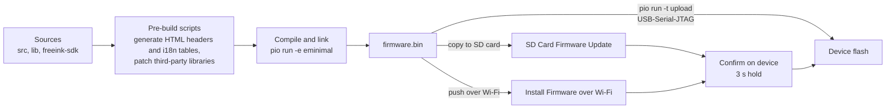
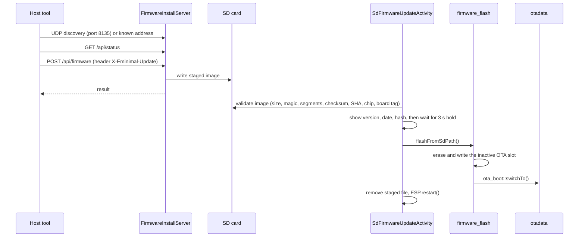

# e-Minimal Firmware: Build, Flash, and Release

| | |
|---|---|
| **Status** | Draft |
| **Applies to** | branch `master`, commit `36f4315e` |
| **Audience** | Developers who build, flash, test, or release the firmware |
| **Related** | [01-system-overview.md](01-system-overview.md), [02-display-pipeline.md](02-display-pipeline.md), [03-application-framework.md](03-application-framework.md), [04-dashboard-and-games.md](04-dashboard-and-games.md), [05-network-and-storage.md](05-network-and-storage.md) |

## Contents

1. [Overview](#1-overview)
2. [Prerequisites](#2-prerequisites)
3. [Repository setup](#3-repository-setup)
4. [Build environments](#4-build-environments)
5. [The `eminimal` environment](#5-the-eminimal-environment)
6. [SDK configuration (sdkconfig)](#6-sdk-configuration-sdkconfig)
7. [Partition table](#7-partition-table)
8. [Build, flash, and monitor](#8-build-flash-and-monitor)
9. [Build-time scripts](#9-build-time-scripts)
10. [Tests](#10-tests)
11. [Static checks and conventions](#11-static-checks-and-conventions)
12. [Firmware identity and versioning](#12-firmware-identity-and-versioning)
13. [Release and install paths](#13-release-and-install-paths)
14. [Troubleshooting](#14-troubleshooting)
15. [Open questions](#15-open-questions)

---

## 1. Overview

The firmware is a PlatformIO project that uses the Arduino framework on an
ESP32-S3. One `platformio.ini` defines every device target. The e-Minimal
device is built by the `eminimal` environment.

The build produces one application image, `.pio/build/eminimal/firmware.bin`.
It reaches the device in one of three ways: USB flashing, an image file on
the SD card, or a push over Wi-Fi. The last two write to the inactive OTA slot
and require confirmation on the device.



## 2. Prerequisites

| Requirement | Detail | Source |
|---|---|---|
| PlatformIO Core (`pio`) or the VS Code PlatformIO extension | Builds, uploads, and monitors | `docs/contributing/getting-started.md` |
| Python 3.8 or newer | Runs the build scripts and tools | `docs/contributing/getting-started.md` |
| Git | Submodule checkout; `scripts/patch_jpegdec.py` calls `git apply` | `scripts/patch_jpegdec.py` |
| USB-C cable | Flashing and console over the ESP32-S3 native USB port | `platformio.ini` `[env:eminimal]` |
| CMake 3.16+ and a host C++20 compiler | Only for host unit tests | `test/CMakeLists.txt` |
| `clang-format` 21 or newer | Only for the formatting step | `bin/clang-format-fix` |
| `cppcheck` | Only for `pio check` | `platformio.ini` `[base]` `check_tool` |
| Python packages in `requirements.txt` | Optional tools: font conversion, image generation, the debugging monitor | `requirements.txt`, `scripts/requirements.txt` |

PlatformIO downloads the toolchain, the pioarduino platform package
(`platform-espressif32` 55.03.311), and the registry libraries on first build.

## 3. Repository setup

The SDK is a git submodule. Clone with submodules, or initialise them afterwards:

```sh
git clone --recursive <repository-url>
# or, in an existing clone:
git submodule update --init --recursive
```

`.gitmodules` points `freeink-sdk` at the fork's SDK repository, branch
`eminimal-7in8`. PlatformIO links the SDK libraries with `symlink://` entries
in `[base]` `lib_deps`, so SDK edits take effect without a reinstall.

Caution from `CLAUDE.md` ("Submodule order"): do not run
`git submodule update` while `freeink-sdk` holds commits that the parent
repository's gitlink does not record yet. It detaches the submodule at the
recorded commit.

### 3.1 Local overrides

`platformio.ini` loads an optional `platformio.local.ini`
(`extra_configs = platformio.local.ini`). The file is git-ignored
(`.gitignore`, pattern `*.local*`). Typical content:

```ini
[platformio]
default_envs = eminimal

[env:eminimal]
upload_port = <serial port of the device>
monitor_port = <serial port of the device>
monitor_speed = 115200
```

Without this file, `default_envs = default` selects the Xteink ESP32-C3
target. Always pass `-e eminimal` in commands and scripts that must work on
any clone.

## 4. Build environments

All environments are defined in `platformio.ini`. They share the `[base]`
section. Environments that extend `[firmware_tuned]` or `[firmware_tuned_c3]`
rebuild the Arduino core with a custom SDK configuration; the others use the
prebuilt core.

| Environment | Device | MCU | Extends | Purpose |
|---|---|---|---|---|
| `default` | Xteink X4 and X3 | ESP32-C3 | `base`, `firmware_tuned_c3` | Upstream development build |
| `gh_release` | Xteink X4 and X3 | ESP32-C3 | `base`, `firmware_tuned_c3` | Upstream release |
| `gh_release_rc` | Xteink X4 and X3 | ESP32-C3 | `base`, `firmware_tuned_c3` | Upstream release candidate |
| `slim` | Xteink X4 and X3 | ESP32-C3 | `base`, `firmware_tuned_c3` | No serial logging |
| `sticky`, `sticky-gh_release`, `sticky-gh_release_rc` | Seeed Sticky | ESP32-S3 | `base`, `firmware_tuned` | Development, release, release candidate |
| `x4pro`, `x4pro-gh_release`, `x4pro-gh_release_rc` | Xteink X4 Pro | ESP32-S3 | `base` | Development, release, release candidate |
| `x4c`, `x4c-gh_release`, `x4c-gh_release_rc` | Xteink X4 Classic | ESP32-S3 | `base` | Development, release, release candidate |
| `papermono`, `papermono-gh_release`, `papermono-gh_release_rc` | M5Stack Paper Mono | ESP32-S3 | `base` | Development, release, release candidate |
| **`eminimal`** | **e-Minimal 7.8"** | **ESP32-S3** | **`base`** | **The only environment for this device** |

There is one `eminimal` environment. It serves as both the development and
the release build; there are no `eminimal-gh_release` variants.

### 4.1 Settings inherited from `[base]`

| Setting | Value | Effect |
|---|---|---|
| `platform` | pioarduino `platform-espressif32` 55.03.311 | Toolchain and Arduino core version |
| `framework` | `arduino` | |
| `monitor_speed` | 115200 | Serial console baud rate |
| `board_build.flash_mode` | `dio` | |
| `board_build.flash_size` | 16MB | |
| `board_upload.offset_address` | 0x10000 | Application image offset |
| `check_tool` | `cppcheck` with the flags in `check_flags` | Static analysis via `pio check` |
| `build_unflags` | `-std=gnu++11`, `-fexceptions` | Replaced by the flags below |
| `lib_ignore` | `BLE` | Bluetooth library is not linked |
| `extra_scripts` | Six `pre:` and two `post:` scripts | See section 9 |

Base build flags that matter for every target:

| Flag | Meaning |
|---|---|
| `-std=gnu++2a`, `-fno-exceptions` | C++20 without exceptions. A failed `new` aborts |
| `-DARDUINO_USB_MODE=1`, `-DARDUINO_USB_CDC_ON_BOOT=1` | Console on the native USB-Serial-JTAG peripheral |
| `-DEINK_DISPLAY_SINGLE_BUFFER_MODE=1` | Single framebuffer mode in the display SDK |
| `-DDESTRUCTOR_CLOSES_FILE=1` | SdFat file objects close in their destructor |
| `-DUSE_UTF8_LONG_NAMES=1` | UTF-8 long file names in SdFat |
| `-DUSE_SPI_ARRAY_TRANSFER=1` | Batched SPI transfers in SdFat. Inert on SDMMC boards such as this one |
| `-DXML_GE=0`, `-DXML_CONTEXT_BYTES=1024` | expat: no general entity expansion; bounded context buffer |
| `-DPNG_MAX_BUFFERED_PIXELS=16416` | PNG scanline buffer for images up to 2048 px wide |
| `-DFREEINK_FONT_ENABLE_AUTOHINT=1` | FreeType auto-hinter for runtime TTF rendering |
| `-DFREEINK_NET_WOLFSSL=1` and the `WOLFSSL_*` / `HAVE_*` flags | TLS through wolfSSL with TLS 1.3, single-precision ECC, SNI, and the max-fragment extension |
| `-Wl,--wrap=panic_print_backtrace,--wrap=panic_abort,--wrap=bootloader_common_check_efuse_blk_validity` | Hooks for panic capture and an eFuse check override |

## 5. The `eminimal` environment

### 5.1 Board and transport settings

| Setting | Value | Reason given in `platformio.ini` |
|---|---|---|
| `extends` | `base` | Uses the prebuilt Arduino core, which includes the TinyUSB component needed for USB mass storage |
| `board` | `esp32-s3-devkitc1-n16r8` | 16 MB flash, 8 MB octal PSRAM module |
| `board_build.mcu` | `esp32s3` | |
| `board_build.arduino.memory_type` | `qio_opi` | Measured working on this module; the other S3 targets use `dio_opi` |
| `board_build.partitions` | `partitions_eminimal.csv` | Two large OTA slots, no SPIFFS |
| `upload_speed` | 2000000 | Faster flashing. The comment advises 921600 if esptool reports sync or timeout errors |
| `custom_i18n_builtin_langs` | `en` | English only; upstream compiles all languages |

### 5.2 Build flags

| Flag | Meaning |
|---|---|
| `-DFREEINK_DEVICE_EMINIMAL=1` | Selects the `EMINIMAL_78` board profile and the IT8951 driver in the SDK, and enables every `#if FREEINK_DEVICE_EMINIMAL` block in the firmware |
| `-DFREEINK_CAP_USB_MSC=1` | Enables USB Drive (SD card as USB mass storage) |
| `-DFREEINK_NO_CALIBRE_WIRELESS=1` | Compiles out the Calibre wireless server |
| `-DFREEINK_NO_KOSYNC=1` | Compiles out the KOReader sync client |
| `-DBOARD_HAS_PSRAM` | Required for `psramFound()`; also turns on runtime vector fonts (`lib/EpdFont/VectorFontSupport.h`) |
| `-DUSB_PRODUCT="e-Minimal"`, `-DUSB_MANUFACTURER="e-Minimal"` | USB descriptor strings |
| `-DCROSSPOINT_VERSION="<eminimal.version>-eminimal"` | Machine version string: web API, User-Agent, update comparison |
| `-DCROSSPOINT_BASE_VERSION="<crosspoint.version>"` | Upstream release the build is based on, shown in About |
| `-DFIRMWARE_PRODUCT_NAME="e-Minimal"` | Name shown to the user |
| `-DFIRMWARE_PRODUCT_VERSION="<eminimal.version>"` | Version shown to the user |
| `-DFIRMWARE_PRODUCT_HOSTNAME="eminimal"` | mDNS host name for Calibre mode. Unused in this build, which excludes that activity; the mDNS name in use is `PhonePortal::SHARED_HOSTNAME` (`src/network/PhonePortal.h`), also `eminimal` |
| `-DENABLE_SERIAL_LOG`, `-DLOG_LEVEL=2` | Serial logging on, at debug level (`lib/Logging/Logging.h`: 0 errors, 1 info, 2 debug) |
| `-DIT8951_TIMING_LOG` | One timing line per display refresh. Marked bench-only in the comment |
| `-DUSE_BLOCK_DEVICE_INTERFACE=1` | SdFat mounts on the native SDMMC block device |

`CROSSPOINT_WAIT_FOR_USB_SERIAL` is deliberately not set. Boot is faster, and
the earliest log lines can be lost if the host has not opened the port yet
(`src/main.cpp` `setup()`).

### 5.3 Source filter and extra library

`build_src_filter` excludes four source files that belong to the disabled
features:

- `src/activities/network/CalibreConnectActivity.cpp`
- `src/activities/settings/KOReaderSettingsActivity.cpp`
- `src/activities/settings/KOReaderAuthActivity.cpp`
- `src/activities/reader/KOReaderSyncActivity.cpp`

`lib_deps` adds one library to the base list:
`BoardEMinimal78=symlink://freeink-sdk/libs/hardware/BoardEMinimal78`. It
supplies the IT8951 wiring and panel values. Without it the driver falls back
to another board's defaults.

## 6. SDK configuration (sdkconfig)

The `eminimal` environment extends only `[base]`. It sets no
`custom_sdkconfig` and no `custom_component_remove`. It therefore links the
prebuilt Arduino core libraries for the `qio_opi` memory variant and inherits
their ESP-IDF configuration unchanged.

The `[firmware_tuned]` and `[firmware_tuned_c3]` sections do rebuild the core
with custom Kconfig values (smaller timer task stacks, Wi-Fi code moved out of
IRAM, unused cloud components removed). They apply to the ESP32-C3 and Sticky
targets only. The comment in `platformio.ini` explains why USB mass-storage
targets do not use them: the custom core rebuild omits the TinyUSB component.

Files named `sdkconfig.*` at the repository root are generated by PlatformIO
during those rebuilds. They are git-ignored (`.gitignore`, `/sdkconfig.*`) and
are not an input to the `eminimal` build.

One runtime setting replaces an sdkconfig value: `src/main.cpp` sets the
Arduino loop task stack to 24 KB with `SET_LOOP_TASK_STACK_SIZE`, because the
stack size baked into a prebuilt core cannot be changed through sdkconfig.

## 7. Partition table

`partitions_eminimal.csv` describes the 16 MB flash.

| Name | Type | Subtype | Offset | Size | Size (approx.) | Purpose |
|---|---|---|---|---|---|---|
| (bootloader, partition table) | | | 0x0000 | | below 0x9000 | Second-stage bootloader and the partition table itself. Not listed in the CSV |
| `nvs` | data | nvs | 0x9000 | 0x5000 | 20 KB | Non-volatile key/value storage used by ESP-IDF components |
| `otadata` | data | ota | 0xE000 | 0x2000 | 8 KB | Records which application slot the bootloader starts |
| `app0` | app | ota_0 | 0x10000 | 0x7F0000 | 7.94 MB | Application slot 0. USB flashing writes here |
| `app1` | app | ota_1 | 0x800000 | 0x7F0000 | 7.94 MB | Application slot 1 |
| `coredump` | data | coredump | 0xFF0000 | 0x10000 | 64 KB | Core dump storage |

Notes:

- There is no SPIFFS or other on-flash filesystem. Settings and caches live on
  the SD card. The space goes to the two application slots.
- For comparison, the upstream `partitions.csv` has two 6.25 MB slots
  (0x640000) and a 3.4 MB SPIFFS partition.
- The image is about 3.6 MB according to the comment in `platformio.ini`, so
  each slot has ample headroom.
- A change to the partition table takes effect only through a USB flash.
  SD-card and Wi-Fi installs never rewrite the table (`platformio.ini` comment).
- SD-card and Wi-Fi installs always write the slot that is not running and
  then switch `otadata` (`src/network/FirmwareFlasher.h`,
  `src/network/OtaBootSwitch.h`).

## 8. Build, flash, and monitor

Run all commands from the repository root.

| Task | Command |
|---|---|
| Build | `pio run -e eminimal` |
| Build and flash over USB | `pio run -e eminimal -t upload` |
| Flash to a specific port | `pio run -e eminimal -t upload --upload-port <port>` |
| Serial monitor | `pio device monitor -e eminimal` |
| Monitor with memory graph and command prompt | `python scripts/debugging_monitor.py [port]` |
| Clean | `pio run -e eminimal -t clean` |
| Host unit tests | `pio run -e eminimal -t unit-tests` |
| Static analysis | `pio check -e eminimal` |
| Firmware size across commits | `python scripts/firmware_size_history.py --env eminimal --commits <refs>` |

Guidance:

- Build once after the last code edit. Do not clean by default. Do not rebuild
  for documentation-only or comment-only changes (`CLAUDE.md`, "Build/verify").
- The device exposes one USB port for both flashing and the console. It is the
  ESP32-S3 USB-Serial-JTAG peripheral, not a UART bridge.
- While USB Drive is active the USB PHY is switched to mass storage. The
  serial port disappears until the reboot that ends the session
  (`platformio.ini` comment, `src/platform/UsbSerialJtagHandoff.cpp`).
- `scripts/firmware_size_history.py` defaults to `--env default`. Pass
  `--env eminimal` explicitly.

### 8.1 Serial bench commands

The firmware accepts line commands on the console. Each starts with `CMD:`
(`src/main.cpp` `loop()`).

| Command | Effect |
|---|---|
| `CMD:SCREENSHOT` | Dumps the framebuffer between `SCREENSHOT_START:<bytes>` and `SCREENSHOT_END` |
| `CMD:BATTERY` | Prints battery voltage, percentage, charging state, USB state, gauge rate, and divider reading |
| `CMD:MEM` | Prints internal heap and PSRAM free, minimum free, and largest block |
| `CMD:METRICS` | Lists every tunable theme metric |
| `CMD:METRIC <name> <value>` | Patches one theme metric and redraws |
| `CMD:POWER [seconds]` | Samples power for 1 to 600 s on the bench meter |
| `CMD:POWER SLEEP <seconds>` | Measures the light-sleep floor. Drops the console |
| `CMD:POWER LAST` | Prints the last sleep measurement |

The `POWER` commands exist only in the e-Minimal build and expect a bench
power meter (`src/util/PowerProbe.cpp`).

## 9. Build-time scripts

`[base]` `extra_scripts` lists eight scripts. PlatformIO runs the `pre:`
scripts before compilation and loads the `post:` scripts after the build
environment is configured.

| Order | Script | Stage | What it does | Effect on `eminimal` |
|---|---|---|---|---|
| 1 | `scripts/patch_pioarduino_cache.py` | pre | Patches the pioarduino builder so that its custom-core cache check is per chip. Restores or invalidates the cached custom core when `custom_sdkconfig` changes | No custom sdkconfig is requested, so no core rebuild is triggered |
| 2 | `scripts/patch_wolfssl.py` | pre | Appends overrides to `user_settings.h` in each `.pio/libdeps/*/Arduino-wolfSSL/src`: re-enables DH, defines `HAVE_FFDHE_2048`, sets `FP_MAX_BITS` to 8192 | Applies |
| 3 | `scripts/build_html.py` | pre | Walks `src/` for `.html`, `.js`, and `.css`. Minifies HTML, gzips each file, and writes `<Name>Html.generated.h`, `<Name>Js.generated.h`, or `<Name>Css.generated.h` beside the source, with the byte array, sizes, and an ETag | Applies. Generates the web UI under `src/network/html/` |
| 4 | `scripts/gen_i18n.py` | pre | Reads `lib/I18n/translations/*.yaml` and writes `lib/I18n/I18nKeys.h`, `I18nStrings.h`, and `I18nStrings.cpp`. Honours `custom_i18n_builtin_langs` | Applies with English only |
| 5 | `scripts/git_branch.py` | pre | Injects `CROSSPOINT_VERSION` with branch and short SHA for the `default` and `sticky` environments | No effect. `eminimal` sets its version in `platformio.ini` |
| 6 | `scripts/patch_jpegdec.py` | pre | Applies the patches in `scripts/jpegdec_patches/` to each `.pio/libdeps/*/JPEGDEC` checkout with `git apply`. Skips patches already applied; aborts the build if a patch neither applies nor is already applied | Applies |
| 7 | `scripts/register_unit_tests_target.py` | post | Registers the custom target `unit-tests`, which runs CMake and CTest on `test/` | Applies |
| 8 | `scripts/patch_arduino_rom_libc.py` | post | Adjusts libc linker flags for ESP32-C3 builds that select ROM libc | No effect. Returns immediately for a non-C3 MCU |

### 9.1 Generated files

Never edit or commit these files (`CLAUDE.md`, "Generated files"; `.gitignore`).

| Generated file | Source of truth | Generator |
|---|---|---|
| `src/network/html/**/*.generated.h` | `src/network/html/*.html`, `js/*.js`, `css/*.css` | `scripts/build_html.py` |
| `lib/I18n/I18nKeys.h`, `lib/I18n/I18nStrings.h`, `lib/I18n/I18nStrings.cpp` | `lib/I18n/translations/*.yaml` (`english.yaml` is the reference) | `scripts/gen_i18n.py` |

The i18n generator can also be run by hand:

```sh
python scripts/gen_i18n.py lib/I18n/translations lib/I18n/
```

### 9.2 Other scripts

These scripts are not part of the build.

| Script | Purpose |
|---|---|
| `scripts/debugging_monitor.py` | Serial monitor with coloured log levels, a memory graph, a command prompt, and screenshot capture |
| `scripts/firmware_size_history.py` | Builds selected commits and reports flash and RAM usage |
| `scripts/convert_icon.py` | Converts a PNG or SVG icon to a C header |
| `scripts/generate-font-manifest.py` | Builds a `fonts.json` manifest from `.cpfont` files for device-initiated font downloads |
| `scripts/generate_hyphenation_trie.py`, `scripts/update_hyphenation.sh` | Regenerate hyphenation tables |
| `scripts/generate_*_epub.py`, `scripts/generate_test_bmps.py` | Produce test books and images |
| `scripts/generate_userguide_epub.py` | Builds the user guide as an EPUB |
| `scripts/script_profile_mem.sh` | Lists the largest symbols per section of a built ELF. Its path is hardcoded to `.pio/build/default/firmware.elf` |
| `scripts/bindery/` | Tools and tests for the in-browser Convert page, including a mock of the device web server (`scripts/bindery/README.md`) |

## 10. Tests

### 10.1 Host unit tests

The tests under `test/` are GoogleTest suites built for the host with CMake.
They do not use the ESP toolchain. GoogleTest v1.17.0 is fetched by CMake
`FetchContent` on first configure (`test/CMakeLists.txt`).

Run all suites:

```sh
cmake -S test -B build/test
cmake --build build/test
ctest --test-dir build/test --output-on-failure -j
```

The same three steps are wrapped as a PlatformIO target:

```sh
pio run -e eminimal -t unit-tests
```

Run one suite:

```sh
cmake --build build/test --target StreamingJsonParserTest
build/test/streaming_json_parser/StreamingJsonParserTest --gtest_filter='*'
```

Suites registered in `test/CMakeLists.txt`:

| Area | Suites |
|---|---|
| EPUB parsing and layout | `content_opf_parser`, `chapter_html_slim_parser`, `css_parser`, `chapter_position`, `page_link`, `token_boundary`, `hyphenation_eval`, `ligature_guard` |
| Text and Unicode | `utf8_compose`, `combining_marks`, `minibidi_arabic`, `html_to_plain_text` |
| Library index and metadata | `library_text`, `library_format`, `library_index_file`, `library_builder`, `book_overrides` |
| Rendering and fonts | `differential_rounding`, `absolute_grayscale`, `glyph_bitmap`, `font_cache_manager`, `sd_card_font` |
| Parsers and I/O | `streaming_json_parser`, `release_json_parser`, `xml_parser_utils`, `inflate_stream`, `fs_helpers`, `opds_filename` |
| Sync and credentials | `koreader_xpath_resolver`, `progress_comparison`, `credential_integrity` |
| Input | `home_button` |
| Games | `party_games` (rules for all Game Night games, including `LudoTest.cpp`) |

Suites added or extended by the fork include `party_games`, `book_overrides`,
`glyph_bitmap`, and additions to `library_text`, `library_index_file`, and
`content_opf_parser` (`git diff --stat upstream/develop...HEAD -- test`).

### 10.2 Other tests

| Test | How to run | What it covers |
|---|---|---|
| `test/test_list_viewport.py` | `python3 test/test_list_viewport.py` (needs a host C++ compiler) | `UiListActivity::syncListViewport()` compiled without hardware dependencies |
| `scripts/bindery/run-core-test.js`, `check_outputs.py`, `browser_test.py` | See `scripts/bindery/README.md` | The Convert page's JavaScript core and its XTC and EPUB output |
| `scripts/patch_pioarduino_cache.py --self-test` | Run with Python | The cache-matching helper in that script |

`test/epubs/` holds EPUB fixtures for manual and on-device checks.
`test/language/` holds language fixtures.

### 10.3 What cannot be tested on the host

Display output, refresh quality, key handling, sleep and wake, heap behaviour,
and all four orientations require the device. `CLAUDE.md` asks contributors to
flag these checks for a person with hardware.

## 11. Static checks and conventions

### 11.1 Commands

| Check | Command | Notes |
|---|---|---|
| Formatting | `./bin/clang-format-fix -g` (or `bin/clang-format-fix.ps1 -g` on Windows) | `-g` limits the run to git-modified C and C++ files. Requires clang-format 21+. Generated font data, hyphenation tables, `lib/uzlib`, and `lib/miniz/third_party` are excluded |
| Static analysis | `pio check -e eminimal --fail-on-defect low --fail-on-defect medium --fail-on-defect high` | cppcheck with `--enable=all`, `--check-level=exhaustive`. The SDK and `.pio` are suppressed |
| Build | `pio run -e eminimal` | |
| Unit tests | `pio run -e eminimal -t unit-tests` | |

A pre-commit hook in `.githooks/pre-commit` runs the formatter. Enable it
with `git config core.hooksPath .githooks` only when clang-format 21 is
installed.

Formatting style is defined by `.clang-format`: `ColumnLimit: 120`,
`IndentWidth: 2`.

### 11.2 Coding rules

The fork's rules are in `CLAUDE.md`. `AGENTS.md` is the upstream guide and
describes the Xteink hardware; `CLAUDE.md` lists where it does not apply.

| Topic | Rule |
|---|---|
| Allocation | No bare `new`. Use `makeUniqueNoThrow<T>()` (`lib/Memory/Memory.h`), null-check, and `LOG_ERR` on failure. Allocate in `onEnter()`, free in `onExit()` |
| Errors | No exceptions and no `abort()`. Log and return `false`, or log and fall back |
| Strings | `constexpr` tables. No `std::string` or Arduino `String` in hot paths. A `string_view` is not null-terminated |
| Abstractions | No `std::function` or needless templates in library or render-loop code |
| Text and logs | User-facing text through `tr(STR_*)`. Logging through `LOG_ERR`, `LOG_INF`, `LOG_DBG`; never raw `Serial` |
| SD access | Only through `HalStorage` (`Storage`) and `HalFile` |
| Tasks | Delete tasks in `onExit()` before the activity is destroyed |
| UI | Render through the theme (`GUI`). No hardcoded fonts or positions. Cover all four orientations |
| Input | Read keys through `MappedInputManager`. Detect this board with `five_button::active()`. Do not depend on `Button::Left` or `Button::Right` |
| Naming | PascalCase classes and files, camelCase members, UPPER_SNAKE constants, `#pragma once` |
| Settings enums | Append-only. Values are persisted by index in `settings.json` |
| Cache formats | Bump `BOOK_CACHE_VERSION` or `SECTION_FILE_VERSION` before changing a binary layout, and update `docs/file-formats.md` |
| Commits | `<type>: <summary>` with `feat`, `fix`, `refactor`, `docs`, `test`, `chore`, or `perf` |

### 11.3 Continuous integration

`.github/workflows/ci.yml` runs on pull requests and on pushes to `master`. It
has jobs for clang-format, cppcheck, a firmware build matrix, and host unit
tests. The build matrix covers `default`, `sticky`, `x4pro`, `x4c`, and
`papermono`. **It does not build `eminimal`.** The release workflows
(`release.yml`, `release_candidate.yml`) likewise cover only the upstream
release environments. The `eminimal` build is verified locally.

## 12. Firmware identity and versioning

Two version numbers are kept in `platformio.ini`:

| Section | Key | Value at this commit | Meaning |
|---|---|---|---|
| `[eminimal]` | `version` | 1.1.0 | The fork's own release number. Bump it for each e-Minimal release |
| `[crosspoint]` | `version` | 1.6.5 | The upstream CrossPoint release the fork is based on |

They flow into the build as preprocessor definitions and are combined in
`src/FirmwareIdentity.h`:

| Macro | Resolves to | Used for |
|---|---|---|
| `CROSSPOINT_VERSION` | `1.1.0-eminimal` | Machine version: web API, HTTP User-Agent, update comparison, boot log line |
| `FIRMWARE_NAME_TEXT` | `e-Minimal` | Product name in the UI |
| `FIRMWARE_DISPLAY_VERSION` | `e-Minimal v1.1.0` | Version shown to the user |
| `FIRMWARE_ABOUT_VERSION` | `e-Minimal v1.1.0 (CrossPoint 1.6.5)` | The About screen's firmware row |
| `FIRMWARE_HOSTNAME` | `eminimal` | mDNS host name for Calibre mode; not referenced in this build (see 5.2) |

Unlike the `default` and `sticky` development builds, the `eminimal` version
string carries no branch name or commit hash (`scripts/git_branch.py` applies
only to those two environments).

Board tag. Every image embeds the string `CROSSPOINT-BOARD-V1:<board>;` once
in `.rodata`. For this target the board name is `eminimal`
(`src/network/FirmwareBoardTag.cpp`). The update paths scan a candidate image
for this tag and reject one that names a different board. All ESP32-S3 boards
share a chip ID, so the tag is the only guard between them. An image with no
tag is accepted.

## 13. Release and install paths

This section is a summary. [05-network-and-storage.md](05-network-and-storage.md)
describes the network protocol and the on-card staging in detail.

### 13.1 Producing a release image

1. Set `[eminimal] version` in `platformio.ini`.
2. Build: `pio run -e eminimal`.
3. The image is `.pio/build/eminimal/firmware.bin`.

No workflow in `.github/workflows/` builds or publishes an e-Minimal image.

### 13.2 Install paths

| Path | Trigger | Transport | Writes | Confirmation |
|---|---|---|---|---|
| USB flash | `pio run -e eminimal -t upload` | USB-Serial-JTAG, esptool | Bootloader, partition table, and `app0` | None |
| SD Card Firmware Update | Settings action `SdFirmwareUpdate` | A `.bin` file chosen on the card | The inactive OTA slot | Image version, build date, SHA-256 prefix, then a 3 s hold on Confirm |
| Install Firmware over Wi-Fi | Settings action `WifiFirmwareInstall` | HTTP upload to a dedicated server on the device | Staged to `/.e-minimal/ota/firmware.bin`, then the inactive OTA slot | Same screen and 3 s hold as the SD path |
| Recovery mode | Wake with Power while holding the physical Up key | SD card | The inactive OTA slot | Same as the SD path; the picker is the only screen available |
| Check for Updates (GitHub OTA) | Hidden on this board | | | |



Key properties, with sources:

- **The Wi-Fi server only stages.** `FirmwareInstallServer` exposes
  `GET /api/status` and `POST /api/firmware`, plus a UDP discovery reply. It
  has no pages and no file access. Nothing is flashed until a person confirms
  on the device (`src/network/FirmwareInstallServer.h`).
- **Browser forgery is blocked.** The upload must carry the
  `X-Eminimal-Update` header, which a cross-site web form cannot add
  (`src/network/FirmwareInstallServer.h`).
- **Size limit.** The upload is bounded by the size of the next OTA slot
  (`src/network/FirmwareInstallServer.cpp` `handleUploadData()`).
- **Idle stop.** The install screen leaves after 5 minutes with no request
  (`FirmwareInstallActivity::IDLE_STOP_MS`).
- **Shared flasher.** Both the SD path and the Wi-Fi path call
  `firmware_flash::flashFromSdPath()`. It writes the partition directly and
  switches `otadata` with `ota_boot::switchTo()`
  (`src/network/FirmwareFlasher.h`, `src/network/OtaBootSwitch.h`).
- **Validation.** The flasher's result codes show what is checked: size, image
  magic, segment table, checksum, appended SHA-256, chip ID, and board tag
  (`firmware_flash::Result`).
- **Images are unsigned.** The confirmation screen states this. The SHA-256
  prefix lets the user compare against the build they intended to install
  (`docs/eminimal-controls.md`).
- **GitHub OTA is disabled here.** `OtaUpdater` queries the upstream
  repository's latest release and looks for an asset named for the board. No
  such asset exists for this board, so the menu entry is compiled out
  (`src/network/OtaUpdater.cpp`, `src/activities/settings/SettingsActivity.cpp`).

### 13.3 Data compatibility across releases

- Settings enum values are stored by index. New values must be appended.
- Book caches carry a version number and are rebuilt when it changes.
- A card that still has the pre-1.1.0 `/.crosspoint` folder is migrated once
  at boot by `migrateLegacyDataDir()` in `src/main.cpp`. If both folders
  exist, the old one is left untouched.

## 14. Troubleshooting

| Symptom | Likely cause | Action |
|---|---|---|
| `pio run` builds for ESP32-C3, or the flashed image does not boot the device | No `-e eminimal`, and no `platformio.local.ini` setting `default_envs` | Pass `-e eminimal` |
| Missing headers under `freeink-sdk/` | Submodule not initialised | `git submodule update --init --recursive` |
| `pio run` hangs at SCons startup | The command runs inside a sandboxed shell (`CLAUDE.md`, "Sandboxed pio hangs") | Run it from an unsandboxed terminal |
| esptool sync or timeout errors during upload | `upload_speed = 2000000` is too fast for the cable or hub | Set `upload_speed = 921600` in `platformio.local.ini` |
| No serial port visible | USB Drive mode is active; the PHY is in mass-storage mode | Leave USB Drive. The device reboots and the port returns |
| First boot log lines are missing | `CROSSPOINT_WAIT_FOR_USB_SERIAL` is off for this target | Open the monitor before reset, or add the flag in a local build |
| Build aborts in `patch_jpegdec.py` | A patch neither applies nor is already applied; the JPEGDEC checkout differs from the pinned commit | Delete `.pio/libdeps/eminimal/JPEGDEC` and rebuild |
| `multiple definition of 'app_main'` | Stale scaffold from an interrupted custom-core rebuild. Affects the `firmware_tuned` environments, not `eminimal` | `rm -rf .dummy CMakeLists.txt sdkconfig.default sdkconfig.defaults .pio/build/default` (from the `platformio.ini` comment). Do not use `git clean -fdX`; it deletes `platformio.local.ini` |
| A translated string or web page change does not appear | A generated file was edited instead of its source | Edit the `.yaml` or `.html` source and rebuild |
| `clang-format-fix` fails with "too old" or `unknown key 'AlignFunctionDeclarations'` | clang-format older than 21 | Install clang-format 21, or match the style by hand and rely on review |
| Device shows "SD card error" at boot | `Storage.begin()` failed | Check the card and its seating. The firmware cannot run without a card |
| Device returns to deep sleep immediately after a power-key press | The wake hold was not verified | Hold Power longer. See `gpio.verifyPowerButtonWakeup()` in `src/main.cpp` `setup()` |
| Device boots to a crash report screen | The previous run ended in a panic | Read the report. The dump was written to the SD card by `HalSystem::checkPanic()` |
| Device unusable after a bad install | The new image fails at run time | Enter recovery mode (wake with Power while holding Up) and install a known-good `.bin` from the card, or flash over USB |
| Image rejected as "wrong board" | The `.bin` carries another board's tag | Build with `-e eminimal` |
| Partition change has no effect after a Wi-Fi or SD install | Those paths do not rewrite the partition table | Flash over USB |
| Garbled or stale reading layout after a firmware change | Old book caches | Clear the reading cache from Settings, or delete the cache under `/.e-minimal/` on the card |
| Crashes under memory pressure | Internal heap exhausted or fragmented | Capture `CMD:MEM` output and the periodic `MEM` log lines; check largest-block figures |

For network-side problems (device not reachable, uploads failing), see
`docs/troubleshooting.md` and [05-network-and-storage.md](05-network-and-storage.md).

## 15. Open questions

1. **Host push tool.** Source comments and a UI string refer to an
   `ota_push.py` script (for example `tools/ota_push.py` in
   `src/network/FirmwareInstallServer.h`). No such file exists in this
   repository at this commit. The client side of the Wi-Fi install is
   therefore documented here only from the server's point of view.
2. **Release procedure.** No e-Minimal release workflow, tag convention, or
   published-artifact location was found in the repository. Section 13.1
   describes only what the build system supports.
3. **Recovery-mode key.** `setup()` selects `HalGPIO::BTN_UP` as the recovery
   key for boards other than X4 Pro and X4 Classic, which includes this one.
   The recovery path was not exercised while writing this document.
4. **Recovery hatch in `ota_0`.** The comment in `partitions_eminimal.csv`
   says "ota_0 also holds the recovery hatch". What distinguishes `ota_0` from
   `ota_1` in this respect was not determined from the source.
5. **Upload speed ceiling.** The `platformio.ini` comment states that the
   2 Mbps figure was measured on an earlier UART-bridge build and is
   unverified on USB-Serial-JTAG.
6. **`pio check -e eminimal`.** The check configuration is inherited from
   `[base]`. Whether cppcheck runs clean for this environment was not verified;
   CI runs it without selecting `eminimal`.
7. **CI trigger branch.** `ci.yml` triggers on pushes to `master`, while
   upstream's documentation names `develop` as the integration branch and the
   fork works on `master`. Whether CI runs for the fork at all was not
   determined.
